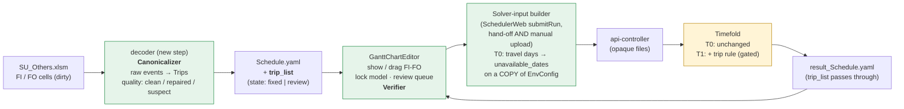
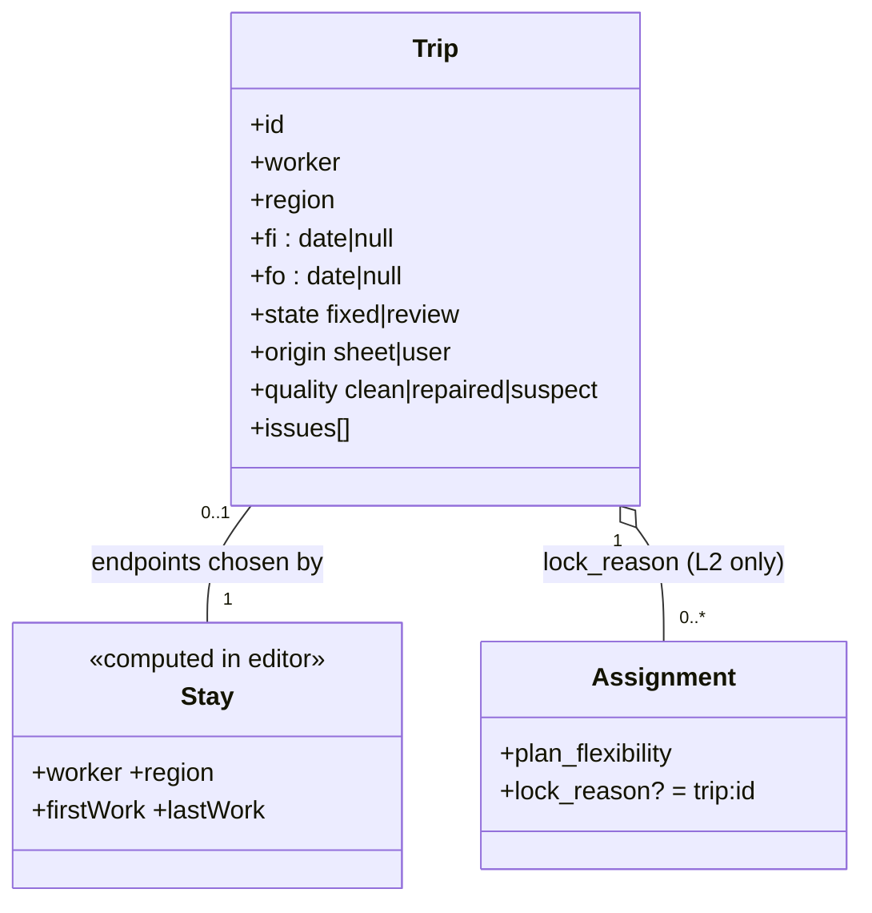
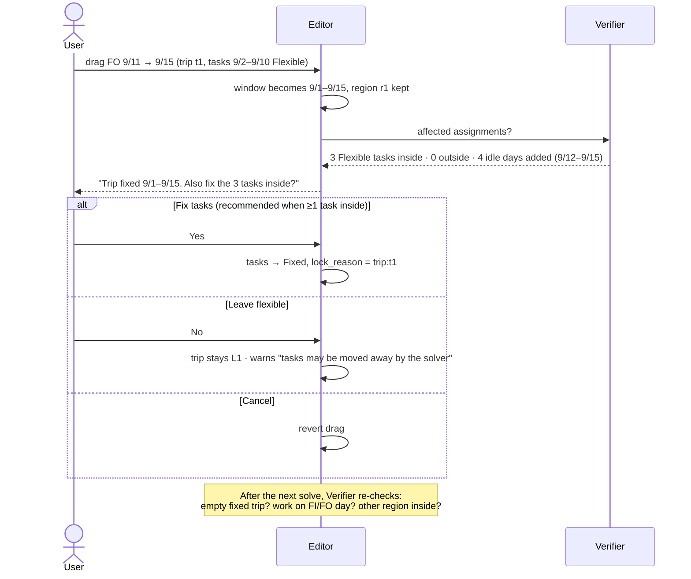
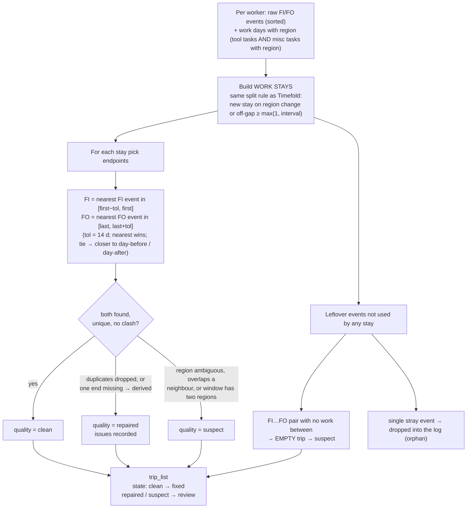
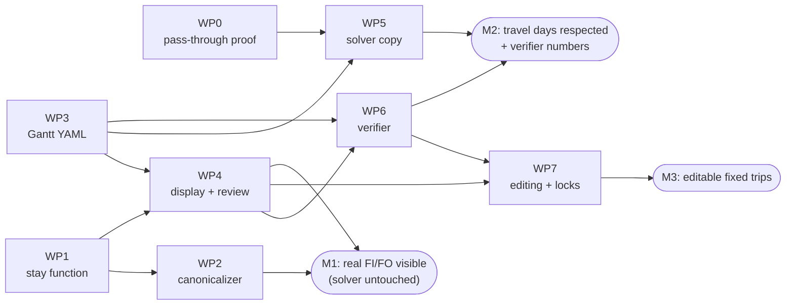

# Fly-In / Fly-Out (FI/FO) — Fixed Trips, Timefold Awareness and Dirty Input

> **CORRECTION (2026-10-21, revised):** an earlier note here said `unavailable_dates` would not stop work on
> FI/FO days. More precisely, in the current Timefold the rule `employeeAvailableAllDays` is disabled
> (`EmployeeSchedule.java:1262`), so an unavailable day is **not a hard rule**. Instead the block earns **zero hours**
> that day (`producedHoursForBlock`, `:1348`), the underfill rule makes the solver compensate, and the **output
> skips** such days (`ExportSchedule.java`, `isWorkerUnavailableByWid`). So the written assignments contain no work on
> those days, **but** the day-based rules (one task per day, overtime, transit, stay) still count the worker as
> covering them. A Fixed row blocks the day consistently (`oneTaskPerEmpPerDay`, hard).

> **Date:** 2026-10-20 · **Revision:** v3 · **Status:** DRAFT for discussion, nothing implemented
> **Decided by you:** D1 = **T0 first (no Timefold change)**; T1 is decided later from verifier data (§14.3).
> **My calls on D2–D8:** §11 — each is a recommendation you can veto.
> **Scope:** `decorder/` → `GanttChartEditor` → `SchedulerWeb` → Timefold (`TFDocker`) → back to `GanttChartEditor`
>
> **What changed from v1:** v1 treated FI/FO as *display data* and left Timefold untouched. Your new facts
> (FI/FO are editable and become *fixed*; Timefold can then break them; the sheet is full of human error) mean
> FI/FO must be treated as a **constraint on the plan**, not only as a label. v2 therefore:
> 1. replaces loose *events* with **Trips** (region + FI + FO + state),
> 2. adds an explicit **lock model** for what happens to the tasks inside a trip when FI/FO moves,
> 3. adds a **canonicalizer** so dirty sheet data never becomes a hard constraint,
> 4. splits Timefold awareness into **T0 (YAML only, no solver change)** and **T1 (small gated solver addition)**
>    and says honestly which of your problems each one can and cannot solve.

---

## 0. Short answer

* A **Trip** = `{worker, region, FI date, FO date, state}`. Stored in `Schedule.yaml` as `trip_list`.
* **Work days are the ground truth for where a stay is; FI/FO only choose its endpoints.** That is what lets us
  survive the human errors (51 % of workers with FI/FO have a broken FI/FO sequence in the real file).
* Only **clean + fixed** trips are ever sent to Timefold as constraints. Dirty ones are shown for review and
  never make the plan infeasible.
* **Problem "Timefold assigns work on the FO day" can be solved with no Timefold change** (block FI/FO days via
  `unavailable_dates` in the *solver copy* of EnvConfig).
* **Problem "empty gap inside a fixed trip gets another region" cannot be fully solved by YAML alone.** It needs
  one small, switched-off-by-default hard constraint in Timefold (T1). **Decision taken: ship T0 first (no
  Timefold change), measure with the Verifier, then decide T1 against the numeric gate in §14.3.**
* T0's solver-copy step lives in **SchedulerWeb `submitRun`**, because SchedulerWeb also accepts hand-picked YAML
  files (`RunLogPage.tsx` file picker/drop); putting it in the Gantt hand-off would miss that path (D8).

---

## 1. Requirements as I now understand them

| # | Requirement (from you) | Consequence |
|---|---|---|
| R1 | User's real FI/FO must be kept (not predicted) | Decoder must read FI/FO; YAML must carry them |
| R2 | FI/FO can be **adjusted in GanttChartEditor**; an adjusted FI/FO becomes **Fixed** | Needs editing, persistence, undo/collab, and a lock model |
| R3 | Timefold does not know FI/FO → may assign work on the FO day (e.g. FI 9/1, work 9/2–9/10, FO 9/11, solver assigns 9/11) | Travel days must be unavailable to the solver |
| R4 | When FI/FO moves, tasks inside may need to become Fixed or not; e.g. FO 11→15 while Timefold moves tasks 9/2–9/10 → "FI/FO for nothing" | Explicit rules for task↔trip coupling + empty-trip detection |
| R5 | Empty days between FI and FO (fixed or not) let Timefold place **another region** there | A trip is exclusive to its region while it lasts → needs **region** on every trip, and a solver-visible region lock |
| R6 | `SU_Others` contains **multiple/incorrect FI/FO due to human error** | Canonicalizer + quality grade; dirty data must not become hard constraints |
| R7 | Product goes to user testing soon → Timefold logic changes are risky; YAML may change | Prefer YAML-only; any solver change must be additive, gated and provably neutral when unused |

---

## 2. Evidence (code + real data)

### 2.1 Where FI/FO is lost and guessed today

| Place | File | What happens |
|---|---|---|
| Dropped | `decorder/decoder7.py:745,1195` | `IGNORE_WHITE_TEXT = {"FI","FO"}` → `continue` |
| Guessed | `GanttChartEditor/.../workerViewModel.ts:114-153` | FI = first work − 1, FO = last work + 1 |
| Not serialized | `GanttChartEditor/.../yamlService.ts:195-262` | `stringifyScheduleYaml` writes named fields by hand → unknown keys vanish on save |
| Solver hand-off | `GanttChartEditor/.../handoffService.ts:22-24` | `sendToScheduler` serializes env + schedule, **but** SchedulerWeb also accepts hand-picked `.yaml` files (`RunLogPage.tsx:297`) |
| Single choke point | `SchedulerWeb/src/services/runService.ts` `submitRun(runId, envFile, schedFile)` | **Every** run (hand-off or manual) passes here → the right place to build the solver copy |

### 2.2 How wrong is the guess? (`20260915 SU_Others…xlsm`, sheet `予定表_2026`)

| Measurement | Result |
|---|---|
| FI / FO cells entered | **2,097 / 2,334** across 351 of 503 workers |
| FI exactly 1 day before first work cell | 82 % · FO exactly 1 day after last: 77 % |
| FO 2 days after last work (weekend between) | 234 (10 %) |
| Work stays where guess == user on both ends | **1,507 / 1,958 (77 %)** |
| Stays hiding a real return trip (user FO *inside* a stay the Gantt merges) | 81 |

### 2.3 How dirty is the input? (R6, measured)

| Measurement | Result |
|---|---|
| Workers with ≥ 1 broken sequence (**FI→FI** or **FO→FO**) | **178 / 351 (51 %)** |
| Transitions: FI→FO 1,926 · FO→FI 1,740 · **FI→FI 101 · FO→FO 313** | 313 FO→FO = the typical "forgot the FI" |
| First event is FO (stay began before the sheet's range) | 95 workers — *legitimate* |
| Last event is FI (still abroad at the end) | 70 workers — *legitimate* |
| FI→FO trips with **no tool-code work inside** | 197 / 1,926 (10 %) — empty, suspicious |
| FO→FI gaps that contain tool-code work (work *outside* any trip) | 26 |
| Trip length | median 27 d · p90 53 d · max 187 d |
| FI font colour | black 1,609 · **red 393** · theme 94 (meaning unknown — Q1) |

Consequence: **raw FI/FO cannot be trusted as constraints.** Half the workers would produce a nonsense window.

### 2.4 What Timefold does and does not know (read from `EmployeeSchedule.java`)

* No FI/FO concept. A "stay" is derived from **worked days** per region; a new stay starts when off-days
  `>= max(1, stay_off_interval)` (lines ~1736-1869). Today `max_stay_on` / `max_annual_stay` are `10000` → those
  two constraints are effectively off.
* `regionTransitGap` (line ~1615, **hard**): when the region changes, the next day must be ≥ `prev + transit + 1`.
  It compares a flexible seat with the previous worked day, so it protects **only the days right next to
  existing work** (with `transite_day_map` = 1 day, exactly one day). It does **not** know the worker is "abroad
  in R" on idle days farther away → this is why R5 happens.
* `oneTaskPerEmpPerDay` counts Fixed + dynamic tasks per day → a "fake Fixed placeholder" on idle days would
  **block real work** on those days. (So the tempting hack "fill the trip with Fixed placeholder tasks" is out.)
* `unavailable_dates` on a worker is honoured as a hard availability filter; each entry is read from a map and
  **extra keys are ignored** (`date`, `single.days`, `weekly.weekdays`), so an entry can carry a tag.
* `ExportSchedule` loads `Schedule.yaml` as a generic map, replaces only `assignment_list`, dumps everything
  back → an additional `trip_list` key survives the run (to be proven once in the real container — §10 step 0).
* The Gantt and Timefold disagree by one day on what a "stay" is: Timefold *splits* a stay at off-gap `>= interval`, the Gantt
  *merges* at `<= interval` (`workerViewModel.ts:127-129`). With interval 3, a 3-day gap is two stays vs one.

---

## 3. The scenarios you described, and what actually solves each

```
P1  FI 9/1 | work 9/2–9/10 | FO 9/11       Timefold assigns the worker on 9/11 (it never heard of FO)
P2  FO moved 9/11 → 9/15; Timefold then moves the 9/2–9/10 tasks     → trip with nothing in it
P3  Fixed trip has idle days inside; Timefold puts the worker in ANOTHER region on one of them
P4  Sheet says  FI FI FO FO FO ...  (human error)                     → which trips are real?
P5  Worker moves region R1→R2 inside one FI…FO in the sheet          → region change inside a window
P6  User drags FI/FO in the Gantt                                   → what happens to the tasks inside?
```

| Problem | No solver change (**T0**) | With small gated solver rule (**T1**) |
|---|---|---|
| P1 work on FI/FO day | ✅ FI/FO dates injected as `unavailable_dates` into the **solver copy** of EnvConfig | ✅ same, natively |
| P2 tasks leave the trip | ⚠️ partly: *prevent* by locking contents (L2, §5); otherwise **detect** after the solve ("empty fixed trip") | ⚠️ same — the solver still may move flexible tasks; L2 is the real answer |
| P3 other region inside idle gap | ❌ **not preventable** by YAML; only **detected** after the solve. Risk is reduced because contents are pinned (L2) and Timefold already penalises region switching (soft, weight 5) | ✅ hard rule: inside `(FI, FO)` only the trip's region |
| P4 human error | ✅ canonicalizer (§6) — decoder/editor side only | ✅ same |
| P5 region change inside window | ✅ canonicalizer splits the window at the region change | ✅ same |
| P6 dragging FI/FO | ✅ editor rules (§5) | ✅ same |

So: **P1, P4, P5, P6 are solvable now without touching Timefold. P3 is the only one that truly needs T1.**

---

## 4. Target architecture



Green = new in Phase 1 (no solver change). Yellow = unchanged in T0, small gated addition in T1.

### 4.1 YAML (additive; absent == today's behaviour)

```yaml
schedule:
  plan_range: { start_date: 2026/09/15, end_date: 2027/07/31 }
  workflow_task_list: [...]          # unchanged
  misc_task_list: [...]              # unchanged
  assignment_list:                   # unchanged, one optional new key
  - worker: w012
    operation_task: e1p2o1
    ...
    plan_flexibility: Fixed
    lock_reason: trip:t0001          # NEW optional: "this Fixed came from locking trip t0001"
  trip_list:                         # NEW optional
  - id: t0001
    worker: w012
    region: r1                       # REQUIRED for state: fixed
    fi: 2026/09/01                   # null = already abroad before plan_start
    fo: 2026/09/11                   # null = still abroad / unknown end
    state: fixed                     # fixed = enforced | review = shown, NOT enforced
    origin: sheet                    # sheet | user
    quality: clean                   # clean | repaired | suspect
    issues: []                       # e.g. [dup_fo_dropped, region_split]
```

Auto/derived trips (the Gantt's guesses for stays with no stored trip) are **never stored** — they are recomputed.

### 4.2 Data model



---

## 5. Lock model — what "fixed" means, and what happens when FI/FO moves (P2, P6)

### 5.1 Three levels

| Level | Meaning | Stored as | Who sets it |
|---|---|---|---|
| **L0 auto** | Gantt's guess, nothing locked | nothing | default |
| **L1 fixed window** | FI/FO dates and region are locked; tasks inside keep their own flexibility | `trip.state = fixed` | user drags/edits FI or FO, or accepts a reviewed trip |
| **L2 fixed window + contents** | L1 **and** the worker's Flexible assignments inside the window become Fixed | trip + `lock_reason: trip:<id>` on each affected assignment | user ticks "lock tasks inside" (offered, never silent) |

`lock_reason` matters: when the trip is later unlocked/deleted/moved, only assignments that **we** fixed through
the trip go back to Flexible. Assignments the user fixed independently stay Fixed.

### 5.2 Rule: the editor never changes `plan_flexibility` as a silent side effect

When the user moves FI or FO the editor shows a one-time dialog listing what is affected:



### 5.3 Decision table (FI/FO edit → effect)

| User action | Affected tasks | Editor behaviour |
|---|---|---|
| FO later (11→15) | none in the added days | New days are idle. Offer "lock tasks inside" if not yet L2. Warn if the trip contains **no task** ("empty trip") |
| FO earlier, cutting **no** task | none | Just move |
| FO earlier, cutting tasks | tasks after new FO | Dialog: *move them out / unassign them / cancel*. Tasks locked by this trip with `lock_reason` are released to Flexible only if the user picks "release" |
| FI/FO moved onto a day that has work | task on FI/FO day | Same dialog (a travel day cannot hold work) |
| Region of trip changed | tasks of other region inside | Dialog: *split trip at the region change / cancel* |
| Trip deleted | tasks with `lock_reason` of it | Released to Flexible (only those) |
| Two trips overlap after a drag | — | Not allowed; the drag stops at the neighbouring trip (+ transit days) |
| Fixed task dragged outside its fixed trip | — | Allowed only after the trip is edited/unlocked (the Gantt already guards Fixed moves) |

### 5.4 "Empty trip" (your P2) — the explicit rule

> A **fixed** trip with **zero assignments** (any flexibility) inside its window is flagged **EMPTY** (red).
> It is allowed (the user may be reserving a ticket), but it is listed in the verifier panel after every solve.
> L2 prevents it by construction; only a trip left at L1 can become empty.

---

## 6. Dirty input — the canonicalizer (P4, P5, R6)

### 6.1 Principle

> **Work is the ground truth; FI/FO only choose endpoints. Anything ambiguous is shown, never enforced.**

### 6.2 Algorithm (decoder side; editor re-runs the same logic when loading a YAML without `trip_list`)



### 6.3 Human-error catalogue → handling

| Error seen in the sheet | Frequency (real file) | Handling | Quality |
|---|---|---|---|
| FO, FO (FI forgotten) | 313 | Second FO that matches no stay endpoint is dropped; the stay's FI becomes derived (first−1) | repaired |
| FI, FI (FO forgotten) | 101 | Same, mirrored | repaired |
| Window with work in **two regions** (direct R1→R2) | to measure | Split at region change: FO(R1) and FI(R2) derived | repaired |
| FI…FO with **no work inside** | 197 | Kept for review only, not enforced | suspect |
| Work outside any FI…FO | 26 | Derived stay, no event bound | repaired |
| Event far (> tol) from any work | 58 FI / 34 FO were 3–14 d off; > 14 d | ≤ 14 d: bound; > 14 d: orphan (log) | repaired / dropped |
| FO as first event / FI as last event | 95 / 70 | Legit: open-ended window (`fi: null` / `fo: null`) | clean |
| Wrong date, right order | unknowable | Nothing can detect it → user fixes in the Gantt; verifier flags conflicts with work | — |
| Odd tokens (`FI/FO` in one cell, case, full-width) | none found | Normalise case/width; unknown tokens logged | — |

### 6.4 Safety valve

The decoder prints a table to `TransformationLog.txt`: `clean N · repaired N · suspect N · dropped N`, per worker
and in total, plus every dropped event with its cell address (row/column) so a human can correct the sheet.
**Only `state: fixed` ever reaches the solver.** A new `--trips-enforce {clean|clean+repaired|none}` CLI switch
(default `clean`) lets you turn it off completely: with `none`, v2 behaves like v1.

---

## 7. Timefold awareness — T0 and T1 in detail (R3, R5, R7)

### 7.1 T0 — YAML only, **Timefold unchanged**

Built in **SchedulerWeb `submitRun`** (the one place every run passes, including hand-picked files), on a **copy**
of EnvConfig that is uploaded to the solver. The files kept locally and shown in the run log stay as the user
supplied them:

```yaml
workers:
- id: w012
  unavailable_dates:
  - date: 2026/09/01     # FI day  ┐ extra keys are ignored by the solver:
    source: trip         #         │ the tag lets the Gantt strip them again
    trip: t0001          #         ┘ when the result comes back
  - date: 2026/09/11     # FO day
    source: trip
    trip: t0001
```

* Only for `state: fixed` trips. Both FI and FO day (travel days are not workdays).
* The editor **strips `source: trip` entries on load** and never persists them, so moving FO later cannot leave a
  ghost blocked day behind (that would be a silent, permanent constraint — the main danger of this approach).
* Implementation detail: SchedulerWeb already has `js-yaml`. Parse EnvConfig, append the tagged entries to the
  right workers, dump. To make sure the re-dump changes nothing else, a test asserts
  `deepEqual(parse(original), parse(dumped) minus injected entries)`. If a worker has no `unavailable_dates` key,
  create it. If `trip_list` is absent/empty, **do not touch the file at all** (byte-identical upload).
* A fixed trip whose FI or FO lies outside `plan_range` simply injects nothing for that endpoint.
* ⚠️ I have **not** run this through the container: the Java code reads `date` entries and ignores unknown keys
  (read in `EmployeeSchedule.java` ~930-1000), and the Gantt must be extended to keep/strip the tag. Verify in §10.

### 7.2 T1 — one small additive rule inside Timefold (needs your approval)

Inputs: `trip_list` entries with `state: fixed`. Gate: **if none, the constraint list is the same array as
today ⇒ identical results** (this is the property to prove with a golden-run diff).

| Rule | Type | Meaning |
|---|---|---|
| C1 | hard | a non-pinned seat may not cover day `FI` or `FO` of its worker's fixed trip (replaces the T0 trick) |
| C2 | hard | for days strictly inside `(FI, FO)` of a fixed trip, a non-pinned seat of that worker must be in `trip.region` |
| (opt) C3 | soft | small reward for assigning the trip's worker in `trip.region` inside the window (discourages "trip for nothing") |

Pinned/Fixed seats are exempt (they are user facts); a conflict there is reported by the verifier, not the solver.
Open-ended trips: `fi: null` → window starts at plan start; `fo: null` → no C2, only C1 on FI.
I have not sized the Java work beyond reading the constraint structure; from the existing patterns
(`regionTransitGap`, `CrewSeat` ⨝ `BlockDecision`, `seatCoveredDays`) I expect tens of lines plus a parser for
`trip_list`. Treat as an estimate to be confirmed.

### 7.3 Decision: T0 first, T1 decided from data

* **T0 for the first user test.** It satisfies R7 (no solver change), fixes the case you described first (P1),
  and everything else is *detected* and listed instead of silently wrong.
* **T1 is decided from the Verifier's numbers** against the gate in §14.3. The YAML does not change between T0
  and T1 (same `trip_list`), so nothing built for T0 is thrown away.

---

## 8. Verifier — the safety net that works in both T0 and T1

Runs in the editor after every solve (and after manual edits). Output goes to the existing warnings panel
(`constraintService.ts`), never blocks saving.

| Code | Severity | Condition |
|---|---|---|
| `TRIP_WORK_ON_TRAVEL_DAY` | error | assignment covers a fixed trip's FI or FO day |
| `TRIP_OTHER_REGION_INSIDE` | error | assignment in another region strictly inside a fixed window (**P3**) |
| `TRIP_EMPTY` | warning | fixed trip with no assignment inside (**P2**) |
| `TRIP_TASK_OUTSIDE` | info | a task that was inside before the solve is now outside (needs pre-solve snapshot) |
| `TRIP_REVIEW_PENDING` | info | trips in `review` state (count + list) |
| `TRIP_ORPHAN` | info | stored trip bound to no work stay |
| `STAY_DERIVED_ONLY` | info | stays with no trip → shown dashed |

Visual language: **solid** = fixed trip · **dashed** = derived guess · **amber** = review · **red outline** = error.

---

## 9. Component change list

| Component | Change | Risk |
|---|---|---|
| `decorder/` | New `canonicalizer` step (copy to `decoder8.py`, don't edit 7 in place); read FI/FO with cell address + font colour; emit `trip_list`; log table; `--trips-enforce` switch | Additive; existing keys untouched |
| `types/schedule.ts` | `Trip`, `ScheduleData.tripList?`, `Assignment.lockReason?` | Optional fields |
| `yamlService.ts` | parse/serialize `trip_list` + `lock_reason`; **strip `source: trip` unavailable entries on load** | Absent == identical output |
| `SchedulerWeb/runService.ts` (`submitRun`) | `buildSolverEnv(envText, scheduleText)`: inject tagged travel-day `unavailable_dates` (T0). No-op when no fixed trips | Only the uploaded copy; byte-identical when unused |
| `SchedulerWeb` UI | optional one-line note in the run log: "N travel days blocked for M workers" so the user can see what the solver was told | Display |
| `workerViewModel.ts` | Stays built with Timefold's gap rule; trip-aware FI/FO; same logic for `excelExportService` | Display |
| Reducer / undo / collab | actions `UPSERT_TRIP`, `DELETE_TRIP`, `LOCK_TRIP_CONTENTS`; undo must restore `lock_reason` changes atomically with the trip | **Medium** — same care as assignment moves |
| `WorkerTimelineGrid.tsx` | draggable FI/FO handles, region selector, review queue, dialogs of §5 | UI work, largest item |
| `constraintService.ts` | verifier codes of §8 | Additive |
| `TFDocker` | T0: none · T1: parser + gated rule (§7.2) | T1 only, gated |
| `api-controller` | none | — |

---

## 10. Rollout & verification

0. **Pass-through proof (do this before any code):** add a dummy `trip_list` + an `unavailable_dates` entry
   carrying `source/trip` to a real input, run the current image, diff `result_Schedule.yaml` against a run
   without them: assignments identical **except** that no work is placed on the tagged day, `trip_list` still
   present. If `trip_list` does not survive, fall back: the editor keeps trips in its session/file and re-attaches
   them to the result (design otherwise unchanged).
1. **Canonicalizer golden test** on the 2026-09-15 file: reproduce §2.3 counts; assert zero diff in the rest of
   `Schedule.yaml` / `EnvConfig.yaml`; hand-check 20 worst workers.
2. **Editor unit tests:** every row of §5.3 and §6.3; interval boundary (`gap = interval−1, =, +1`); undo of
   lock/unlock; collab merge of two users editing the same trip.
3. **End-to-end:** decoder → editor (drag FO 11→15, lock contents) → solver → editor; verifier clean.
4. **Metrics:** per run `clean/repaired/suspect`, `P2`, `P3` counts → decides T1.
5. **T1 (only if the gate in §14.3 says so):** golden-run diff with no `trip_list` must be byte-identical; with
   trips, C1/C2 never violated and score within an agreed tolerance on the existing sample inputs.

Success criteria (T0): ≥ 95 % of enforced FI/FO appear in the Gantt on the date the user typed/edited; no `P1`
violation ever; `P2`/`P3` are measured and reported by the Verifier; solver output unchanged when no trips are
supplied (byte-identical upload).

---

## 11. Decisions (D1 yours; D2–D8 are my calls — veto any)

| # | Topic | Decision | Why / consequence |
|---|---|---|---|
| D1 | T0 vs T1 | **T0 first** *(decided by you)* | No Timefold change before user testing; T1 judged later by the gate in §14.3 |
| D2 | Are clean sheet FI/FO `fixed`? | **Yes if `quality: clean` and not red-font (D5); everything else → `review`.** Contents are **not** auto-locked (L1 only) — the decoder never changes `plan_flexibility` | The user typed it, so honour it; but an untrusted FI/FO must never become a block on the solver. Trips entirely before `plan_start` are history: kept and shown, nothing injected |
| D3 | Dialog default when dragging FI/FO | **"Also fix the N tasks inside" pre-selected when N ≥ 1 and any is Flexible; always a visible dialog; Cancel always available** | Prevents P2 ("trip for nothing") by default without silent changes. With N = 0 the dialog is skipped and the trip is flagged EMPTY |
| D4 | Gap rule | **Follow Timefold: new stay when off-days ≥ max(1, `stay_off_interval`).** One pure function `splitIntoStays` + shared JSON test vectors used by the Gantt (TypeScript) and the decoder (Python) so the two cannot drift | Visible side effect: a few stays that the Gantt used to merge (gap = interval) now show as two. Release note it. Weekend inside a block: test with interval 2 and 3 |
| D5 | Red-font FI/FO (393 cells) | **Until you tell me the meaning, red-font events import as `review` (not enforced).** The decoder lists every red cell (sheet row/col) in the log so you can sample a few | Under-enforcing is the safe direction: worst case a block is missing, not a wrong block |
| D6 | R1→R2 direct hop | **Two trips**, one per region. Canonicalizer splits a window with work in two regions at the region change; FO(R1)/FI(R2) derived from work, may fall on the same day (connecting flight) | Matches `transite_day_map` semantics and Timefold's per-region stay logic |
| D7 | Empty fixed trip | **Warning (`TRIP_EMPTY`), not error** | Tickets may be booked before tasks exist; but it is listed after every solve so it cannot hide |
| D8 | Manual YAML upload path | **Exists** (`RunLogPage.tsx` file picker/drop). T0 solver copy therefore goes into **SchedulerWeb `submitRun`**, not the Gantt hand-off | One choke point for both paths; no-op when there are no fixed trips |

Still open (need you, but they do not block T0 work packages WP0–WP6): **D5** meaning of red font; and whether
users type **future** FI/FO (booked flights) — it changes how much P3 matters in the gate.

---

## 12. Not in this proposal (and why)

* **Fake Fixed placeholder tasks** to make Timefold "see" a trip — blocked by `oneTaskPerEmpPerDay`, pollutes
  hours/overtime/history totals.
* **Marking the whole trip interior unavailable** — would stop the solver from using the worker *in* the region
  where he already is.
* **Auto-correcting dates in the sheet** — wrong-date errors are undetectable; we flag, the human decides.
* **Writing FI/FO back into SU_Others** — open question Q5 from v1; not needed for this scope.

---

## 13. Evidence scripts

Read-only analysis scripts (run with `python -I`) are in the session scratchpad: `fifo_scan2.py` (FI/FO ↔ work
distance), `fifo_scan3.py` (guess vs. real stays), `fifo_scan4.py` (sequence errors, empty trips). They can be moved
to `decorder/tools/` so the §2 numbers are reproducible.

---

## 14. T0 build plan and the T1 gate

### 14.1 Work packages (size: S small · M medium · L large; no calendar estimates — I have not sized the UI work in detail)

| WP | Content | Size | Depends on |
|---|---|---|---|
| WP0 | Pass-through proof in the real container (§10 step 0) | S | — |
| WP1 | `splitIntoStays` shared function + JSON test vectors (TS + Python), D4 | S | — |
| WP2 | Canonicalizer in `decoder8.py`: events + cell addresses + font colour → `trip_list`; log table; `--trips-enforce` | M | WP1 |
| WP3 | Gantt types + YAML parse/serialize `trip_list`, `lock_reason`; strip `source: trip` unavailable entries on load | S–M | — |
| WP4 | View model: stays use WP1; trips drawn solid/dashed/amber; review list; Excel export follows automatically | M | WP1, WP3 |
| WP5 | SchedulerWeb `buildSolverEnv` in `submitRun` (+ run-log note) | S | WP0, WP3 format |
| WP6 | Verifier codes (§8) incl. pre-solve snapshot for `TRIP_TASK_OUTSIDE`, metrics export | M | WP3, WP4 |
| WP7 | Editing: drag FI/FO, region picker, lock dialogs (§5), reducer/undo/collab | L | WP4, WP6 |



* **M1** already fixes the original complaint (FI/FO shown = FI/FO entered) with **zero effect on scheduling**.
* **M2** adds P1 protection and starts producing the numbers for the T1 gate.
* **M3** delivers R2 (editing + lock model). If the user test must start before M3, M2 is a valid test build
  (trips come only from the sheet; no editing yet).

### 14.2 What the user can safely test at each milestone

| Milestone | Solver behaviour vs today | New risk |
|---|---|---|
| M1 | Identical (no trips sent) | None for scheduling |
| M2 | Differs **only** by: no work on FI/FO days of fixed trips | A wrong fixed trip blocks 2 days for one worker. Mitigated by clean-only enforcement (D2), visible run-log note, `--trips-enforce none` |
| M3 | Same as M2; plus user-created fixed trips | Same, plus editor bugs (collab/undo) |

### 14.3 T1 gate (decide from data, not opinion)

The Verifier writes, per solve, a small record `{run, trips_fixed, P1, P2_empty, P3_other_region, review_pending}`.

> **Recommend T1 if, over the first 5 real runs of the user test, `P3_other_region ≥ 1` in 2 or more runs** —
> or the user marks any single P3 as unacceptable. **Stay on T0 if `P3` is 0 or isolated and the user fixes it by
> hand in under a minute.** `P2_empty` alone never triggers T1 (L2 and the dialog are the remedy).

The numbers (5 runs, 2 occurrences) are my proposal for you to adjust. An optional cheaper pre-check: replay the
Verifier on already existing solver outputs plus trips decoded from the 2026-09-15 sheet, to estimate the P3 rate
before the user test even starts.

If T1 is chosen: the rule set is §7.2 (C1/C2, optional C3), gated on `trip_list` presence, with the golden-run
byte-identity test as its acceptance criterion; the YAML contract is already in place.
