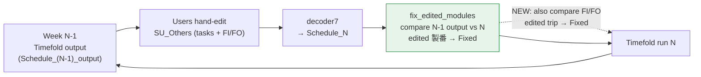
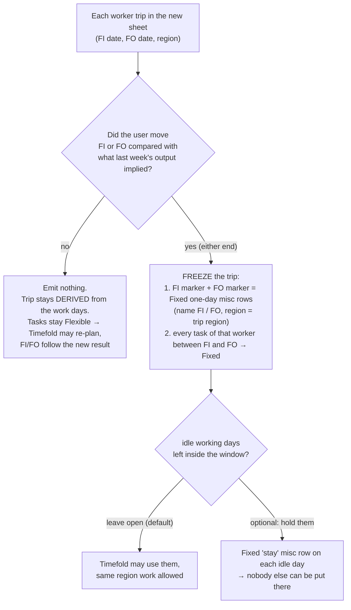

# FI/FO — Proposed Approach (idea level, Timefold unchanged)

> **Status:** idea for discussion. No code, nothing decided.
> **Replaces, for the discussion:** the earlier "ask users to fix the sheet", `trip_list` + SchedulerWeb injection and
> "T1" ideas. Those documents (`…Design…`, `…ImplementationPlan…`, `…TeamBrainstorm…`) stay as background; the plan
> will need to be redone if the team picks this approach.

## 0. Ground rules we are working under

1. **Users keep typing in Excel exactly as today.** Mistakes in the sheet are ours to absorb. (One normalisation
   step turns raw FI/FO cells into clean *worker / date / FI-or-FO / region* facts before anything else runs. How it
   treats bad cells is **not decided here**.)
2. **Timefold is not changed.** Only YAML content may change.
3. **Whatever the user edited becomes Fixed; whatever they did not touch stays Flexible** for Timefold — the same
   principle as `tools/fix_edited_modules.py`.

## 1. The weekly loop, and where FI/FO fits

`fix_edited_modules.py` already defines the loop. FI/FO simply needs the same treatment as a module.



Today the compare step only looks at **module tasks** (`(worker, date)` per 製番); misc rows are skipped, and the
decoder drops FI/FO cells. The idea is to add a **trip** (one worker's FI → FO) as a second kind of "thing a person
can edit".

## 2. Four facts about Timefold that decide the design

(Read from `EmployeeSchedule.java`; they are why "Timefold unchanged" is workable.)

| # | Fact | Where | Consequence |
|---|---|---|---|
| 1 | Timefold has **no FI/FO**. A "stay" is derived from the days a worker works in a region | `regionStayMaxOn`, `regionTransitGap` | FI/FO can only reach it indirectly |
| 2 | **Any Fixed row blocks its day** for that worker (hard rule: one task per day + 12 h cap) — including misc rows | `oneTaskPerEmpPerDay`, `dailyCap12h`, `FIXED_*_BY_EMP_DAY` | A Fixed one-day row on the FI day and on the FO day stops the solver working him on those days |
| 3 | Rows that are not a real module task (**misc**) are **always treated as Fixed**, whatever `plan_flexibility` says, and their **region is ignored** (no fab ⇒ no region) | lines ~2777, 2803 | "FI/FO as a misc task with region" blocks the day and is visible, but Timefold does **not** learn the region from it, and it can never be "flexible" |
| 4 | Fixed module rows **do** carry a region (via the module's fab) and feed the stay / transit rules | `regionTransitGap` | Real Fixed tasks inside a trip give Timefold region presence; this is what a frozen trip relies on |

## 3. The idea: a trip is a unit that gets frozen — like a module



**Edit detection** reuses the existing idea: compare this week's FI/FO with the FI/FO that **last week's output
implies** (the same way modules are compared against the previous output). Only a *difference* means "the user
moved it".

**The marker** (a Fixed one-day misc task) needs no new YAML key and no new file: it already travels through
SchedulerWeb → Timefold → result, can be dragged in the Gantt like any bar, and Timefold preserves Fixed rows
untouched. Suggested values: name `FI` / `FO`, `hour: 1` (it blocks the day regardless of hours; 1 h avoids adding
overtime or inflating the fairness total the way a 10 h cell would), region = the trip's region (used by the Gantt
only).

## 4. Your questions

### 4.1 "If the user changes only FO, is the entire FI–FO including the tasks between fixed?"

**Recommendation: yes, the whole trip of that worker (FI marker, FO marker, all of his tasks between).**
It is the same rule as modules today ("one cell changed → the whole 製番 is frozen").

| If we freeze… | User moves FO 9/11 → 9/15, then Timefold runs |
|---|---|
| **a) markers only** | Timefold is still free to move the 9/2–9/10 tasks → FI/FO left around nothing ("trip for nothing"), and the gap can be reused by another region |
| **b) markers + tasks inside** *(recommended)* | Tasks cannot move; the trip is exactly what the user left. Idle days 9/11–9/14 remain open |
| **c) b) + hold the idle days** | Nothing can happen inside the window at all; also blocks useful extra work in the same region |

Cost of over-freezing is small (one worker, one trip); cost of under-freezing is the exact failures you listed.

### 4.2 "Turn FI/FO into a misc task that has a region?"

**Yes as the marker — with two limits you should know:**
* It blocks the FI day and the FO day in Timefold and is visible/editable everywhere with no new structure ✔
* Timefold **ignores the region of a misc task** and **always treats it as Fixed** (facts 2–3). So it gives the
  "not on FO day" protection (your 9/11 example), but does not tell Timefold "he is abroad in region A".
* The region on the marker is therefore for the **Gantt**: it lets the Gantt draw FI…FO with the right region
  and exact dates instead of guessing.

If the team later needs Timefold itself to know the region without changing Timefold, the only YAML-only way is to
express presence with a **real Fixed task** that has a fab (a small "trip" pseudo-module per region, same
trick `fix_edited_modules` uses with workload = assigned hours). Heavier, so only if needed.

### 4.3 "FI/FO the user did not move should not be fixed"

Covered by the diagram: no marker, no freeze, tasks stay Flexible. If Timefold moves the tasks, the FI/FO of that
trip are simply re-derived from the new result and written into next week's sheet.

## 5. Walk-through of your two cases

```mermaid
sequenceDiagram
    actor U as User (Excel)
    participant D as decoder + fix step
    participant T as Timefold
    participant G as Gantt

    Note over U,T: Case 1 — FI 9/1, work 9/2–9/10, FO 9/11 (untouched)
    D->>D: FI/FO equal last week's → not edited
    D->>T: tasks Flexible, no markers
    T->>G: new tasks → FI/FO re-derived and shown

    Note over U,T: Case 2 — user moves FO 9/11 → 9/15
    U->>D: edited sheet
    D->>D: FO differs → freeze trip
    D->>T: FI marker 9/1 (Fixed) · tasks 9/2–9/10 (Fixed) · FO marker 9/15 (Fixed)
    T->>T: cannot work him on 9/1 or 9/15, cannot move the tasks
    T->>G: result keeps the trip; Gantt draws FI 9/1 → FO 9/15 from the markers
```

Case 1 from your message ("Timefold might assign work on 9/11"): in the *untouched* case Timefold may still place
work on 9/11, but that is legitimate (FO is then re-derived from the new last work day). It only becomes a
problem when the user **fixed** FO = 9/11 — then the marker blocks 9/11.

## 6. What is still not solved with Timefold unchanged

| Risk | When | Mitigation inside this idea |
|---|---|---|
| Another region placed on an **idle working day inside a frozen trip** | Only if the window has idle days *and* Timefold has flexible work elsewhere for that worker | Option c) hold blocks, or accept and watch it (the Gantt can flag "other region inside a frozen trip" after the run) |
| **Baseline for "did the user move it"** | We need what last week's output implied for FI/FO | See question A below |
| Trips of **unedited** workers can still be re-planned by Timefold | By design (they are Flexible) | Nothing to do; this is the intended behaviour |

## 7. What would change (rough, only if the idea is chosen)

| Place | Change |
|---|---|
| decoder | Stop discarding FI/FO; normalise them; make them available to the compare step |
| `fix_edited_modules.py` (or a sibling) | New "edited trip" comparison; emit FI/FO markers; freeze the worker's tasks inside the window |
| GanttChartEditor | Draw FI/FO bars from the markers (exact dates, region); fall back to today's derivation for trips without markers; dragging a marker = an edit (→ Fixed) |
| SchedulerWeb / api-controller / Timefold | **none** |

Notice what disappeared compared with the earlier design: no new `trip_list`, no SchedulerWeb injection, no
unavailable-day tagging, no Timefold change.

## 8. Questions to settle with the team

* **A. Baseline.** Where do the FI/FO in the weekly sheet come from — generated from last week's output, or typed
  from scratch? Do we keep the **untouched** sheet as it was handed to users? (Needed to know what "moved" means.)
* **B.** Freeze scope when only FI or FO moved: whole trip (recommended) or markers only?
* **C.** Idle working days inside a frozen trip: leave open (default) or hold?
* **D.** Should the marker region come from the user's neighbouring tasks (derived) or must it be typed?
