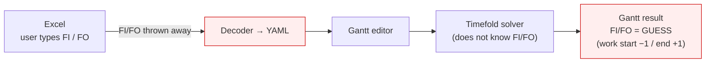
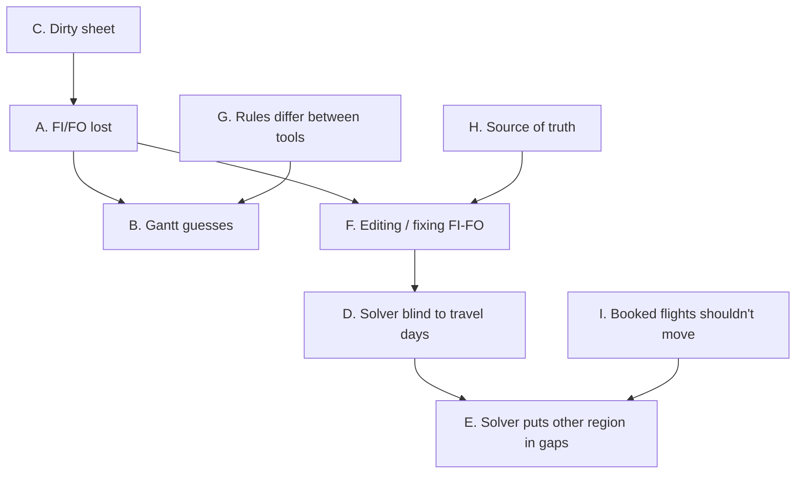
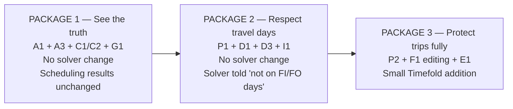

# FI/FO — Team Brainstorm Sheet

> **CORRECTION (2026-10-21, revised):** an earlier note here said `unavailable_dates` would not stop work on
> FI/FO days. More precisely, in the current Timefold the rule `employeeAvailableAllDays` is disabled
> (`EmployeeSchedule.java:1262`), so an unavailable day is **not a hard rule**. Instead the block earns **zero hours**
> that day (`producedHoursForBlock`, `:1348`), the underfill rule makes the solver compensate, and the **output
> skips** such days (`ExportSchedule.java`, `isWorkerUnavailableByWid`). So the written assignments contain no work on
> those days, **but** the day-based rules (one task per day, overtime, transit, stay) still count the worker as
> covering them. A Fixed row blocks the day consistently (`oneTaskPerEmpPerDay`, hard).

> **Purpose:** help the team decide *what we are actually trying to fix* about Fly-In / Fly-Out, and see the
> range of possible fixes. **Nothing here is decided.** Technical detail is in
> `FlyInOut_Design20261020.md`; the build steps (only if we go ahead) are in `FlyInOut_ImplementationPlan20261020.md`.

---

## 1. The situation in plain words

The user plans in the Excel sheet (`SU_Others`) and types **FI** (fly in) and **FO** (fly out) on the days they
travel. We turn the sheet into YAML, edit it in the Gantt editor, send it to the Timefold solver, and show the
result. Along the way **the FI/FO the user typed disappears**, and the Gantt *guesses* new ones from the work
days. So what the user sees after scheduling is not what they entered, and the solver never knew about their
travel in the first place.

**Facts we measured (current sample sheet):**

| Fact | Number |
|---|---|
| FI / FO entered by users | 2,097 / 2,334 (351 of 503 workers) |
| Gantt's guess matches what the user typed (both ends) | **77 %** of work stays — about 1 in 4 is wrong |
| Workers whose FI/FO sequence is broken (FI,FI or FO,FO) | **51 %** (178 of 351) |
| Trips with no work inside them | 10 % (197 of 1,926) |
| FI/FO cells that are colored red-fill (decoder already treats that day as "unavailable") | 629 |
| FI cells in red *font* (meaning unknown) | 393 |

---

## 2. What could "the problem" be? (pick the ones that matter)

Different people may mean different things by "FI/FO is wrong". Please tick which are real for you.

| # | Problem | Example | Who feels it |
|---|---|---|---|
| **A** | Typed FI/FO is **lost** | User types FI 9/1, FO 9/11 → not in any YAML | everyone downstream |
| **B** | The Gantt shows a **guess**, not the real dates | Real FO 9/13, Gantt shows 9/11 | user, after scheduling |
| **C** | The sheet itself has **human errors** | FI,FI,FO,FO,FO… ; FI with no work; two trips merged | decoder, user |
| **D** | The solver **doesn't know** travel days | FI 9/1, work 9/2–9/10, FO 9/11 → solver may assign work on 9/11 | planner |
| **E** | The solver may put the worker in **another region on an idle day inside a trip** | Worker abroad in A, idle 9/5, solver sends him to B | planner |
| **F** | **Editing** FI/FO in the Gantt: what does "fixed" mean? | Move FO 9/11→9/15; solver then moves the tasks 9/2–9/10 → trip for nothing | user |
| **G** | **Definitions disagree** between tools | Solver says 3 days off = new trip; Gantt says same trip | everyone |
| **H** | **Who owns the truth**: Excel or Gantt? | User fixes FO in the Gantt; next month's Excel still has the old one | user, team |
| **I** | **Cost of change**: flights are booked | Solver rearranges a trip that is already ticketed | planner, travel desk |

A, B, C are about **data and display**; D, E, I are about **what the solver is allowed to do**; F, H are about
**how users work**; G is about **consistency**. The team can choose to solve only the first group and still
have a useful release.

---

## 3. Idea menu for each problem

Size: **S** small · **M** medium · **L** large. "Solver change" = touches the Timefold code (risky before testing).

### A + B — Keep the real FI/FO and show it
| Idea | Size | Solver change | Notes |
|---|---|---|---|
| A1. Decoder reads FI/FO and writes them into `Schedule.yaml` as a new optional list; Gantt draws them (real = solid, guess = dashed) | M | no | The core fix. Old files still work |
| A2. Keep guessing but tune the formula | S | no | Best case ~85 %. Cannot know the real date |
| A3. Show real vs guess **side by side** so users see where they differ | S–M | no | Useful even before we trust the data |
| A4. Do nothing, tell users FI/FO is only a hint | — | no | Cheapest; the complaint stays |

### C — Dirty input
| Idea | Size | Solver change | Notes |
|---|---|---|---|
| C1. Decoder **repairs** using work days as ground truth (nearest FI/FO to the work stay wins, extras dropped, missing end derived) and logs every fix | M | no | Needs a quality grade: clean / repaired / suspect |
| C2. Only **clean** trips become hard rules; the rest are shown "needs review" and never block anything | S (on top of C1) | no | Protects the solver from bad data |
| C3. **Fix at the source**: Excel data-validation / macro that flags FI,FI or FO,FO the moment it is typed | M | no | Best long-term; depends on who owns the sheet |
| C4. Report-only: decoder prints a list of bad cells, humans correct the sheet | S | no | Cheap; relies on people |
| C5. Stop typing FI/FO in Excel at all; enter trips only in the Gantt | L | no | Removes the dirty source but changes everyone's habit |

### D — Solver blind to travel days
| Idea | Size | Solver change | Notes |
|---|---|---|---|
| D1. Before sending to the solver, mark FI day and FO day as **unavailable** for that worker (the solver already understands unavailable days) | S–M | **no** | Fixes the "work on the FO day" case. Note: the sheet's red-fill cells already do this by hand |
| D2. Teach the solver a new "travel day" rule | M | yes | Same effect as D1, cleaner, but touches Timefold |
| D3. After solving, **check and warn** ("work on FO day") but don't prevent | S | no | Safety net; works with any other idea |

### E — Other region inside a trip
| Idea | Size | Solver change | Notes |
|---|---|---|---|
| E1. Small **new rule in Timefold**: inside a fixed trip only that trip's region is allowed. Switched off when no trips are supplied | M | **yes** | The only complete fix. Needs approval + a "result is identical when unused" test |
| E2. **Fix the tasks inside the trip** (make them Fixed) so there are fewer idle days to misuse | S | no | Reduces, doesn't remove, the risk. The solver already protects the day *next to* fixed work |
| E3. Detect after solving and show an error; user fixes by hand | S | no | Honest, but manual |
| E4. Accept the risk for the first user test, measure how often it happens, then decide E1 | S | no | Lets data decide. Needs a counter |

### F — Editing and "fixed"
Questions the team must answer first: *When the user drags FO, do the tasks inside also become fixed? When tasks
move, does the trip move?* Idea options:

| Idea | Notes |
|---|---|
| F1. **Ask every time** (dialog: "also fix the 3 tasks inside?", default Yes if tasks exist) | Never changes anything silently; slightly more clicks |
| F2. Trip fixed = its tasks automatically fixed | Simple, but surprises users |
| F3. Trip fixed only fixes the dates; tasks stay movable; warn if the trip ends up empty | Matches "dates are booked, work is flexible"; allows trips for nothing |
| F4. Trip and tasks are **one object** (move one, the other follows) | Cleanest model, biggest change |
| F5. Read-only in the first release: show real FI/FO, no editing yet | Smallest; skips collab/undo work |

### G — Consistent definitions
| Idea | Notes |
|---|---|
| G1. One rule everywhere: *new trip when days-off ≥ the region's `stay_off_interval`* (what the solver already does), shared by decoder and Gantt, with common test cases | Small, and hides a one-day mismatch today |
| G2. Decide how "other work" (non-tool tasks, region "Other") counts toward a trip | Needs a business answer |
| G3. Decide how a direct hop Region A→B counts (one trip or two) | Needs a business answer |

### H — Source of truth
| Idea | Notes |
|---|---|
| H1. Excel stays the master; Gantt edits are exported/kept only in YAML | Simple, but Gantt edits are lost on the next import |
| H2. Gantt becomes the master for FI/FO once imported; Excel FI/FO is only the initial import | Needs a "write back to Excel" or a rule that Excel is ignored afterwards |
| H3. Write FI/FO from the Gantt **back into the Excel/`SU_Others` format** | Closes the loop; extra feature |

### I — Booked flights shouldn't move
| Idea | Size | Solver change | Notes |
|---|---|---|---|
| I1. **Freeze window**: trips (and their tasks) starting in the next N days are always Fixed | S–M | no | Matches how travel is really booked |
| I2. Make the solver **penalise changing** an existing trip (stability) | M | yes | Smoother re-plans, but solver work |
| I3. **Compare two runs** and highlight trips that changed | M | no | Gives travel desk a change list |

### Bonus ideas (not asked, may be worth a thought)
* Let the solver **produce** FI/FO as part of its answer for new work (FI/FO as an *output*, not only an input).
* Turn on the region limits that exist but are switched off today (`max_stay_on`, `max_annual_stay` are `10000`) once real trips are trusted.
* Show a per-worker **travel summary** (number of trips, days abroad per region) for the travel desk.

---

## 4. Three possible packages (the team can mix)

| | Package 1 | Package 2 | Package 3 |
|---|---|---|---|
| User sees real FI/FO in Gantt | ✅ | ✅ | ✅ |
| Dirty sheet handled safely | ✅ | ✅ | ✅ |
| No work on FI/FO days | ❌ (only warned) | ✅ | ✅ |
| Booked trips don't get rearranged | ❌ | ✅ (freeze window) | ✅ |
| User can edit/fix FI/FO in Gantt | ❌ | ❌ (or F5) | ✅ |
| Other region can't intrude on idle days | ❌ | ❌ (detected) | ✅ |
| Timefold code changed | no | no | **yes (small, switchable)** |
| Risk for a near-term user test | lowest | low | medium |

---

## 5. Questions to ask the team

**About reality**
1. When a user types FI/FO, is it a **fact** (already flown), a **booking** (ticket bought), or a **wish**?
2. Do users type FI/FO for **future** dates at all?
3. What does **red font** (and red fill) on an FI/FO cell mean?
4. Who owns the Excel sheet — can we change how it is filled in (validation, a template)?
5. How costly is a changed trip once booked? Is there a "no changes within N days" rule?

**About rules**
6. What counts as one trip: 3 days off — same trip or new trip? What about Region A→B without going home?
7. Is "other work" (non-tool tasks) part of a trip, and does it count as a region?
8. Is an **empty trip** (flights booked, no tasks) ever valid?
9. Should the solver be *forbidden* to work on FI/FO days, or only discouraged?

**About ownership and timing**
10. After import, who is the master of FI/FO: Excel or the Gantt?
11. Must the first user test include **editing** FI/FO, or is seeing the real dates enough?
12. Are we allowed to touch the Timefold code before the user test?
13. Who decides when a repaired / uncertain trip is trusted (the planner, a lead)?

---

## 6. What would change my recommendation

* If most FI/FO are **facts in the past** → Package 1 is enough; the solver never needs to know.
* If many are **future bookings** → Package 2 at least, probably Package 3.
* If the **sheet can be fixed at source** (C3) → the repair logic (C1) can shrink a lot.
* If the **team can't touch Timefold** → stop at Package 2 and rely on D3/E3/E4 to measure how often the gap
  problem (E) really happens before arguing about it.
* If **users must edit** in the Gantt right away → F1 + the "fixed" rules (design §5) become the main work item.
