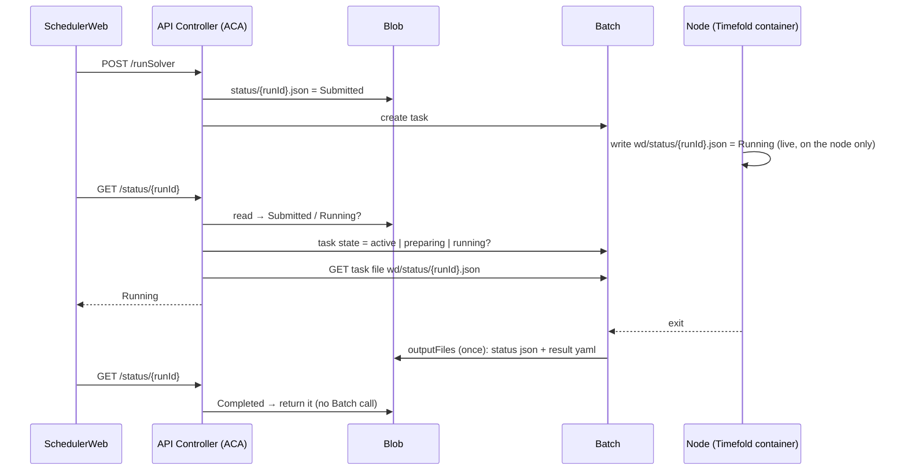

# Company Phase 8 — How "Running" status works (Timefold + Sigma-I)

**Baseline:** `api-controller/src/server.js` as of 2026-10-19 (working copy on
top of `3925de6 update running status`). This version runs end to end: Running
shows mid-solve, and the output and final status reach Blob.

---

## 1. The Batch limit we design around

A Batch task's **`outputFiles` are uploaded once, after the task's command line
exits.** Batch has no "upload every N seconds" option. So anything a task wants
in Blob *through outputFiles* arrives only at the end (`Completed` / `Failed` /
`Cancelled` + result YAML).

This is a limit of **outputFiles**, not of Blob. A process inside the task can
write to Blob any number of times if it calls Blob itself, with the pool's
managed identity token from IMDS. We don't do that today (see §4).

## 2. Current design (hybrid: Batch while active, Blob after)



`GET /status/{runId}` rule:

| Blob status | Batch task state | Returned |
|---|---|---|
| `Submitted` / `Running` | `active` / `preparing` / `running` + live file found | **live file** (Running) |
| `Submitted` / `Running` | no live file yet (node starting / pulling image) | Blob (`Submitted`) |
| `Completed` / `Failed` / `Cancelled` | — | Blob (final) |

### What made it work (lessons from the 2026-10 fix)

| Problem | Cause | Fix in `createBatchTask` |
|---|---|---|
| Output/status not uploaded (`FileUploadMiscError`) | Java writes the result `600` as root; Batch's upload agent can't read it | `chmod -R a+rX /work/output /work/status` after the solve |
| The chmod never ran | Batch passes `commandLine` as **args** to the image ENTRYPOINT, which ignores them | `--entrypoint /bin/bash` in `containerRunOptions`, `commandLine` starts with `-c '…'` |
| `mkdir: Permission denied`, exit 1 before any status file | Image user `solver` can't write the root-owned bind mounts | `--user root` + `autoUser elevationLevel: admin` |
| Input not found | `resourceFiles` keep the blob path under `filePath` | Mount `wd/input/input/{runId}` as `/work/input` |

## 3. Does this conflict with the Sigma-I Bridge?

**No. The Sigma-I design already uses the same pattern.** In
[SigmaI_Azure_DetailedDesign §8.3](../../sigmaI/SigmaI_Azure_DetailedDesign20261013.md),
the Bridge task:

- writes its **live** status to `wd/status/{runId}.json` on the node every 10 s
  (the same path Timefold uses);
- sends it to Blob with `outputFiles … uploadCondition: taskCompletion`, so
  only once, at the end, exactly like Timefold;
- and the API reads it with the same live task-file read (§2 of that doc:
  "Live status via the Batch task-file API … Same path; the bridge writes it").

So "the Bridge continuously writes `status.json` in Blob" is **not** what the
design says. It continuously writes the **local** file. Two places in the
Sigma-I docs read as if it writes Blob directly, and should be reworded when
that doc is next edited:

- the Summary ("keeps `status/{runId}.json` up to date");
- the Implementation Plan sequence diagram (`BR->>BLOB: status = Completed`).
  In practice that write is Batch's outputFiles upload.

Because both engines follow the same contract, the API stays engine-agnostic.
The only per-engine difference is **which Batch job** to ask (`BATCH_JOB_ID`
vs `BATCH_JOB_ID_SIGMAI`, picked from `engine` in the Blob status, Sigma-I
design §7.2).

| | Timefold | Sigma-I |
|---|---|---|
| Who writes the live file | `entrypoint.sh` + Java ticker | `bridge.sh` |
| Live file path on node | `wd/status/{runId}.json` | `wd/status/{runId}.json` |
| Blob status during the run | `Submitted` (from API) | `Submitted` (from API) |
| Blob status at the end | outputFiles, `taskCompletion` | outputFiles, `taskCompletion` |
| API read while active | Batch task file | Batch task file |

## 4. Should Timefold (or the Bridge) also write status to Blob continuously?

**Recommendation: not now.** Keep the hybrid. Only change it if one of these
becomes a real need:

| Reason you might want it | Comment |
|---|---|
| Show Running when the Batch task-file API is unreachable / blocked by policy | Not the case today — it works |
| Other readers besides the API (dashboards, history) need mid-run status | `runs/{runId}.json` (Sigma-I §6.4) covers history at the end; mid-run isn't needed |
| Fewer Batch API calls per poll | The API makes 2 Batch calls per poll at 5 s. Fine for our run counts |

Cost of doing it: a Blob client inside the container (curl + an IMDS token for
the pool identity), a new failure mode (token or network errors mid-solve), and
three writers to one blob (API `Submitted` → task `Running` → outputFiles
final). If we ever do it, do it **the same way in both engines**, so the API
rule in §2 does not change. It just finds `Running` in Blob first.

## 5. Real gaps worth closing (API only, both engines)

These are already in the Sigma-I design (§7.1, §7.2, §9.2). They apply to
Timefold too, and need no container change:

1. **Task completed but no final status in Blob** (upload failed, task killed
   by `maxWallClockTime`, node lost). Today `/status` returns `Submitted`
   forever. Fix: if Blob is `Submitted`/`Running` and the Batch task is
   `completed` for more than 2 min → return `Failed`
   (`TaskExitedWithoutStatus`, using the task's `executionInfo.exitCode` /
   `failureInfo` as the message).
2. **Task create failed** after `status = Submitted` was written. Today it
   stays `Submitted` forever. Fix: on a `createBatchTask` error, write
   `status = Failed (SubmitFailed)` before returning 500.
3. **Silent fallbacks.** `getBatchTaskState(...).catch(() => null)` and
   `if (!res.ok) return null` hide 401/403/400 errors. Log non-404 failures, so
   a broken live read shows in `az containerapp logs show` instead of looking
   like "still Submitted".

## 6. Quick check when Running doesn't show

```bash
source ~/azure-timefold-company-env.sh
RUN_ID=<runId>
az batch task show --job-id "$JOB_ID" --task-id "$RUN_ID" --query state -o tsv        # running?
az batch task file download --job-id "$JOB_ID" --task-id "$RUN_ID" \
  --file-path "wd/status/$RUN_ID.json" --destination ./live.json && cat ./live.json  # "Running"?
curl "https://$APP_URL/status/$RUN_ID"                                                 # matches live.json?
```

- `live.json` missing → container side (mounts, permissions, §2 table).
- `live.json` = Running but `curl` = Submitted → API live read (check the ACA
  revision is the new image, and the ACA identity's Batch role).

Always deploy a **new image tag** (`api-controller:v2`, `v3`, …). Re-pushing
the same tag may leave the old revision running.
