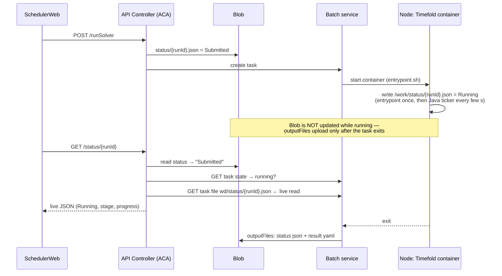

# Company Phase 8 — Why status stays "Submitted" while the task is running

**Symptom:** after `POST /runSolver`, the Batch task is really running (portal /
`az batch task show` says `running`), but `GET /status/{runId}` keeps returning
`Submitted` until the task ends. Then it jumps straight to `Completed`/`Failed`.

**Short answer:** we do **not** need a Bridge script for Timefold. The pieces
that write and read the live status already exist. One of them is failing, and
the API hid the failure. This page shows how the live status works, which part
is most likely broken, and how to check it in about 10 minutes.

---

## 1. How "Running" is supposed to reach the web app



So during the run, **"Running" exists only on the node** (in the task's working
directory). Blob gets it only after the task ends. The API is the only part that
can move the status from `Submitted` to `Running`, by reading the file off the
node through the Batch **task-file API**.

| Piece | Code | What to check |
|---|---|---|
| ① Container writes the file | `TFDocker/docker/entrypoint.sh` (`write_running`) + `EmployeeSchedule.writeRunningStatus` | Works — the same file reaches Blob when the task ends (so the mount and the path are correct) |
| ② Batch keeps it at `wd/status/{runId}.json` | `-v $AZ_BATCH_TASK_WORKING_DIR/status:/work/status` | Works, for the same reason |
| ③ API reads task state | `getBatchTaskState()` in `api-controller/src/server.js` | Must return `running` |
| ④ API reads the live file | `readLiveStatusFile()` | **Suspect.** Any failure fell back to Blob (`Submitted`) **silently** |

## 2. Likely causes (most likely first)

### A. The deployed ACA revision is old code

The live read (③④) was added in api-controller commit `3925de6 update running status`.
Phase 6 deploys the tag `api-controller:v1`. If you push a new `v1` and run
`az containerapp update` with the **same tag**, ACA may keep the old revision,
which only reads Blob (= `Submitted` forever).
**Fix:** always push a **new tag** (`v2`, `v3`, …) and deploy that tag.

### B. The task-file URL path was not encoded (fixed in code, needs redeploy)

`filePath` is a single path parameter in the Batch REST API. Microsoft's example
writes it as `wd\testFile.txt`. Our code sent `files/wd/status/{runId}.json`
with raw `/`. Those can be read as extra URL segments, so the request fails. The
old code returned `null` on any non-200 response, so the status quietly stayed
`Submitted`.
**Fixed (not yet deployed):** `server.js` now sends
`encodeURIComponent('wd/status/{runId}.json')` (`%2F`), which is how the Azure
SDKs send it.

### C. Permission on the task-file read (403)

The ACA identity has **Azure Batch Account Contributor** (Phase 2.2). It already
creates tasks, so reads should be allowed too. If the debug output (§3) shows
`403`, check that role on the Batch account in the portal.

### D. Not an error: the node is still starting

While the task is `active` or `preparing` (pool scaling up from 0 nodes, image
pull), there is no file yet, so `Submitted` is correct. This can take
5–15 minutes on a cold pool. The debug output shows it as `taskState: "active"`
or `"preparing"`, with `liveFile.httpStatus: 404`.

## 3. How to check (copy-paste)

Code changes in `api-controller/src/server.js` (not yet deployed):

- `GET /status/{runId}?debug=1` returns each step of the lookup instead of hiding it:

  ```json
  {
    "blobStatus": { "status": "Submitted", ... },
    "taskState":  "running",
    "liveFile":   { "live": null, "httpStatus": 404, "detail": "..." }
  }
  ```

- Failed state or file reads are now logged as `[status] ...` in the ACA log.
  A normal 404, while the file isn't written yet, is not logged.

### Step 1 — Is the file on the node? (rules out ① ②)

While a run is in progress:

```bash
source ~/azure-timefold-company-env.sh
RUN_ID=<the runId from SchedulerWeb>

az batch task show --job-id "$JOB_ID" --task-id "$RUN_ID" --query state -o tsv   # expect: running
az batch task file list --job-id "$JOB_ID" --task-id "$RUN_ID" --recursive -o table | grep status
az batch task file download --job-id "$JOB_ID" --task-id "$RUN_ID" \
  --file-path "wd/status/$RUN_ID.json" --destination ./live.json && cat ./live.json   # expect: "Running"
```

If `live.json` says `Running`, the container side is fine and the problem is in
the API (A/B/C).

### Step 2 — Deploy the fixed API under a new tag (fixes A + B)

```bash
cd web/api-controller
az acr build --registry "$ACR" --image api-controller:v2 .
az containerapp update --name "$ACA_APP" --resource-group "$RG" \
  --image "$ACR_LOGIN/api-controller:v2"
az containerapp revision list --name "$ACA_APP" --resource-group "$RG" -o table   # new revision active
```

(Use `docker build` + `docker push` instead of `az acr build` if that's how
Phase 6 was done on your network.)

### Step 3 — Ask the API what it sees

```bash
curl "https://$APP_URL/status/$RUN_ID?debug=1"
az containerapp logs show --name "$ACA_APP" --resource-group "$RG" --follow | grep "\[status\]"
```

| Debug result | Meaning | Action |
|---|---|---|
| `taskState: running`, `liveFile.live.status: Running` | Fixed | Plain `/status/{runId}` now returns Running |
| `taskState: running`, `liveFile.httpStatus: 404` | URL or path problem | Compare with the path from Step 1's `file list` |
| `httpStatus: 401/403` or `taskStateError` | Permission problem | Check ACA identity's Batch role (Phase 2.2) |
| `taskState: active / preparing` | Node not started yet | Wait; check pool scaling |
| No `taskState` key at all | Old revision still serving | Redo Step 2 with a new tag |

## 4. Do we need a "Bridge" like Sigma-I?

**No, not for Timefold.** In Sigma-I the solver is a separate service on the VM
(Docker Compose + Redis). Something has to call `POST /jobs`, poll it, and
translate its status, so the Bridge task does that work. Timefold runs **inside**
the Batch task and writes `status/{runId}.json` itself. The API already reads
that file live. A Bridge would only add a layer in front of something that
already works.

**Fallback, only if the task-file API cannot work** (for example, blocked by
policy): have the container push its status to Blob while it runs. Each few
seconds, `entrypoint.sh` (or the Java ticker) uploads `status/{runId}.json` to
Blob using the pool's managed identity. That needs a token from IMDS
(`169.254.169.254`) inside the container, plus `curl` in the image. The API then
gets `Running` from Blob and the live read is no longer needed. This is more
moving parts, so only do it if §3 shows the file read cannot be made to work.

## 5. Checklist

- [ ] Step 1: `wd/status/{runId}.json` on the node says `Running`
- [ ] Step 2: API deployed as a **new tag**, new revision active
- [ ] Step 3: `?debug=1` shows `taskState: running` + `liveFile.live.status: Running`
- [ ] SchedulerWeb: 結果を表示 on a running row shows the Running/progress dialog
