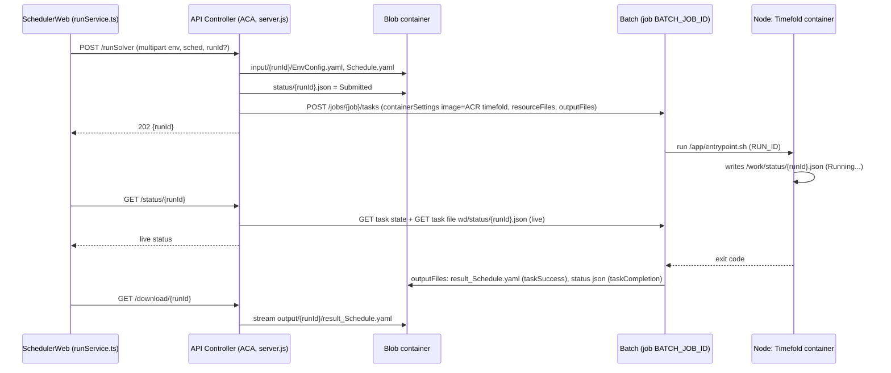
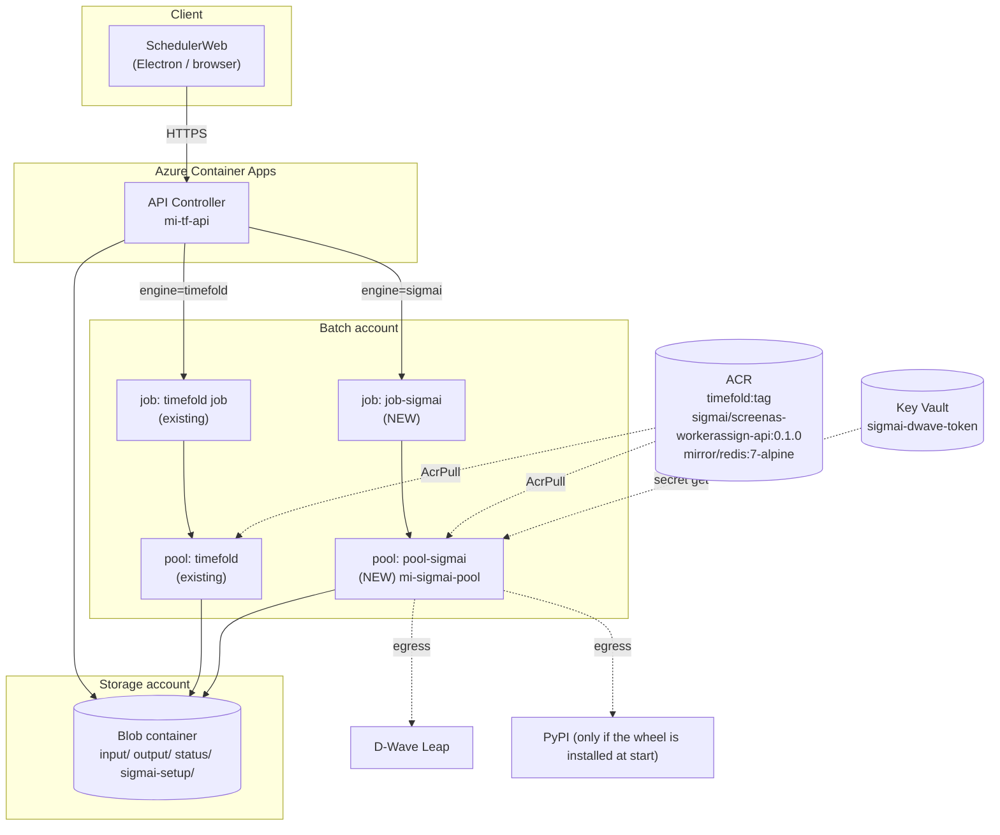
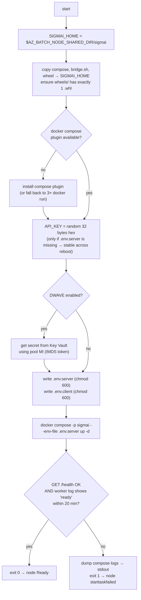
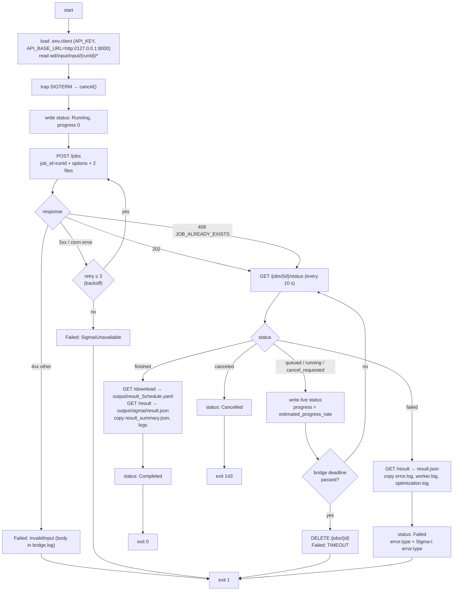
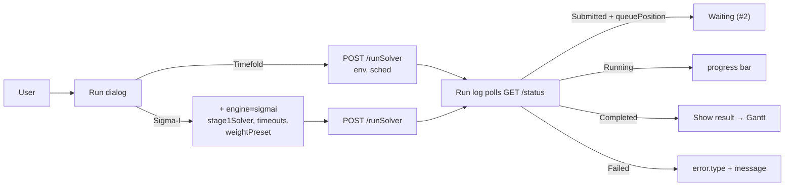
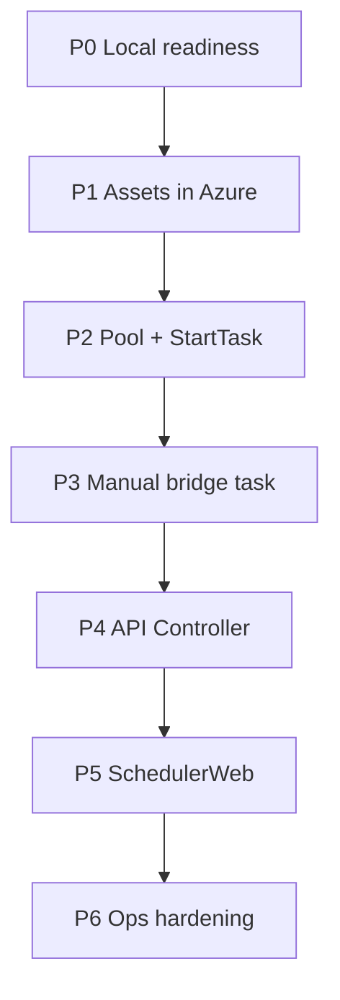

# Sigma-I on Azure — Detailed Design

> Deep version for implementation. Short visual version: [SigmaI_Azure_ImplementationPlan20261013.md](./SigmaI_Azure_ImplementationPlan20261013.md) / [JP](./SigmaI_Azure_ImplementationPlan20261013(JP).md)
>
> Related: [SchedulerWeb/Azure.md](../SchedulerWeb/Azure.md) (Timefold v1 architecture), `api-controller/src/server.js`, Sigma-I delivery `sigmaI/2.Web APIソースコード一式/`.
>
> Status: **draft for review**. Azure CLI commands are intentionally left out — this document fixes *what* to build; the step-by-step `az` guides come later (same style as `Azure-Company-0x`).

---

## 0. Summary

- SchedulerWeb gets an **engine** choice: `timefold` (today) or `sigmai` (new).
- The **API Controller (ACA)** keeps the same 4 endpoints. It reads `engine` and submits the Batch task to a different **Batch job/pool**.
- Sigma-I runs on its **own Batch pool (`pool-sigmai`)**. The Sigma-I stack (API + worker + Redis) is started **once per node** by the pool's **StartTask** and stays up, so the core wheel is installed only once per node boot.
- Every run is a lightweight **Bridge task** on that node. It:
  1. takes the YAML files from Blob and calls Sigma-I `POST /jobs`,
  2. polls Sigma-I status and keeps `status/{runId}.json` updated (Running / Completed / Failed / Cancelled),
  3. downloads the result and logs and puts them in Blob.
- **Queueing** is done by the Batch job queue: `taskSlotsPerNode = 1`, so extra runs wait in Batch as `active` tasks until the node is free. The API exposes a `queuePosition`.
- The status file schema and the 5 run states are **the same as Timefold**, so SchedulerWeb needs only small changes.
- The Timefold path is **not touched**.

---

## 1. How Timefold works today (baseline)

Source of truth: `documents/SchedulerWeb/Azure.md` and `api-controller/src/server.js`.



Key mechanisms we **reuse** for Sigma-I:

| Mechanism | How Timefold uses it | Sigma-I reuse |
|---|---|---|
| `resourceFiles` with `blobPrefix: input/{runId}/` | Batch downloads the input YAML to the task dir | Same, plus `sigmai_options.json` |
| Live status via the Batch task-file API (`wd/status/{runId}.json`) | API reads the status while the task is running | Same path; the bridge writes it |
| `outputFiles` (`taskSuccess` for the result, `taskCompletion` for status) | Batch uploads them when the task ends | Same, plus the `sigmai/*` logs |
| Batch terminate → SIGTERM → write `Cancelled` | `entrypoint.sh` trap | The bridge trap also calls Sigma-I `DELETE /jobs/{id}` |
| `runId` regex `^[A-Za-z0-9_-]+$` | API validation | **Identical** to Sigma-I `job_id` pattern → we use `runId` as `job_id` |

---

## 2. What is different about Sigma-I

From the delivery README, `docker-compose.yml` and the API source:

| Topic | Fact | Design impact |
|---|---|---|
| Processes | `redis`, `api` (uvicorn :8000), `worker` (celery) | Needs Docker Compose (or 3× `docker run`) on the node |
| Core logic | `screenas_workerassign_opt-*.whl`, mounted at `/opt/wheels`, **installed when the containers start**; needs internet | Expensive start → **keep the stack warm** |
| Wheel rule | Exactly **one** `.whl` in `wheels/`, otherwise it refuses to start | StartTask must clean the folder |
| Call style | Async HTTP: `POST /jobs` (multipart) → `GET /status` → `GET /result` / `GET /download`; `DELETE` = cancel | The bridge is an HTTP client, not a solver |
| Auth | `X-API-Key` header must match the container env `API_KEY` | Generate it **on the node**; it never leaves the node |
| Solvers | `stage1_solver` ∈ {`scip`,`dwave`} (default `scip`); `stage2_solver` = `scip` only | Validate in the API Controller |
| Time limits | `stage1_timeout`, `stage2_timeout` (default 30 s each); job total limit = the sum | Batch `maxWallClockTime` = sum + margin |
| Other options | `weight_preset` ∈ {standard, daily_balance, worker_balance}; `disabled_constraints` ⊂ {stage2.overtime_limits, stage2.stay_limits, stage2.manager_assignment}; `stage{1,2}_num_solutions_limit` | Pass through |
| D-Wave | `DWAVE_API_TOKEN` env on the server side; outbound to D-Wave Leap | Key Vault + egress |
| Public statuses | `queued`, `running`, `finished`, `failed`, `cancel_requested`, `canceled` | See §7 mapping |
| Error types | `OPTIMIZATION_FAILED`, `STAGE1_FAILED`, `STAGE2_FAILED`, `TIMEOUT`, `CORE_IMPORT_ERROR`, … | Copied into `status.error.type` |
| Artifacts | `data/jobs/<job_id>/` → `logs/error.log`, `logs/worker.log`, `opt_output/optimization.log`, `result_summary.json`, `result_Schedule.yaml` | The bridge uploads the useful ones |
| Restart behaviour | On worker start, orphan recovery marks running jobs failed ("Worker restarted while the job was running.") | A node reboot fails the in-flight run → retry rules in §9 |
| Duplicate id | `POST /jobs` with an existing `job_id` → `JOB_ALREADY_EXISTS` | The bridge treats this as "resume polling" (idempotent) |

---

## 3. Target architecture



### 3.1 Why a separate pool (and not reuse the Timefold pool)

- **Different lifecycle.** Timefold nodes run "1 task = 1 container, then exit". Sigma-I nodes keep a long-lived stack. Mixing them means the Timefold tasks also pay for the Sigma-I StartTask, and Sigma-I could be scheduled on a node without the stack.
- **Different sizing.** Timefold is tuned for compute-optimized VMs; Sigma-I SCIP sizing is unknown (Q3), and D-Wave runs are mostly waiting on the network.
- **Different scaling rules.** Sigma-I needs "keep warm after idle"; Timefold wants "scale to 0 quickly".
- **Isolation.** A broken Sigma-I StartTask cannot take Timefold down.

### 3.2 Why Batch (not ACA Jobs or a Container App) for Sigma-I

| Option | Pros | Cons | Verdict |
|---|---|---|---|
| **Batch pool + StartTask + bridge task** (proposed) | Same platform as Timefold; built-in queue; VM SKU choice; Docker Compose works on the VM | StartTask scripting; node cold start | ✅ v1 |
| Sigma-I as an always-on Container App (3 containers) | No VMs to manage | Redis/worker as ACA sidecars is awkward; no SKU choice; costs 24/7; long SCIP runs on ACA | ❌ |
| ACA Job per run | Simple | Pays the install cost on **every** run (what we want to avoid) | ❌ |
| Separate always-on VM | Easiest to debug | No queue, no autoscale, a manual "pet" server | Fallback for the PoC only |

---

## 4. Blob layout (additions in **bold**)

```
<container>/
├── input/{runId}/
│   ├── EnvConfig.yaml
│   ├── Schedule.yaml
│   └── **sigmai_options.json**          ← written by the API when engine=sigmai
├── output/{runId}/
│   ├── result_Schedule.yaml             ← same file name as Timefold
│   └── **sigmai/**
│       ├── **result.json**              ← Sigma-I GET /jobs/{id}/result
│       ├── **result_summary.json**      ← opt_output/result_summary.json
│       ├── **error.log**                ← logs/error.log (if it exists)
│       ├── **worker.log**
│       ├── **optimization.log**
│       └── **bridge.log**
├── status/{runId}.json                  ← same schema + optional new fields
└── **sigmai-setup/**                    ← read-only for nodes, uploaded by us
    ├── **docker-compose.azure.yml**
    ├── **wheels/screenas_workerassign_opt-<ver>.whl**   (exactly one)
    ├── **start-sigmai.sh**              ← StartTask script
    └── **bridge.sh**                    ← Bridge task script
```

`sigmai_options.json`:

```json
{
  "engine": "sigmai",
  "stage1Solver": "scip",
  "stage2Solver": "scip",
  "stage1TimeoutSec": 1800,
  "stage2TimeoutSec": 1800,
  "stage1NumSolutionsLimit": null,
  "stage2NumSolutionsLimit": null,
  "weightPreset": "standard",
  "disabledConstraints": [],
  "scenarioName": "label from SchedulerWeb"
}
```

---

## 5. HTTP API contract changes (API Controller)

Endpoints stay the same. The Timefold behaviour is unchanged when `engine` is missing.

### 5.1 `POST /runSolver`

New optional multipart fields:

| Field | Type | Default | Validation |
|---|---|---|---|
| `engine` | `timefold` \| `sigmai` | `timefold` | enum |
| `stage1Solver` | `scip` \| `dwave` | `scip` | enum; `dwave` rejected if `SIGMAI_DWAVE_ENABLED=false` |
| `stage2Solver` | `scip` | `scip` | must be `scip` |
| `stage1TimeoutSec` | int | 1800 (proposal) | 1 … `SIGMAI_MAX_STAGE_TIMEOUT_SEC` |
| `stage2TimeoutSec` | int | 1800 (proposal) | same |
| `stage1NumSolutionsLimit` / `stage2NumSolutionsLimit` | int | none | ≥ 1 |
| `weightPreset` | string | `standard` | enum of 3 |
| `disabledConstraints` | JSON array string | `[]` | subset of 3 ids, no duplicates |

> Sigma-I's own default timeout is only 30 s. We should pick our own default (e.g. 1800 s) after testing — **to decide**.

Side effects when `engine=sigmai`:

1. Upload `input/{runId}/EnvConfig.yaml`, `Schedule.yaml`. **Normalize the names**: today the API uses `originalname`; the bridge expects these exact names.
2. Upload `input/{runId}/sigmai_options.json`.
3. Write `status/{runId}.json = { status: Submitted, engine: "sigmai", ... }`.
4. Create the task in `BATCH_JOB_ID_SIGMAI` (spec in §6.3).

### 5.2 `GET /status/{runId}`

Same logic as today (blob status → if not terminal, check the Batch task state → read the live file). Additions:

- Read `engine` from the blob status to pick the Batch job id.
- If the Batch task state is `active` (waiting): return the blob status plus `queuePosition`.
  - `queuePosition` = 1 + the number of tasks in `job-sigmai` that are `running`, or `active` with an earlier `creationTime`.
  - Implementation: `GET /jobs/job-sigmai/tasks?$filter=state eq 'active' or state eq 'running'&$select=id,state,creationTime`.
- If the task state is `completed` but the blob status is still not terminal (Batch upload delay or a crash): return `Failed` with `error.type = "BridgeExitedWithoutStatus"` after a grace period of 2 minutes.

### 5.3 `GET /download/{runId}`

No change (same `output/{runId}/result_Schedule.yaml`). Optional later: `GET /download/{runId}/logs` → zip of `output/{runId}/sigmai/`.

### 5.4 `DELETE /run/{runId}`

No change in behaviour (terminate the task, then delete the blobs). Add the prefix `output/{runId}/sigmai/` (it is already covered by `output/{runId}/`).

### 5.5 New API Controller env vars

| Var | Example | Note |
|---|---|---|
| `BATCH_JOB_ID_SIGMAI` | `job-sigmai` | |
| `SIGMAI_DWAVE_ENABLED` | `false` | Feature flag until Q5 is settled |
| `SIGMAI_MAX_STAGE_TIMEOUT_SEC` | `7200` | Guard rail |
| `SIGMAI_WALLCLOCK_MARGIN_SEC` | `900` | Added to the sum of the timeouts |

---

## 6. Batch design

### 6.1 Pool `pool-sigmai` (illustrative values — confirm in P2)

| Setting | Proposal | Why |
|---|---|---|
| VM size | `Standard_D8s_v5` or `Standard_F8s_v2` (8 vCPU) | SCIP is CPU-bound; RAM for 3 containers. **Benchmark** (Q3) |
| Image | Same container-capable Ubuntu image as the Timefold pool (e.g. `microsoft-dsvm/ubuntu-hpc`, `batch.node.ubuntu 22.04`) | Docker is already present; proven in Azure-Company-05 |
| Priority | **Dedicated** (not Spot) | Eviction kills the warm stack and the in-flight run |
| `taskSlotsPerNode` | **1** | One Sigma-I run at a time → the Batch queue is our queue |
| `taskSchedulingPolicy.nodeFillType` | `Pack` | |
| Identity | user-assigned `mi-sigmai-pool` (or reuse the Timefold pool MI) | AcrPull, Blob, Key Vault |
| `containerConfiguration` | `containerImageNames`: Sigma-I image + redis mirror; registry with the MI | Images are pre-pulled at node allocation |
| Autoscale | see §6.4 | |
| Max nodes | 1 (v1) | Concurrency = 1, matching the Sigma-I default deployment |

### 6.2 StartTask (`start-sigmai.sh`)

Runs as **pool-scope admin autoUser**, `waitForSuccess: true`, `maxTaskRetryCount: 2`. Batch will not schedule bridge tasks on the node until it succeeds.

`resourceFiles`: `sigmai-setup/` → `$AZ_BATCH_NODE_STARTUP_DIR/wd/sigmai-setup/` (via MI).



Notes:
- **Idempotent.** Batch re-runs the StartTask after a node reboot. `up -d` is safe; keep the existing `.env.server`.
- `docker-compose.azure.yml` = the delivered compose with:
  - `image:` pointing at ACR (`<acr>.azurecr.io/sigmai/screenas-workerassign-api:0.1.0`, `<acr>.azurecr.io/mirror/redis:7-alpine`) → no Docker Hub dependency or rate limits.
  - `./data` → `${SIGMAI_HOME}/data` so the bridge can read the artifacts on the host.
  - `restart: unless-stopped` on all 3 services.
  - Port `8000` bound to `127.0.0.1` only (`"127.0.0.1:8000:8000"`) → the API is not exposed outside the node.
- **Readiness.** `/health` alone may answer before the worker has finished `pip install`. Also check `docker compose logs worker` for `celery@... ready`.

### 6.3 Bridge task (one per run)

Task spec (sketch):

```jsonc
{
  "id": "{runId}",
  "displayName": "sigmai {runId}",
  // host task (no containerSettings): the bridge needs localhost:8000 and the host data dir
  "commandLine": "/bin/bash -c 'bash $AZ_BATCH_NODE_SHARED_DIR/sigmai/bridge.sh'",
  "userIdentity": { "autoUser": { "scope": "pool", "elevationLevel": "admin" } },
  "environmentSettings": [ { "name": "RUN_ID", "value": "{runId}" } ],
  "constraints": {
    "maxWallClockTime": "PT{stage1+stage2+margin}S",
    "maxTaskRetryCount": 1,
    "retentionTime": "P1D"
  },
  "resourceFiles": [
    { "autoStorageContainerName": "<container>", "blobPrefix": "input/{runId}/", "filePath": "input",
      "identityReference": { "resourceId": "<mi>" } }
  ],
  "outputFiles": [
    { "filePattern": "output/result_Schedule.yaml",
      "destination": { "container": { "containerUrl": "...", "path": "output/{runId}/result_Schedule.yaml", "identityReference": {...} } },
      "uploadOptions": { "uploadCondition": "taskSuccess" } },
    { "filePattern": "output/sigmai/*",
      "destination": { "container": { "containerUrl": "...", "path": "output/{runId}/sigmai", "identityReference": {...} } },
      "uploadOptions": { "uploadCondition": "taskCompletion" } },
    { "filePattern": "status/{runId}.json",
      "destination": { "container": { "containerUrl": "...", "path": "status/{runId}.json", "identityReference": {...} } },
      "uploadOptions": { "uploadCondition": "taskCompletion" } }
  ]
}
```

> Remember the Timefold lesson: with `filePath: "input"` + `blobPrefix: "input/{runId}/"`, the files land in `wd/input/input/{runId}/`. The bridge must use that path.

> Wildcard `outputFiles` use `path` as a **prefix** (unlike the exact-name entries). Verify the final blob names in P3.

**Bridge algorithm (`bridge.sh`, bash + curl, python3 for JSON):**



`cancel()` (on SIGTERM from a Batch terminate):
1. `DELETE /jobs/{runId}`.
2. Poll up to 45 s for `canceled`.
3. Write `Cancelled` (atomic), copy the logs, `exit 143`.

Set the task `retentionTime` / terminate grace so that the 45 s fits (the Timefold doc proposes 60 s).

### 6.4 Autoscale (keep warm)

Proposed formula (**verify the syntax in P6**):

```
// keep 1 node while there was any active/running task in the last 60 min
lookback = TimeInterval_Minute * 60;
busy = max($PendingTasks.GetSample(lookback, 1));
$TargetDedicatedNodes = busy > 0 ? 1 : 0;
$TargetLowPriorityNodes = 0;
$NodeDeallocationOption = taskcompletion;
```

- The evaluation interval is at least 5 min → up to 5 min of extra delay before boot starts.
- **Option B (business hours):** `$TargetDedicatedNodes = (weekday && 8 ≤ hour < 20) || busy ? 1 : 0` — the node is warm when users arrive.
- **Option C (fastest first run):** the API Controller resizes the pool when a run arrives and the pool is at 0. This needs autoscale off, plus a separate scale-down job. More moving parts; consider only if cold start hurts.

Cold-start budget (to measure in P2):

| Step | Estimate |
|---|---|
| VM allocation | 3–5 min |
| Image pre-pull from ACR | 1–2 min |
| `pip install` wheel + deps | 2–8 min (unknown) |
| Health / ready | < 1 min |
| **Total first run delay** | **~6–15 min** |

If Sigma-i allows a **pre-baked image** (Q1): build `FROM sigmai/screenas-workerassign-api:0.1.0` + install the wheel in our own ACR image. This removes the pip step and the PyPI egress. We need to confirm how the delivered image's startup script behaves if the package is already installed.

---

## 7. Status model

### 7.1 `status/{runId}.json` (superset of the Timefold schema)

```jsonc
{
  "runId": "20261013_101500123",
  "status": "Submitted | Running | Completed | Failed | Cancelled",
  "stage": null,                      // Sigma-I does not expose stage1/stage2 progress publicly → null
  "progress": 42,                     // 0–100, from estimated_progress_rate
  "startedAt": "...", "updatedAt": "...", "finishedAt": null,
  "error": { "type": "OPTIMIZATION_FAILED", "message": "Optimization failed.", "stage": "system" },
  "output": "output/{runId}/result_Schedule.yaml",
  // ── new, optional ──
  "engine": "sigmai",
  "queuePosition": 2,                 // only from GET /status, never stored
  "solver": { "stage1": "scip", "stage2": "scip", "stage1TimeoutSec": 1800, "stage2TimeoutSec": 1800 },
  "sigmai": {
    "jobStatus": "running",
    "summary": { "validationPassed": false, "finalScore": null, "stage1Status": "optimal", "stage2Status": "chunked" }
  }
}
```

### 7.2 Mapping

| Source | Value | → `status` | Notes |
|---|---|---|---|
| Batch task | `active` | `Submitted` | + `queuePosition` |
| Batch task | `preparing` / `running`, no live file yet | `Submitted` | |
| Sigma-I | `queued` | `Running` | progress 0 |
| Sigma-I | `running` | `Running` | progress = rate |
| Sigma-I | `cancel_requested` | `Running` | UI may show "Cancelling…" |
| Sigma-I | `finished` | `Completed` | after the result file is saved |
| Sigma-I | `failed` | `Failed` | `error.type` copied |
| Sigma-I | `canceled` | `Cancelled` | |
| Bridge | own deadline exceeded | `Failed` | `error.type = "TIMEOUT"` |
| Bridge | cannot reach Sigma-I | `Failed` | `error.type = "SigmaIUnavailable"` |
| API | task completed, no terminal status after 2 min | `Failed` | `error.type = "BridgeExitedWithoutStatus"` |

> Sigma-I `finished` does **not** guarantee a usable schedule — check `summary.validation_passed`. Proposal: if `finished` but `validation_passed == false`, still report `Completed` but put `sigmai.summary.validationPassed=false` so the UI can warn. **To decide.**

---

## 8. SchedulerWeb changes

| Area | File (today) | Change |
|---|---|---|
| Types | `src/types/index.ts` | `Run.engine`, `Run.solverOptions`, `RunStatus.queuePosition`, `RunStatus.sigmai` |
| API client | `src/services/runService.ts` | Send `engine` + Sigma-I fields in `POST /runSolver` |
| Run store | `src/services/runStore.ts` / `runs.json` | Persist `engine` and the options per run |
| Run dialog | (where runs are started) | Engine radio: Timefold / Sigma-I. For Sigma-I: Stage 1 solver (SCIP / D-Wave, D-Wave hidden if disabled), Stage 1 / 2 time limits, weight preset, advanced: disabled constraints |
| Run log | `src/pages/RunLogPage.tsx` | Engine column/badge; "Waiting (#n)" when `queuePosition`; show `error.type`; warn if `validationPassed=false` |
| Settings | `src/pages/SettingsPage.tsx` | Default engine and default time limits |
| i18n | `src/config/uiConfig.en.ts`, `uiConfig.ja.ts` | New labels |
| Local mode | `localApi/` | Optional: `engine=sigmai` → call the local Sigma-I compose at `localhost:8000` (same bridge logic in TS) |



---

## 9. Failure handling and retries

| Failure | Detected by | Result | Recovery |
|---|---|---|---|
| Invalid YAML / options | Sigma-I 422 | `Failed` (InvalidInput) | User fixes the input |
| Optimization failed / validation failed | Sigma-I `failed` | `Failed` + logs in Blob | Investigate `error.log`, `optimization.log` |
| Sigma-I timeout | Sigma-I `failed` (TIMEOUT) | `Failed` | Larger timeouts |
| Bridge deadline | bridge | `Failed` (TIMEOUT) + `DELETE /jobs` | — |
| Batch `maxWallClockTime` | Batch kills the task | API sees completed + no terminal → `Failed` | Margin too small → tune |
| Node reboot during a run | worker orphan recovery → `failed` | `Failed` ("Worker restarted…") | Batch retry (1): the bridge POSTs again; the job id still exists → it polls the failed job → `Failed`. **Proposal:** on retry, if the existing job is `failed` with the orphan message, re-submit as `{runId}-r1` |
| Node lost / replaced | Batch requeues the task (retry) | New node, new Redis → POST creates a fresh job | Automatic |
| StartTask fails | node `starttaskfailed` | Tasks stay `active` (queued forever) | Alert on node state; the API returns `Submitted` + a `nodeIssue` hint after N min |
| D-Wave token invalid / no egress | Sigma-I `failed` (STAGE1_FAILED) | `Failed` | Fix Key Vault / network |
| Two submissions with the same runId | API (blob exists) | 409 | The API generates the runId |

---

## 10. Security and identities

| Identity | Scope | Roles | Status |
|---|---|---|---|
| `mi-tf-api` (ACA) | Storage account | Storage Blob Data Contributor | existing |
| `mi-tf-api` (ACA) | Batch account | Azure Batch Account Contributor (covers the new job) | existing |
| `mi-sigmai-pool` (or reuse `mi-tf-pool`) | ACR | AcrPull | new / existing |
| `mi-sigmai-pool` | Storage account | Storage Blob Data Contributor (outputFiles + `sigmai-setup/` read) | new / existing |
| `mi-sigmai-pool` | Key Vault | Key Vault Secrets User (`sigmai-dwave-token` only) | **new** |

Secrets:
- `API_KEY` (Sigma-I) — **generated on the node**, stored only in `${SIGMAI_HOME}/.env.*` (chmod 600, owned by the pool admin user). Never in Blob, task env or the API.
- `DWAVE_API_TOKEN` — Key Vault → `.env.server` on the node. Do **not** put it in pool `environmentSettings` (visible to anyone with Batch read).
- Sigma-I port 8000 bound to `127.0.0.1` → not reachable from the VNet.

---

## 11. Networking

| Destination | Why | When |
|---|---|---|
| ACR | pull images | node start |
| Storage (Blob) | resource/output files | always |
| Key Vault | DWAVE token | node start (if D-Wave is enabled) |
| `pypi.org`, `files.pythonhosted.org` | wheel dependencies | every node start (unless pre-baked) |
| D-Wave Leap endpoints (`*.dwavesys.com`) | Stage 1 `dwave` | during D-Wave runs |
| Docker Hub | **not needed** if redis is mirrored to ACR | — |

If the company puts Batch in a VNet with a firewall / no default outbound, these need to be allow-listed (Q4).

---

## 12. Cost (rough — check the Azure Pricing Calculator for our region)

| Item | Driver | Note |
|---|---|---|
| Sigma-I node | VM hours while the node exists (incl. the warm idle tail) | 8-vCPU general/compute VM ≈ a few tenths of USD per hour; business-hours warm (12 h × 22 d) ≈ 264 h/month |
| Idle tail | 60 min after the last run | Trade-off vs cold start |
| D-Wave | Leap plan / QPU time | Separate contract (Q5) |
| ACR / Blob / Key Vault | small | Key Vault ~ per 10k operations |
| API Controller | unchanged | |

Spot / low-priority is **not** recommended for this pool (warm stack + long runs).

---

## 13. Observability

- **Bridge:** everything goes to `output/sigmai/bridge.log` (uploaded on completion) + task stdout/stderr (Batch).
- **StartTask:** stdout/stderr in the node startup dir; node state `starttaskfailed` → Azure Monitor alert.
- **Sigma-I:** `worker.log`, `error.log`, `optimization.log` per run → Blob.
- **API Controller:** logs the engine, runId, Batch task id and queue position on submit.
- **Later:** a Log Analytics workspace for the Batch account diagnostics.

---

## 14. Phased plan with exit criteria



| Phase | Work | Exit criteria |
|---|---|---|
| **P0** | Make the Sigma-I job **succeed locally** with our Test_data (`test-001` currently fails `validation_passed=false`, `stage2=chunked`); ask the Sigma-i questions §15; measure the local start time and the solve time for SCIP | One local job `finished` with a valid `result_Schedule.yaml` that opens in the GanttChartEditor |
| **P1** | Push the Sigma-I image + redis mirror to ACR; upload `sigmai-setup/` to Blob; Key Vault secret; identity + roles | `az acr repository list` shows both; MI can read `sigmai-setup/` |
| **P2** | Create `pool-sigmai` (fixed 1 node, no autoscale yet) + `job-sigmai`; write `start-sigmai.sh` | Node `idle`, StartTask exit 0, `curl 127.0.0.1:8000/health` OK from the node; cold-start time measured |
| **P3** | Write `bridge.sh`; submit a task manually (like Azure-Company-05) | `output/{runId}/result_Schedule.yaml` + `sigmai/*` + `status=Completed` in Blob; a 2nd task submitted while the 1st is running waits `active`, then runs without reinstall; cancel works in both states |
| **P4** | API Controller: `engine`, options validation, `sigmai_options.json`, task spec, `queuePosition` | Postman: Timefold regression OK; Sigma-I run end-to-end via the API |
| **P5** | SchedulerWeb UI + types + i18n | A user can choose an engine, see the queue/progress and open the result |
| **P6** | Autoscale formula, alerts, retention (30 days lifecycle like Timefold), D-Wave enable | Node scales 0↔1 as designed; alert fires on a StartTask failure |

---

## 15. Open questions

| # | Question | Owner | Blocks |
|---|---|---|---|
| Q1 | Can we pre-install the wheel into a derived image? How does the image's startup behave if it is already installed? | Sigma-i | P2 (cold start) |
| Q2 | License: may we host the image + wheel in our ACR/Batch? Version update process for new wheels? | Sigma-i | P1 |
| Q3 | Recommended CPU/RAM; does SCIP use multiple cores? Celery concurrency inside the worker? | Sigma-i | P2 sizing |
| Q4 | Batch node outbound internet (PyPI, D-Wave) allowed? VNet/firewall? | Company IT | P2 |
| Q5 | D-Wave Leap contract, token owner, budget; enable D-Wave in v1 or later? | Company | P6 |
| Q6 | Warm policy: idle tail only, or business hours? | Us + Company | P6 |
| Q7 | Default time limits for Stage 1 / Stage 2 shown in the UI? | Us | P4/P5 |
| Q8 | `finished` + `validation_passed=false` → Completed with a warning, or Failed? | Us + Sigma-i | P4 |
| Q9 | Why did `test-001` fail (`OPTIMIZATION_FAILED`, stage2 `chunked`)? Input format differences between Timefold YAML and Sigma-I expectations? | Us + Sigma-i | **P0** |

---

## 16. Risks

| Risk | Impact | Mitigation |
|---|---|---|
| Our YAML is not fully compatible with Sigma-I | Every run fails | P0 gate; Sigma-i review of the input |
| `pip install` at start breaks (PyPI change, no egress) | Node never ready | Pre-baked image (Q1); pin the deps; StartTask retry + alert |
| Docker Compose missing on the Batch image | StartTask fails | Install the plugin in the StartTask or use 3× `docker run` |
| Long cold start annoys users | Bad UX | Business-hours warm (Option B); show "Starting Sigma-I node…" |
| Single node = single point of failure | Runs queue up | Batch auto-replaces failed nodes; later max nodes 2 |
| Sigma-I version upgrade (new wheel) | Behaviour change | Version the `sigmai-setup/` folder (`sigmai-setup/v0.1.x/`), pool env `SIGMAI_SETUP_VERSION`, recreate the node |
