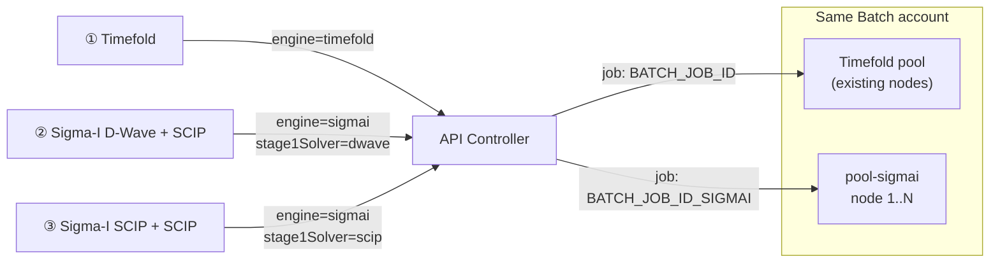
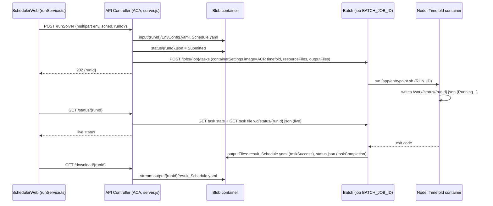
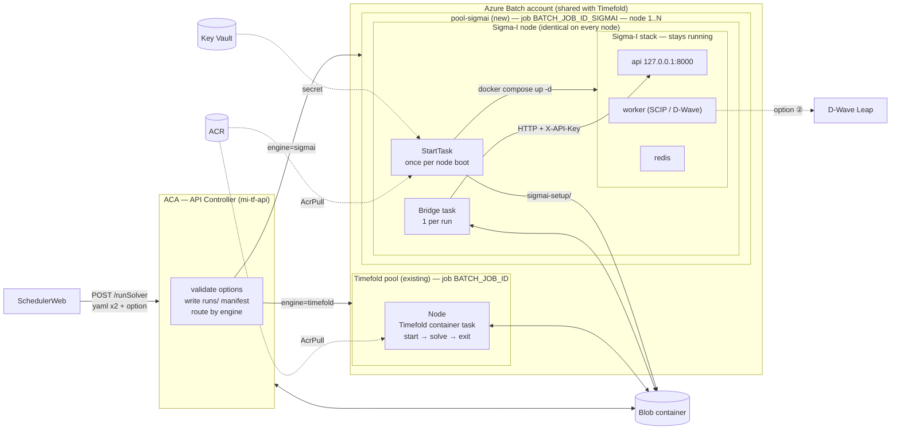
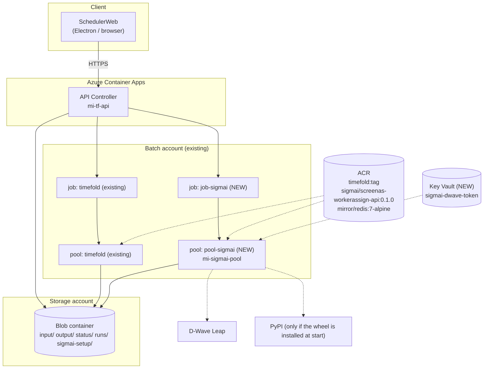
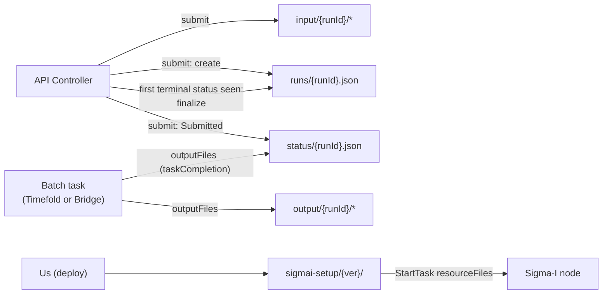
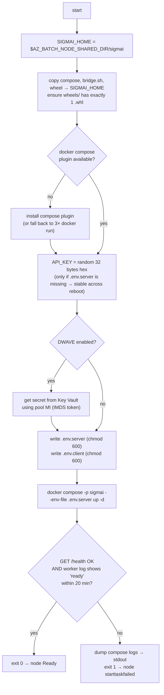
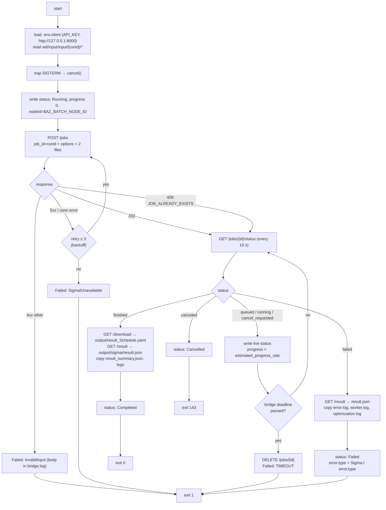
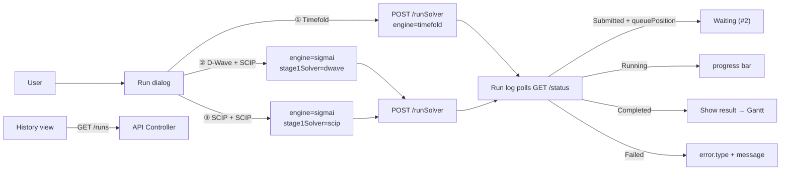
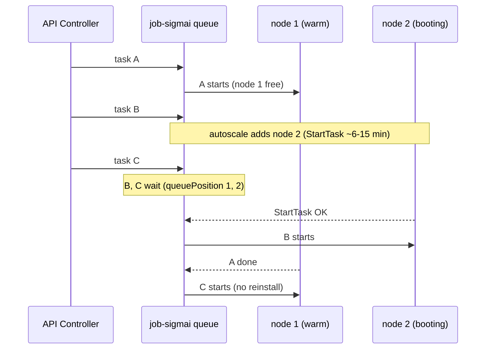
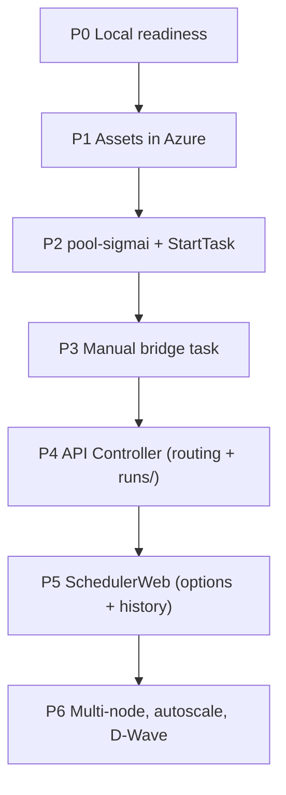

# Sigma-I on Azure — Detailed Design

> Deep version for implementation. Short visual version: [SigmaI_Azure_ImplementationPlan20261013.md](./SigmaI_Azure_ImplementationPlan20261013.md) / [JP](./SigmaI_Azure_ImplementationPlan20261013(JP).md)
>
> Related: [SchedulerWeb/Azure.md](../SchedulerWeb/Azure.md) (Timefold v1 architecture), `api-controller/src/server.js`, Sigma-I delivery `sigmaI/2.Web APIソースコード一式/`.
>
> Status: **draft for review**. Azure CLI commands are intentionally left out. This document fixes *what* to build; the step-by-step `az` guides come later (same style as `Azure-Company-0x`).
>
> Priority: **get Sigma-I running on Azure first.** Batch cost tuning (sharing nodes with Timefold, smarter queueing) is out of scope for v1.

---

## 0. Summary

- SchedulerWeb offers **3 solver options**: ① Timefold, ② Sigma-I D-Wave + SCIP, ③ Sigma-I SCIP + SCIP.
- The **API Controller (ACA)** keeps the same endpoints. It reads `engine` (+ solver fields) and submits the Batch task to the matching **pool** in the **same Batch account** we use for Timefold.
- Sigma-I gets its **own pool (`pool-sigmai`)** with **1..N nodes**. Each node starts the Sigma-I stack (API + worker + Redis) **once** with the pool **StartTask** and keeps it running. The core wheel is installed once per node boot, not once per run.
- Every run is a lightweight **Bridge task** on a Sigma-I node. It:
  1. takes the YAML files from Blob and calls Sigma-I `POST /jobs`,
  2. polls Sigma-I and keeps `status/{runId}.json` up to date (Running / Completed / Failed / Cancelled),
  3. puts the result and the logs in Blob.
- **Queue:** `taskSlotsPerNode = 1`. When all Sigma-I nodes are busy, new runs wait in the Batch job queue (`active`), and the API returns a `queuePosition`.
- **Blob** gains a **run manifest / history** (`runs/{runId}.json`) for **all engines**: solver options, versions, node, timings, final result. It also gets Sigma-I setup files and Sigma-I logs.
- The Timefold **pool and container are not touched**. Only the API Controller changes (routing + manifest).

---

## 1. Solver options

| # | UI label | `engine` | `stage1Solver` | `stage2Solver` | Batch job → pool | External calls |
|---|---|---|---|---|---|---|
| ① | Timefold | `timefold` | — | — | `BATCH_JOB_ID` → Timefold pool (existing) | — |
| ② | Sigma-I: D-Wave + SCIP | `sigmai` | `dwave` | `scip` | `BATCH_JOB_ID_SIGMAI` → `pool-sigmai` | D-Wave Leap (Stage 1) |
| ③ | Sigma-I: SCIP + SCIP | `sigmai` | `scip` | `scip` | `BATCH_JOB_ID_SIGMAI` → `pool-sigmai` | — |

Rules (from the Sigma-I API source, `schemas/requests.py`):
- `stage2Solver` must be `scip`. The Sigma-I API rejects anything else.
- `stage1Solver` ∈ {`scip`, `dwave`}. `dwave` needs `DWAVE_API_TOKEN` on the node.
- Options ② and ③ run on the **same node type**. The solver is just a request field. A separate D-Wave pool (smaller VM, since Stage 1 mostly waits on the network) is a possible later optimization, not v1.



---

## 2. How Timefold works today (baseline)

Source of truth: `documents/SchedulerWeb/Azure.md` and `api-controller/src/server.js`.



Key mechanisms we **reuse** for Sigma-I:

| Mechanism | How Timefold uses it | Sigma-I reuse |
|---|---|---|
| `resourceFiles` with `blobPrefix: input/{runId}/` | Batch downloads the input YAML to the task dir | Same, plus `sigmai_options.json` |
| Live status via the Batch task-file API (`wd/status/{runId}.json`) | API reads the status while the task is running | Same path; the bridge writes it |
| `outputFiles` (`taskSuccess` for the result, `taskCompletion` for status) | Batch uploads them when the task ends | Same, plus the `sigmai/*` logs |
| Batch terminate → SIGTERM → write `Cancelled` | `entrypoint.sh` trap | The bridge trap also calls Sigma-I `DELETE /jobs/{id}` |
| `runId` regex `^[A-Za-z0-9_-]+$` | API validation | **Identical** to the Sigma-I `job_id` pattern → we use `runId` as `job_id` |

---

## 3. What is different about Sigma-I

From the delivery README, `docker-compose.yml` and the API source:

| Topic | Fact | Design impact |
|---|---|---|
| Processes | `redis`, `api` (uvicorn :8000), `worker` (celery) | Needs Docker Compose (or 3× `docker run`) on the node |
| Core logic | `screenas_workerassign_opt-*.whl`, mounted at `/opt/wheels`, **installed when the containers start**; needs internet | Expensive start → **keep the stack warm** |
| Wheel rule | Exactly **one** `.whl` in `wheels/`, otherwise it refuses to start | StartTask must clean the folder |
| Call style | Async HTTP: `POST /jobs` (multipart) → `GET /status` → `GET /result` / `GET /download`; `DELETE` = cancel | The bridge is an HTTP client, not a solver |
| Auth | `X-API-Key` header must match the container env `API_KEY` | Generate it **on the node**; it never leaves the node |
| Time limits | `stage1_timeout`, `stage2_timeout` (default 30 s each); job total limit = the sum | Batch `maxWallClockTime` = sum + margin |
| Other options | `weight_preset` ∈ {standard, daily_balance, worker_balance}; `disabled_constraints` ⊂ {stage2.overtime_limits, stage2.stay_limits, stage2.manager_assignment}; `stage{1,2}_num_solutions_limit` | Pass through |
| D-Wave | `DWAVE_API_TOKEN` env on the server side; outbound to D-Wave Leap | Key Vault + egress |
| Public statuses | `queued`, `running`, `finished`, `failed`, `cancel_requested`, `canceled` | See §9 mapping |
| Error types | `OPTIMIZATION_FAILED`, `STAGE1_FAILED`, `STAGE2_FAILED`, `TIMEOUT`, `CORE_IMPORT_ERROR`, … | Copied into `status.error.type` |
| Artifacts | `data/jobs/<job_id>/` → `logs/error.log`, `logs/worker.log`, `opt_output/optimization.log`, `result_summary.json`, `result_Schedule.yaml` | The bridge uploads the useful ones |
| Restart behaviour | On worker start, orphan recovery marks running jobs failed ("Worker restarted while the job was running.") | A node reboot fails the in-flight run → see §12 |
| Duplicate id | `POST /jobs` with an existing `job_id` → `JOB_ALREADY_EXISTS` | The bridge treats this as "resume polling" (idempotent) |

---

## 4. Target architecture

### 4.1 Block view (ACA → Batch → node)



### 4.2 Azure resources



### 4.3 Why a separate pool in the same Batch account

- **Same account:** reuses the existing Batch account, quota, RBAC (`mi-tf-api` already has Batch Account Contributor) and the Blob auto-storage link. No new Batch account to request.
- **Separate pool, because:**
  - **Different lifecycle.** Timefold nodes run "1 task = 1 container, then exit". Sigma-I nodes keep a long-lived stack. Mixing them means Timefold tasks would also pay for the Sigma-I StartTask, and a Sigma-I run could land on a node without the stack.
  - **Different sizing.** Timefold is tuned for compute-optimized VMs; Sigma-I SCIP sizing is still unknown (Q3).
  - **Different scaling.** Sigma-I wants "keep warm after idle"; Timefold wants "scale to 0 quickly".
  - **Isolation.** A broken Sigma-I StartTask cannot take Timefold down.

### 4.4 Alternatives considered

| Option | Pros | Cons | Verdict |
|---|---|---|---|
| **Same Batch account, new pool + StartTask + bridge task** (proposed) | Same platform; built-in queue; VM SKU choice; Docker Compose works on the VM | StartTask scripting; node cold start | ✅ v1 |
| Run Sigma-I on the Timefold pool nodes | One pool | Every node needs the Sigma-I stack; lifecycles conflict | ❌ (maybe later as a cost optimization) |
| Sigma-I as an always-on Container App | No VMs | Redis/worker as ACA sidecars is awkward; no SKU choice; costs 24/7 | ❌ |
| ACA Job per run | Simple | Pays the install cost on **every** run | ❌ |
| Separate always-on VM | Easiest to debug | No queue, no autoscale, a manual "pet" server | PoC fallback only |

---

## 5. What SchedulerWeb sends

### 5.1 `POST /runSolver` fields

| Field | Type | ① Timefold | ② D-Wave+SCIP | ③ SCIP+SCIP | Validation |
|---|---|---|---|---|---|
| `env` | file | ✔ | ✔ | ✔ | required |
| `sched` | file | ✔ | ✔ | ✔ | required |
| `runId` | string | optional | optional | optional | `^[A-Za-z0-9_-]+$` |
| `label` | string | optional | optional | optional | ≤ 200 chars |
| `originalEnvPath`, `originalSchedPath` | string | optional | optional | optional | stored in the manifest only |
| `engine` | enum | `timefold` (default) | `sigmai` | `sigmai` | `timefold` \| `sigmai` |
| `stage1Solver` | enum | — | `dwave` | `scip` | `scip` \| `dwave`; `dwave` rejected if `SIGMAI_DWAVE_ENABLED=false` |
| `stage2Solver` | enum | — | `scip` | `scip` | must be `scip` |
| `stage1TimeoutSec` | int | — | e.g. 600 | e.g. 1800 | 1 … `SIGMAI_MAX_STAGE_TIMEOUT_SEC` |
| `stage2TimeoutSec` | int | — | e.g. 1800 | e.g. 1800 | same |
| `stage1NumSolutionsLimit`, `stage2NumSolutionsLimit` | int | — | optional | optional | ≥ 1 |
| `weightPreset` | enum | — | optional (`standard`) | optional (`standard`) | standard / daily_balance / worker_balance |
| `disabledConstraints` | JSON array string | — | optional | optional | subset of 3 ids, no duplicates |

Sigma-I fields sent with `engine=timefold` are **rejected (400)**, so a wrong UI state is caught early.

> Sigma-I's own default timeout is only 30 s. Our UI default (e.g. 1800 s) is **to decide** after P0 testing (Q7).

### 5.2 Examples

**① Timefold** (unchanged apart from `engine`):

```text
env=@EnvConfig.yaml  sched=@Schedule.yaml  label="Plan Sep-Nov"  engine=timefold
```

**② Sigma-I D-Wave + SCIP:**

```text
env=@EnvConfig.yaml  sched=@Schedule.yaml  label="Plan Sep-Nov (D-Wave)"
engine=sigmai  stage1Solver=dwave  stage2Solver=scip
stage1TimeoutSec=600  stage2TimeoutSec=1800  weightPreset=standard
```

**③ Sigma-I SCIP + SCIP:**

```text
env=@EnvConfig.yaml  sched=@Schedule.yaml  label="Plan Sep-Nov (SCIP)"
engine=sigmai  stage1Solver=scip  stage2Solver=scip
stage1TimeoutSec=1800  stage2TimeoutSec=1800  weightPreset=standard
```

### 5.3 Field translation chain

| SchedulerWeb (`/runSolver`) | API stores in | Bridge sends to Sigma-I (`POST /jobs`) |
|---|---|---|
| `runId` | everywhere | `job_id` |
| `label` | `runs/{runId}.json` | `scenario_name` |
| `env` | `input/{runId}/EnvConfig.yaml` | `environment` (file, `application/x-yaml`) |
| `sched` | `input/{runId}/Schedule.yaml` | `schedule` (file, `application/x-yaml`) |
| `stage1Solver` / `stage2Solver` | `sigmai_options.json`, manifest | `stage1_solver` / `stage2_solver` |
| `stage1TimeoutSec` / `stage2TimeoutSec` | same | `stage1_timeout` / `stage2_timeout` |
| `stage{1,2}NumSolutionsLimit` | same | `stage{1,2}_num_solutions_limit` |
| `weightPreset` | same | `weight_preset` |
| `disabledConstraints` | same | `disabled_constraints` (JSON string) |

---

## 6. Blob Storage design

### 6.1 Layout (additions in **bold**)

```
<container>/
├── input/{runId}/
│   ├── EnvConfig.yaml                  ← names normalized by the API (today: originalname)
│   ├── Schedule.yaml
│   └── **sigmai_options.json**         ← engine=sigmai only
├── output/{runId}/
│   ├── result_Schedule.yaml            ← same file name for every engine
│   └── **sigmai/**
│       ├── **result.json**             ← Sigma-I GET /jobs/{id}/result
│       ├── **result_summary.json**     ← opt_output/result_summary.json
│       ├── **error.log**               ← logs/error.log (if it exists)
│       ├── **worker.log**
│       ├── **optimization.log**
│       └── **bridge.log**
├── status/{runId}.json                 ← live state; same schema + optional fields
├── **runs/{runId}.json**               ← run manifest / history (ALL engines)
└── **sigmai-setup/{version}/**         ← read-only for nodes, uploaded by us
    ├── **docker-compose.azure.yml**
    ├── **wheels/screenas_workerassign_opt-<ver>.whl**   (exactly one)
    ├── **start-sigmai.sh**             ← StartTask script
    └── **bridge.sh**                   ← Bridge task script
```

### 6.2 Who writes what



### 6.3 `sigmai_options.json`

```json
{
  "engine": "sigmai",
  "stage1Solver": "dwave",
  "stage2Solver": "scip",
  "stage1TimeoutSec": 600,
  "stage2TimeoutSec": 1800,
  "stage1NumSolutionsLimit": null,
  "stage2NumSolutionsLimit": null,
  "weightPreset": "standard",
  "disabledConstraints": [],
  "scenarioName": "Plan Sep-Nov (D-Wave)"
}
```

### 6.4 `runs/{runId}.json` — run manifest / history

Purpose: one permanent record per run, for **every engine**. It answers "who ran what, with which solver and settings, on which version, how long it took, and what came out", even after `input/`, `output/` and `status/` have expired.

```jsonc
{
  "schemaVersion": 1,
  "runId": "20261014_093000123",
  "label": "Plan Sep-Nov (D-Wave)",
  "engine": "sigmai",                         // timefold | sigmai
  "option": "sigmai-dwave-scip",               // timefold | sigmai-dwave-scip | sigmai-scip-scip
  "solver": {                                  // null for timefold
    "stage1": "dwave", "stage2": "scip",
    "stage1TimeoutSec": 600, "stage2TimeoutSec": 1800,
    "stage1NumSolutionsLimit": null, "stage2NumSolutionsLimit": null,
    "weightPreset": "standard", "disabledConstraints": []
  },
  "input": {
    "envFile": "input/20261014_093000123/EnvConfig.yaml",
    "schedFile": "input/20261014_093000123/Schedule.yaml",
    "envSha256": "…", "schedSha256": "…",
    "originalEnvPath": "C:\\…\\EnvConfig.yaml", "originalSchedPath": "…",
    "planRange": { "start": "2025-09-01", "end": "2025-11-14" }   // parsed from Schedule.yaml
  },
  "versions": {
    "apiController": "2.0.0",
    "solverImage": "…azurecr.io/sigmai/screenas-workerassign-api:0.1.0",  // or timefold:tag
    "sigmaiSetup": "0.1.x"                     // sigmai-setup/{version}
  },
  "submittedAt": "2026-10-14T00:30:00Z",
  "submittedBy": null,                         // filled when Entra ID auth is added
  "execution": {                               // from Batch task executionInfo at finalize
    "batchJobId": "job-sigmai", "taskId": "20261014_093000123",
    "poolId": "pool-sigmai", "nodeId": "tvm-…",
    "queuedSec": 95, "startedAt": "…", "finishedAt": "…", "runSec": 1260,
    "attempts": 1
  },
  "result": {
    "status": "Completed",                     // Completed | Failed | Cancelled
    "error": null,                             // { type, message } on failure
    "output": "output/20261014_093000123/result_Schedule.yaml",
    "sigmai": {                                // copy of key fields from result.json
      "validationPassed": true, "finalScore": 123.4,
      "stage1Status": "optimal", "stage2Status": "…",
      "stage1SolveSec": 1.6, "stage2SolveSec": 8.6,
      "kpi": { "makespan": 40, "totalOvertimeHours": null, "totalTravelDays": null }
    }
  },
  "deleted": false                             // true after DELETE /run (history kept) — Q8
}
```

**Lifecycle:**
1. **Create** on `POST /runSolver` (everything up to `submittedAt`).
2. **Finalize** the first time the API sees a terminal status (in `GET /status`, `DELETE /run`, or the optional sweeper §7.6). It adds `execution` (from the Batch task) and `result` (from `status.json` and `output/{runId}/sigmai/result.json`). Finalize is idempotent: skip if `result` is already set.

**Blob index tags** on `runs/{runId}.json` (searchable without a database):

| Tag | Example |
|---|---|
| `engine` | `sigmai` |
| `option` | `sigmai-dwave-scip` |
| `status` | `Completed` |
| `month` | `2026-10` |

Example query: `engine = 'sigmai' AND month = '2026-10' AND status = 'Failed'`.

### 6.5 Retention (lifecycle management rules)

| Prefix | Rule (proposal) |
|---|---|
| `input/`, `output/`, `status/` | delete after 30 days (same as the Timefold plan) |
| `runs/` | cool tier after 90 days; delete after 2 years (Q9) |
| `sigmai-setup/` | manual (keep the versions in use) |

---

## 7. API Controller changes

Endpoints stay the same. Timefold behaviour is unchanged when `engine` is missing, except that **a manifest is now written for Timefold runs too**.

### 7.1 `POST /runSolver`

1. Validate the fields (§5.1).
2. Upload `input/{runId}/EnvConfig.yaml`, `Schedule.yaml` (fixed names).
3. If `engine=sigmai`: upload `input/{runId}/sigmai_options.json`.
4. Write `runs/{runId}.json` (create) + index tags.
5. Write `status/{runId}.json = { status: Submitted, engine, solver }`.
6. Create the Batch task in `BATCH_JOB_ID` (Timefold, unchanged spec) or `BATCH_JOB_ID_SIGMAI` (§8.3).
7. Return `202 { runId, status: "Submitted", engine }`.

If step 6 fails: write `status = Failed (SubmitFailed)`, finalize the manifest, and return 500 (today the status stays `Submitted` forever).

### 7.2 `GET /status/{runId}`

Same as today (blob status → if not terminal, check the Batch task state → read the live file), plus:
- Pick the Batch job id by `engine` from the blob status.
- If the task state is `active`: add `queuePosition` = 1 + the number of `active` tasks created earlier in `job-sigmai`. It is computed with `GET /jobs/job-sigmai/tasks?$filter=state eq 'active'&$select=id,creationTime`.
- If the task is `completed` but no terminal status reached Blob within 2 min → return `Failed` (`BridgeExitedWithoutStatus`).
- On the first terminal status: **finalize** `runs/{runId}.json`.

### 7.3 `GET /download/{runId}`

No change. Optional: `GET /download/{runId}/logs` → stream a zip of `output/{runId}/sigmai/`.

### 7.4 `DELETE /run/{runId}`

Terminate the task and delete `input/`, `output/` and `status/` as today. Then **finalize the manifest** with `Cancelled` (if it was not terminal yet) and set `deleted: true`. The history stays (Q8).

### 7.5 New: `GET /runs` (history list) — optional, P5

```text
GET /runs?engine=sigmai&option=sigmai-dwave-scip&status=Completed&month=2026-10&limit=50
→ 200 [ { runId, label, engine, option, solver, submittedAt, result.status, execution.runSec, … } ]
```

It uses `findBlobsByTags`, then reads the manifests. It lets SchedulerWeb show a shared Azure run history (today it only has the local `runs.json`).

### 7.6 Optional sweeper

A timer (ACA Job, every 15 min) finalizes manifests for runs nobody polled after they finished. Not needed for v1 if SchedulerWeb always polls to the end.

### 7.7 New env vars

| Var | Example | Note |
|---|---|---|
| `BATCH_JOB_ID_SIGMAI` | `job-sigmai` | |
| `SIGMAI_DWAVE_ENABLED` | `false` | Feature flag until Q5 is settled (hides/rejects option ②) |
| `SIGMAI_MAX_STAGE_TIMEOUT_SEC` | `7200` | Guard rail |
| `SIGMAI_WALLCLOCK_MARGIN_SEC` | `900` | Added to the sum of the timeouts |
| `SIGMAI_SETUP_VERSION` | `0.1.x` | Written into the manifest |
| `APP_VERSION` | `2.0.0` | Written into the manifest |

---

## 8. Batch design (`pool-sigmai`)

### 8.1 Pool (illustrative values — confirm in P2)

| Setting | Proposal | Why |
|---|---|---|
| Batch account | **existing** (same as Timefold) | Reuse quota, RBAC, auto-storage |
| VM size | `Standard_D8s_v5` or `Standard_F8s_v2` (8 vCPU) | SCIP is CPU-bound; RAM for 3 containers. **Benchmark** (Q3) |
| Image | Same container-capable Ubuntu image as the Timefold pool (`ubuntu-hpc`, `batch.node.ubuntu 22.04`) | Docker present; proven in Azure-Company-05 |
| Priority | **Dedicated** | Eviction would kill the warm stack and the running solve |
| Nodes | min 0, **max N** (start N = 2) | Concurrency = N runs; cost cap (Q6) |
| `taskSlotsPerNode` | **1** | One Sigma-I run per node; extra runs queue in Batch |
| `taskSchedulingPolicy.nodeFillType` | `Spread` | Use idle warm nodes first |
| Identity | user-assigned `mi-sigmai-pool` (or reuse the Timefold pool MI) | AcrPull, Blob, Key Vault |
| `containerConfiguration.containerImageNames` | Sigma-I image + redis mirror (registry via MI) | Pre-pulled at node allocation |
| Autoscale | §8.4 | |
| vCPU quota | +N × 8 vCPU for the chosen family | Check the Batch account quota (Azure-Company-05 Step 2) |

### 8.2 StartTask (`start-sigmai.sh`)

Runs as **pool-scope admin autoUser**, `waitForSuccess: true`, `maxTaskRetryCount: 2`. Batch schedules no bridge task on the node until it succeeds. **Each node runs it independently** (its own stack, its own API key).

`resourceFiles`: `sigmai-setup/{SIGMAI_SETUP_VERSION}/` → startup dir (via MI).



Notes:
- **Idempotent.** Batch re-runs the StartTask after a node reboot. `up -d` is safe; keep the existing `.env.server`.
- `docker-compose.azure.yml` = the delivered compose with:
  - `image:` pointing at ACR (`<acr>.azurecr.io/sigmai/screenas-workerassign-api:0.1.0`, `<acr>.azurecr.io/mirror/redis:7-alpine`) → no Docker Hub dependency or rate limits.
  - `./data` → `${SIGMAI_HOME}/data` so the bridge can read the artifacts on the host.
  - `restart: unless-stopped` on all 3 services.
  - Port bound to `127.0.0.1:8000` → not reachable from outside the node.
- **Readiness.** `/health` alone may answer before the worker has finished `pip install`. Also check `docker compose logs worker` for `celery@... ready`.

### 8.3 Bridge task (one per run)

Task spec (sketch):

```jsonc
{
  "id": "{runId}",
  "displayName": "sigmai {option} {runId}",
  // host task (no containerSettings): needs 127.0.0.1:8000 and the host data dir
  "commandLine": "/bin/bash -c 'bash $AZ_BATCH_NODE_SHARED_DIR/sigmai/bridge.sh'",
  "userIdentity": { "autoUser": { "scope": "pool", "elevationLevel": "admin" } },
  "environmentSettings": [ { "name": "RUN_ID", "value": "{runId}" } ],
  "constraints": {
    "maxWallClockTime": "PT{stage1+stage2+margin}S",
    "maxTaskRetryCount": 1,
    "retentionTime": "P1D"
  },
  "resourceFiles": [
    { "autoStorageContainerName": "<container>", "blobPrefix": "input/{runId}/", "filePath": "input",
      "identityReference": { "resourceId": "<mi>" } }
  ],
  "outputFiles": [
    { "filePattern": "output/result_Schedule.yaml",
      "destination": { "container": { "containerUrl": "...", "path": "output/{runId}/result_Schedule.yaml", "identityReference": {...} } },
      "uploadOptions": { "uploadCondition": "taskSuccess" } },
    { "filePattern": "output/sigmai/*",
      "destination": { "container": { "containerUrl": "...", "path": "output/{runId}/sigmai", "identityReference": {...} } },
      "uploadOptions": { "uploadCondition": "taskCompletion" } },
    { "filePattern": "status/{runId}.json",
      "destination": { "container": { "containerUrl": "...", "path": "status/{runId}.json", "identityReference": {...} } },
      "uploadOptions": { "uploadCondition": "taskCompletion" } }
  ]
}
```

> The Timefold lesson: with `filePath: "input"` + `blobPrefix: "input/{runId}/"`, the files land in `wd/input/input/{runId}/`. The bridge must read from there.
>
> Wildcard `outputFiles` treat `path` as a **prefix**. Verify the final blob names in P3.

**Bridge algorithm (`bridge.sh`, bash + curl, python3 for JSON):**



`cancel()` (on SIGTERM from a Batch terminate):
1. `DELETE /jobs/{runId}`.
2. Poll up to 45 s for `canceled`.
3. Write `Cancelled` (atomic), copy the logs, `exit 143`.

The terminate grace period must cover these 45 s (the Timefold doc proposes 60 s).

### 8.4 Autoscale (multi-node + keep warm)

Proposed formula (**verify the syntax in P6**; until then use a fixed node count):

```
maxNodes = 2;
lookback = TimeInterval_Minute * 60;
// peak of (active + running) Sigma-I tasks in the last 60 min
peak = max($PendingTasks.GetSample(lookback, 1));
$TargetDedicatedNodes = min(maxNodes, peak);
$TargetLowPriorityNodes = 0;
$NodeDeallocationOption = taskcompletion;
```

- Nodes grow with demand (up to `maxNodes`) and shrink one at a time after 60 min with less load.
- The evaluation interval is at least 5 min → up to 5 min of extra delay before a boot starts.
- **Option B (business hours):** keep `max(1, …)` on weekdays 08:00–20:00 so the first run of the day is fast.

Cold-start budget per node (measure in P2):

| Step | Estimate |
|---|---|
| VM allocation | 3–5 min |
| Image pre-pull from ACR | 1–2 min |
| `pip install` wheel + deps | 2–8 min (unknown) |
| Health / ready | < 1 min |
| **Total first run delay on a cold node** | **~6–15 min** |

If Sigma-i allows a **pre-baked image** (Q1): build `FROM sigmai/screenas-workerassign-api:0.1.0` + install the wheel in our own ACR image. This removes the pip step and the PyPI egress.

---

## 9. Status model

### 9.1 `status/{runId}.json` (superset of the Timefold schema)

```jsonc
{
  "runId": "20261014_093000123",
  "status": "Submitted | Running | Completed | Failed | Cancelled",
  "stage": null,                      // Sigma-I has no public stage1/stage2 progress → null
  "progress": 42,                     // 0–100, from estimated_progress_rate
  "startedAt": "...", "updatedAt": "...", "finishedAt": null,
  "error": { "type": "OPTIMIZATION_FAILED", "message": "Optimization failed.", "stage": "system" },
  "output": "output/{runId}/result_Schedule.yaml",
  // ── new, optional ──
  "engine": "sigmai",
  "option": "sigmai-dwave-scip",
  "queuePosition": 2,                 // only in the GET /status response, never stored
  "nodeId": "tvm-…",
  "solver": { "stage1": "dwave", "stage2": "scip", "stage1TimeoutSec": 600, "stage2TimeoutSec": 1800 },
  "sigmai": {
    "jobStatus": "running",
    "summary": { "validationPassed": false, "finalScore": null, "stage1Status": "optimal", "stage2Status": "chunked" }
  }
}
```

### 9.2 Mapping

| Source | Value | → `status` | Notes |
|---|---|---|---|
| Batch task | `active` | `Submitted` | + `queuePosition` |
| Batch task | `preparing` / `running`, no live file yet | `Submitted` | |
| Sigma-I | `queued` | `Running` | progress 0 |
| Sigma-I | `running` | `Running` | progress = rate |
| Sigma-I | `cancel_requested` | `Running` | UI may show "Cancelling…" |
| Sigma-I | `finished` | `Completed` | after the result file is saved |
| Sigma-I | `failed` | `Failed` | `error.type` copied |
| Sigma-I | `canceled` | `Cancelled` | |
| Bridge | own deadline exceeded | `Failed` | `TIMEOUT` |
| Bridge | cannot reach Sigma-I | `Failed` | `SigmaIUnavailable` |
| API | task completed, no terminal status after 2 min | `Failed` | `BridgeExitedWithoutStatus` |
| API | Batch task create failed | `Failed` | `SubmitFailed` |

> Sigma-I `finished` does not guarantee a usable schedule — check `validation_passed`. Proposal: `finished` + `validation_passed=false` → `Completed` with `sigmai.summary.validationPassed=false` so the UI shows a warning. **To decide (Q10).**

---

## 10. SchedulerWeb changes

| Area | File (today) | Change |
|---|---|---|
| Types | `src/types/index.ts` | `Run.engine`, `Run.option`, `Run.solverOptions`; `RunStatus.queuePosition`, `RunStatus.sigmai` |
| API client | `src/services/runService.ts` | Send `engine` + Sigma-I fields; optional `listRuns()` for `GET /runs` |
| Run store | `src/services/runStore.ts` / `runs.json` | Persist `engine`, `option` and the options per run |
| Run dialog | (where runs are started) | Option picker ①②③ (② hidden if D-Wave is disabled); Stage 1 / 2 time limits; weight preset; advanced: disabled constraints |
| Run log | `src/pages/RunLogPage.tsx` | Engine/option badge; "Waiting (#n)"; `error.type`; warn if `validationPassed=false` |
| History | new view or a tab in the Run log | `GET /runs` filters: engine, option, status, month |
| Settings | `src/pages/SettingsPage.tsx` | Default option and default time limits |
| i18n | `src/config/uiConfig.en.ts`, `uiConfig.ja.ts` | New labels |
| Local mode | `localApi/` | Optional: `engine=sigmai` → local Sigma-I compose at `localhost:8000` |



---

## 11. Multi-node behaviour



- No affinity is needed: any ready node can run any Sigma-I option.
- Each node has its own Redis and data dir, so a run is entirely on one node. The bridge talks only to `127.0.0.1`.
- `runs/{runId}.json.execution.nodeId` records where it ran (useful for debugging).

---

## 12. Failure handling and retries

| Failure | Detected by | Result | Recovery |
|---|---|---|---|
| Invalid YAML / options | Sigma-I 422 | `Failed` (InvalidInput) | User fixes the input |
| Optimization / validation failed | Sigma-I `failed` | `Failed` + logs in Blob | Read `error.log`, `optimization.log` |
| Sigma-I timeout | Sigma-I `failed` (TIMEOUT) | `Failed` | Larger timeouts |
| Bridge deadline | bridge | `Failed` (TIMEOUT) + `DELETE /jobs` | — |
| Batch `maxWallClockTime` | Batch kills the task | API → `Failed` (BridgeExitedWithoutStatus) | Tune the margin |
| Node reboot during a run | worker orphan recovery → `failed` | `Failed` ("Worker restarted…") | Batch retry (1): the bridge POSTs again → the job exists → polls → `Failed`. **Proposal:** on retry, if the existing job failed with the orphan message, re-submit as `{runId}-r1` |
| Node lost / replaced | Batch requeues the task | New node, new Redis → a fresh job | Automatic |
| StartTask fails on a node | node `starttaskfailed` | Tasks go to other nodes, or stay `active` if none | Alert; the API adds a `nodeIssue` hint after N min |
| D-Wave token invalid / no egress | Sigma-I `failed` (STAGE1_FAILED) | `Failed` | Fix Key Vault / network |
| Batch task create fails | API | `Failed` (SubmitFailed) | Retry from the UI |

---

## 13. Security and identities

| Identity | Scope | Roles | Status |
|---|---|---|---|
| `mi-tf-api` (ACA) | Storage account | Storage Blob Data Contributor (also covers `runs/` + index tags) | existing |
| `mi-tf-api` (ACA) | Batch account | Azure Batch Account Contributor (covers the new job/pool) | existing |
| `mi-sigmai-pool` (or reuse `mi-tf-pool`) | ACR | AcrPull | new / existing |
| `mi-sigmai-pool` | Storage account | Storage Blob Data Contributor | new / existing |
| `mi-sigmai-pool` | Key Vault | Key Vault Secrets User (`sigmai-dwave-token` only) | **new** |

> Blob index tag **read/filter** (`findBlobsByTags`) needs `Storage Blob Data Owner`, or a custom role with the `tags/read` + `filter` data actions. Check this when implementing `GET /runs`.

Secrets:
- Sigma-I `API_KEY` — **generated on each node**, stored only in `${SIGMAI_HOME}/.env.*` (chmod 600). Never in Blob, the task env or the API.
- `DWAVE_API_TOKEN` — Key Vault → `.env.server` on the node. Not in pool `environmentSettings` (visible to anyone with Batch read).
- Sigma-I port bound to `127.0.0.1` only.

---

## 14. Networking

| Destination | Why | When |
|---|---|---|
| ACR | pull images | node start |
| Storage (Blob) | resource/output files | always |
| Key Vault | DWAVE token | node start (if option ② is enabled) |
| `pypi.org`, `files.pythonhosted.org` | wheel dependencies | every node start (unless pre-baked) |
| D-Wave Leap endpoints (`*.dwavesys.com`) | Stage 1 `dwave` | option ② runs |
| Docker Hub | **not needed** if redis is mirrored to ACR | — |

If the company puts Batch in a VNet with a firewall or no default outbound, these must be allow-listed (Q4).

---

## 15. Cost (rough — use the Azure Pricing Calculator for our region)

| Item | Driver | Note |
|---|---|---|
| Sigma-I nodes | VM hours × nodes, incl. the 60-min warm tail | 8-vCPU VM ≈ a few tenths of USD/hour; max N caps the worst case |
| D-Wave | Leap plan / QPU time | Separate contract (Q5), option ② only |
| Blob (`runs/`, logs) | small JSON + logs | Negligible; index tags have a small per-tag cost |
| Key Vault | per 10k operations | Negligible |
| API Controller / Timefold | unchanged | |

Spot / low-priority is **not** recommended for `pool-sigmai`.

---

## 16. Observability

- **Bridge:** `output/{runId}/sigmai/bridge.log` + task stdout/stderr.
- **StartTask:** stdout/stderr in the node startup dir; node state `starttaskfailed` → Azure Monitor alert.
- **Sigma-I:** `worker.log`, `error.log`, `optimization.log` per run → Blob.
- **API Controller:** logs the engine, option, runId, Batch job/task and queue position on submit.
- **History:** `runs/` + tags = an audit trail per option (success rate, run time, D-Wave vs SCIP comparison).

---

## 17. Phased plan with exit criteria



| Phase | Work | Exit criteria |
|---|---|---|
| **P0** | Make Sigma-I jobs **succeed locally** with our data for options ③ and ② (`test-001` currently fails: `validation_passed=false`, stage2 `chunked`); ask the questions in §18; measure the start and solve times | A local job `finished` with a valid `result_Schedule.yaml` that opens in the GanttChartEditor |
| **P1** | Push the Sigma-I image + redis mirror to ACR; upload `sigmai-setup/{ver}/`; Key Vault + secret; identity + roles | MI can pull the images and read `sigmai-setup/` |
| **P2** | Create `pool-sigmai` (fixed 1 node) + `job-sigmai` in the **existing** Batch account; `start-sigmai.sh` | Node `idle`, StartTask exit 0, `/health` OK on the node; cold start measured |
| **P3** | `bridge.sh`; submit tasks manually (like Azure-Company-05) | Option ③ run → result + `sigmai/*` + `Completed` in Blob; a 2nd task waits `active`, then runs without reinstall; cancel works queued and running |
| **P4** | API Controller: `engine`/options, `sigmai_options.json`, `runs/` manifest (all engines) + tags, routing, `queuePosition`, finalize | Postman: Timefold regression OK (+ manifest); options ② / ③ end-to-end via the API |
| **P5** | SchedulerWeb option picker, queue display, history (`GET /runs`) | A user picks ①/②/③, sees the queue/progress, opens the result, browses the history |
| **P6** | Fixed N → autoscale formula; alerts; lifecycle rules; enable D-Wave in prod | Nodes scale 0↔N as designed; alert on a StartTask failure |

---

## 18. Open questions

| # | Question | Owner | Blocks |
|---|---|---|---|
| Q1 | Can we pre-install the wheel into a derived image? How does the startup behave if it is already installed? | Sigma-i | P2 (cold start) |
| Q2 | License: may we host the image + wheel in our ACR/Batch? Update process for new wheels? | Sigma-i | P1 |
| Q3 | Recommended CPU/RAM; does SCIP use multiple cores? | Sigma-i | P2 sizing |
| Q4 | Batch node outbound internet (PyPI, D-Wave) allowed? VNet/firewall? | Company IT | P2 |
| Q5 | D-Wave Leap contract, token owner, budget; option ② in v1 or later? | Company | P6 |
| Q6 | Max Sigma-I nodes (N); keep warm in business hours? | Us + Company | P6 |
| Q7 | Default Stage 1 / Stage 2 time limits per option in the UI? | Us | P4/P5 |
| Q8 | On `DELETE /run`: keep the `runs/` history (`deleted: true`) or remove it too? | Us | P4 |
| Q9 | History retention period for `runs/`? | Us + Company | P6 |
| Q10 | `finished` + `validation_passed=false` → Completed with a warning, or Failed? | Us + Sigma-i | P4 |
| Q11 | Why did `test-001` fail (`OPTIMIZATION_FAILED`, stage2 `chunked`)? Any YAML differences between Timefold and Sigma-I? | Us + Sigma-i | **P0** |

---

## 19. Risks

| Risk | Impact | Mitigation |
|---|---|---|
| Our YAML is not fully compatible with Sigma-I | Every run fails | P0 gate; Sigma-i reviews the input |
| `pip install` at start breaks (PyPI change, no egress) | Node never ready | Pre-baked image (Q1); pin the deps; StartTask retry + alert |
| Docker Compose missing on the Batch image | StartTask fails | Install the plugin in the StartTask or use 3× `docker run` |
| Long cold start | Bad UX | Business-hours warm; show "Starting Sigma-I node…" |
| vCPU quota too low for N nodes | Nodes stuck at 0 | Check the quota before P2/P6 |
| Manifest never finalized (nobody polled) | Incomplete history | Finalize on DELETE; optional sweeper (§7.6) |
| Sigma-I version upgrade (new wheel) | Behaviour change | Versioned `sigmai-setup/{ver}/`; `versions` in the manifest; recreate the nodes |
