# Sigma-I Azure 実装計画（概要）

> 図中心の概要版です。詳細版（英語）: [SigmaI_Azure_DetailedDesign20261013.md](./SigmaI_Azure_DetailedDesign20261013.md)
> English: [SigmaI_Azure_ImplementationPlan20261013.md](./SigmaI_Azure_ImplementationPlan20261013.md)

**目的:** SchedulerWeb でソルバーのオプションを選んで実行する。Timefold で使っている Azure 構成（ACA + ACR + Blob + **同じ Batch アカウント**）をそのまま使い、Sigma-I には Batch アカウント内に **専用のプール（ノード群）** を用意する。

---

## 1. ソルバーのオプション

| # | SchedulerWeb のオプション | Stage 1 | Stage 2 | 実行場所 |
|---|---|---|---|---|
| ① | **Timefold** | Timefold | Timefold | Batch → **Timefold プール**（既存） |
| ② | **Sigma-I: D-Wave + SCIP** | D-Wave（量子アニーリング・クラウド） | SCIP | Batch → **Sigma-I プール**（新規） |
| ③ | **Sigma-I: SCIP + SCIP** | SCIP | SCIP | Batch → **Sigma-I プール**（新規） |

> Sigma-I の Stage 2 は常に SCIP（Sigma-I API の仕様で固定）。D-Wave を使えるのは Stage 1 のみ。

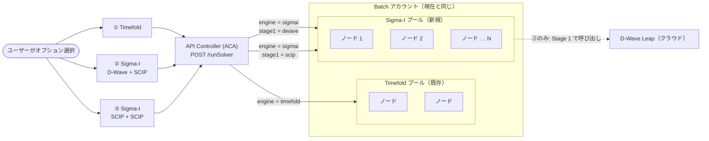

- **Batch アカウントは同じ**、**プールは別**。プールごとにノード・VM サイズ・起動処理が異なる。
- Sigma-I プールのノードは **複数台でもよい**。ノードが多いほど同時に実行できる数が増える。
- ②と③は **同じ Sigma-I ノード** を使う。ソルバーの違いはリクエストのパラメータだけ。

---

## 2. 全体像（ブロック図）

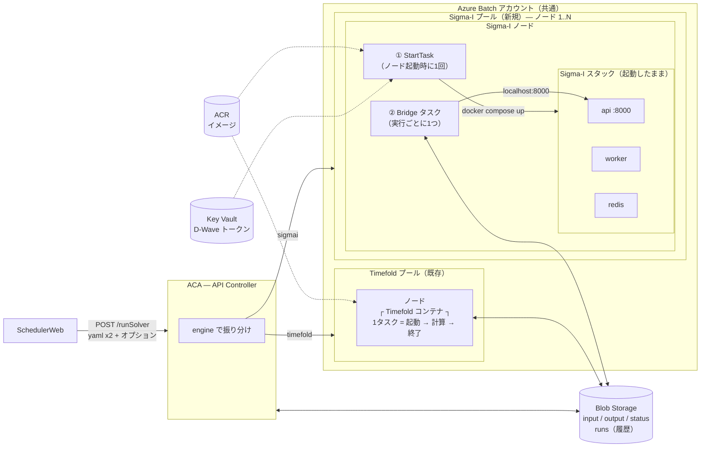

---

## 3. SchedulerWeb が送る内容（オプション別）

3つとも **同じエンドポイント**: `POST /runSolver`（multipart/form-data）。

### ① Timefold — 現在と同じ + `engine`

```text
POST /runSolver
  env              = EnvConfig.yaml        (ファイル)
  sched            = Schedule.yaml         (ファイル)
  label            = "9-11月計画"
  engine           = timefold               ← 新規（省略時の既定値）
```

### ② Sigma-I — D-Wave（Stage 1）+ SCIP（Stage 2）

```text
POST /runSolver
  env              = EnvConfig.yaml        (ファイル)
  sched            = Schedule.yaml         (ファイル)
  label            = "9-11月計画 (D-Wave)"
  engine           = sigmai
  stage1Solver     = dwave
  stage2Solver     = scip
  stage1TimeoutSec = 600
  stage2TimeoutSec = 1800
  weightPreset     = standard              (任意)
```

### ③ Sigma-I — SCIP（Stage 1）+ SCIP（Stage 2）

```text
POST /runSolver
  env              = EnvConfig.yaml        (ファイル)
  sched            = Schedule.yaml         (ファイル)
  label            = "9-11月計画 (SCIP)"
  engine           = sigmai
  stage1Solver     = scip
  stage2Solver     = scip
  stage1TimeoutSec = 1800
  stage2TimeoutSec = 1800
  weightPreset     = standard              (任意)
```

### 各項目の行き先

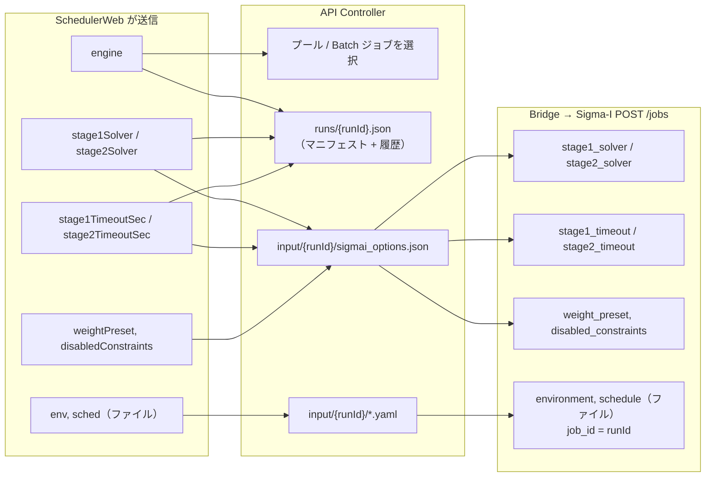

---

## 4. Sigma-I に専用プールが必要な理由

| | Timefold プール | Sigma-I プール |
|---|---|---|
| 実行するもの | コンテナ 1つ | コンテナ 3つ: **API + worker + Redis** |
| 呼び出し方 | コマンド（`entrypoint.sh`） | **HTTP API**（`POST /jobs` → 状態確認 → ダウンロード） |
| 起動コスト | 小（JVM 起動） | **大**: 起動のたびにコアロジック wheel を `pip install` |
| 最適な使い方 | 実行ごとに新規コンテナ | **起動したまま（ウォーム）** で複数回再利用 |
| ノード起動時 | — | **StartTask** が Sigma-I スタックを1回起動 |
| 実行ごと | Timefold コンテナタスク | **Bridge タスク**（小さなスクリプト） |
| シークレット | なし | `API_KEY`（ノード内で生成）、`DWAVE_API_TOKEN`（②のみ） |

---

## 5. Sigma-I ノード1台の中身

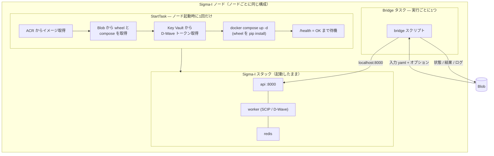

---

## 6. Bridge タスクの3つの役割

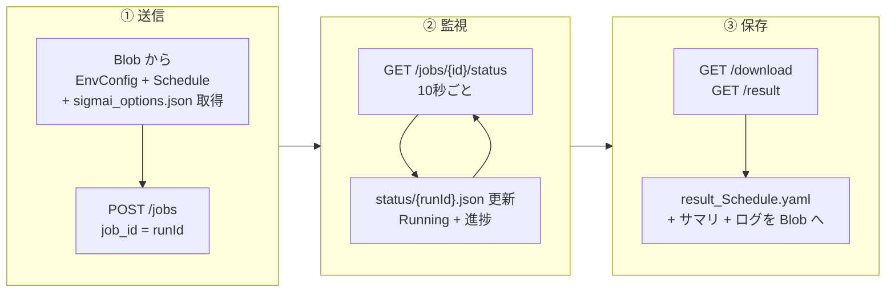

---

## 7. 全体シーケンス（オプション ② / ③）

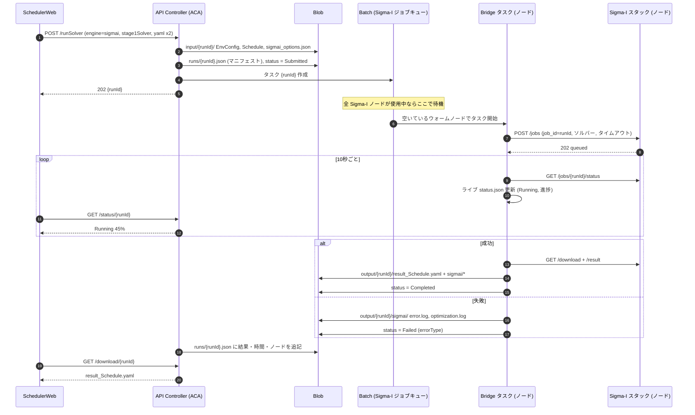

---

## 8. 複数ノードとキュー

```mermaid
gantt
    title Sigma-I プール — ノード2台・1ノード1実行
    dateFormat HH:mm
    axisFormat %H:%M
    section ノード 1
    StartTask (起動 + pip install) :crit, n1s, 09:00, 8m
    実行 A (③ SCIP+SCIP)          :a, after n1s, 30m
    実行 C (② D-Wave+SCIP)        :c, after a, 20m
    section ノード 2
    StartTask (起動 + pip install) :crit, n2s, 09:05, 8m
    実行 B (③ SCIP+SCIP)          :b, after n2s, 30m
    section Batch キュー
    実行 C 待機                    :done, cw, 09:15, 23m
```

- 1ノード = 同時に1実行（`taskSlotsPerNode = 1`）。
- ノード数より実行が多い場合、余った実行は **Batch キューで待機**。SchedulerWeb では **Submitted（待ち #n）** と表示。
- 各ノードはスタックを **1回だけ起動** するので、同じノードでの2回目以降の実行はインストール不要。

---

## 9. 実行ステータス（SchedulerWeb の表示）

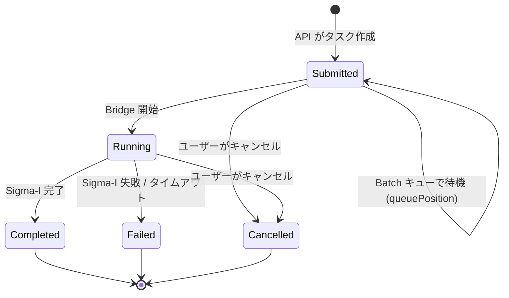

| Sigma-I の状態 | → SchedulerWeb の状態 |
|---|---|
| *（Batch タスク待機中）* | `Submitted` + `queuePosition` |
| `queued`、`running`、`cancel_requested` | `Running` |
| `finished` | `Completed` |
| `failed` | `Failed`（+ `errorType`） |
| `canceled` | `Cancelled` |

Timefold と同じ5状態なので、UI の変更はわずか。

---

## 10. キャンセル

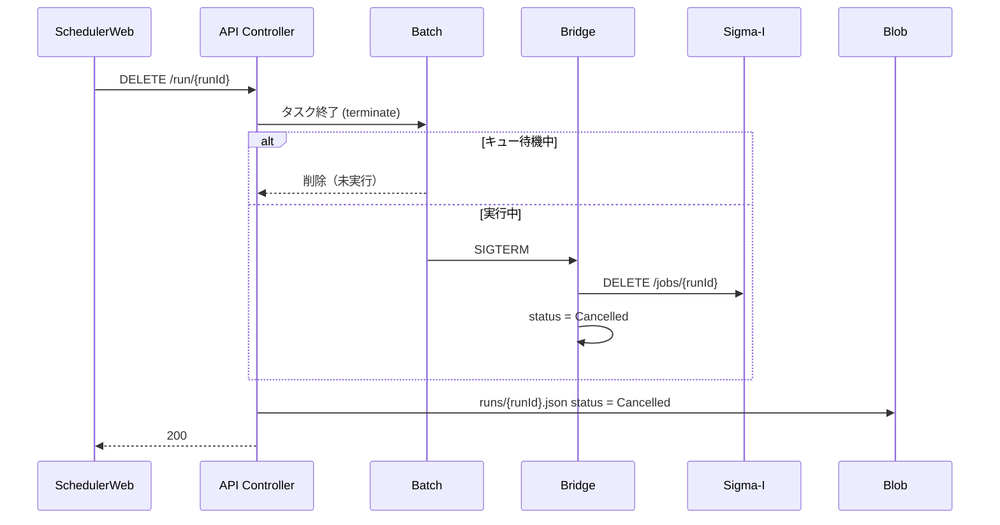

---

## 11. Blob Storage — 保存するもの

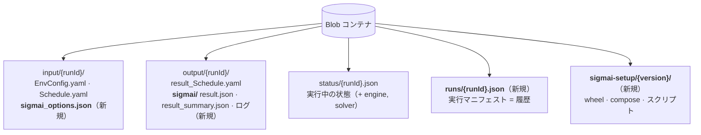

| プレフィックス | 内容 | 書き込み元 | 保存期間 |
|---|---|---|---|
| `input/{runId}/` | 入力 YAML + Sigma-I オプション | API | 30日 |
| `output/{runId}/` | 結果 YAML + Sigma-I サマリ / ログ | Batch タスク | 30日 |
| `status/{runId}.json` | 実行中のライブ状態 | API → タスク | 30日 |
| **`runs/{runId}.json`** | **誰が・いつ・どのソルバー・設定・バージョン・ノード・所要時間・最終結果** | API（作成 + 完了時に確定） | **長期（履歴）** |
| **`sigmai-setup/{ver}/`** | Sigma-I wheel、compose、StartTask / bridge スクリプト | 自チーム（デプロイ時） | バージョンごと |

`runs/{runId}.json`（簡単な例）:

```json
{
  "runId": "20261014_093000123",
  "label": "9-11月計画 (D-Wave)",
  "engine": "sigmai",
  "solver": { "stage1": "dwave", "stage2": "scip", "stage1TimeoutSec": 600, "stage2TimeoutSec": 1800, "weightPreset": "standard" },
  "versions": { "sigmaiImage": "0.1.0", "sigmaiWheel": "0.1.x", "apiController": "v2" },
  "submittedAt": "2026-10-14T00:30:00Z",
  "execution": { "pool": "pool-sigmai", "node": "tvm-…-1", "queuedSec": 95, "runSec": 1260 },
  "result": { "status": "Completed", "validationPassed": true, "finalScore": 123.4 }
}
```

履歴には **Blob インデックスタグ**（`engine`、`status`、`month`）を付ける。これで「10月の D-Wave 実行一覧」などをデータベースなしで検索できる。

---

## 12. Sigma-I ノードのライフサイクル

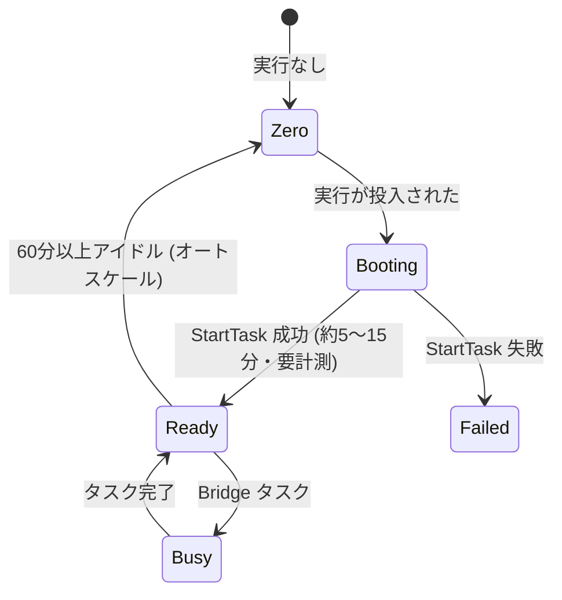

オートスケール: ノード数 = 待機中 + 実行中の Sigma-I 実行数（上限 N）。各ノードは最後の実行から60分間ウォームを維持する。

---

## 13. 変更点

| コンポーネント | 変更内容 | 規模 |
|---|---|---|
| **SchedulerWeb** | オプション選択（①②③）、時間上限、待ち順表示、実行一覧・履歴にエンジン表示 | 小 |
| **API Controller** | `engine` 振り分け、オプション検証、`sigmai_options.json`、`runs/` マニフェスト（全エンジン）、待ち順、任意で `GET /runs` | 中 |
| **Blob** | 新プレフィックス `runs/`、`sigmai-setup/`、`output/{runId}/sigmai/`、インデックスタグ、ライフサイクルルール | 小 |
| **ACR** | Sigma-I API イメージ + `redis:7-alpine` のコピーを登録 | 極小 |
| **Key Vault** | `DWAVE_API_TOKEN`（オプション②） | 極小 |
| **Batch** | 新規 **Sigma-I プール** + ジョブ + StartTask + bridge スクリプト（同じ Batch アカウント） | **大** |
| **Timefold プール / コンテナ** | **変更なし** | — |

---

## 14. ロードマップ

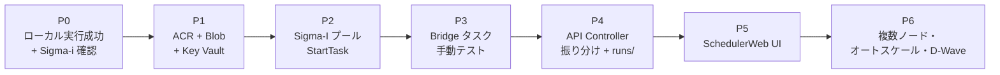

⚠ **P0 の前提:** ローカルテスト `test-001` は `OPTIMIZATION_FAILED`（`validation_passed: false`）で終了した。先に Sigma-i と原因を解決する。入力やモデルの問題は Azure では解決しない。

まずは **Azure 上で動かすこと** を優先する。Batch のコスト最適化（Timefold とのノード共有、高度なキュー制御）は後で検討する。

---

## 15. 確認事項（Sigma-i / 社内 IT）

| # | 質問 | 確認先 |
|---|---|---|
| 1 | wheel を **イメージに事前インストール** して、毎回の pip を省略できるか？ | Sigma-i |
| 2 | イメージ + wheel を自社 Azure で動かしてよいか？ | Sigma-i |
| 3 | SCIP 用の推奨 VM サイズ（CPU / メモリ）は？ | Sigma-i |
| 4 | Batch ノードからのインターネット接続（PyPI、D-Wave）は可能か？ | 社内 IT |
| 5 | D-Wave Leap の契約 / トークン管理者 / 費用は？ | 社内 |
| 6 | Sigma-I ノードの最大台数（コスト上限）は？ 業務時間中はウォームを維持するか？ | 自チーム + 社内 |
| 7 | 実行履歴（`runs/`）の保存期間は？ | 自チーム + 社内 |
