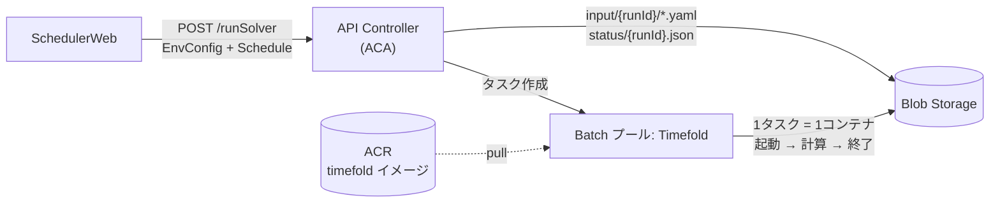
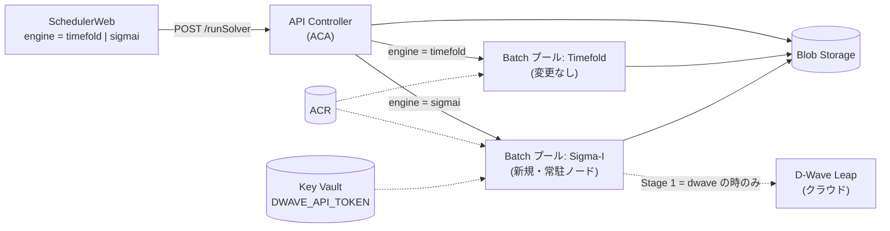
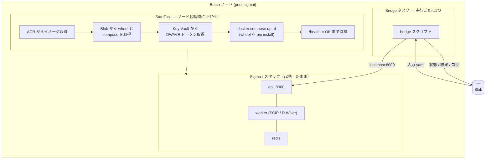
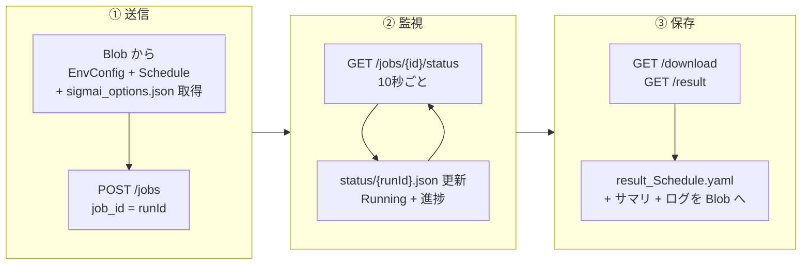
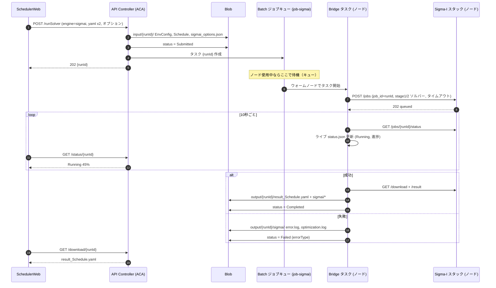
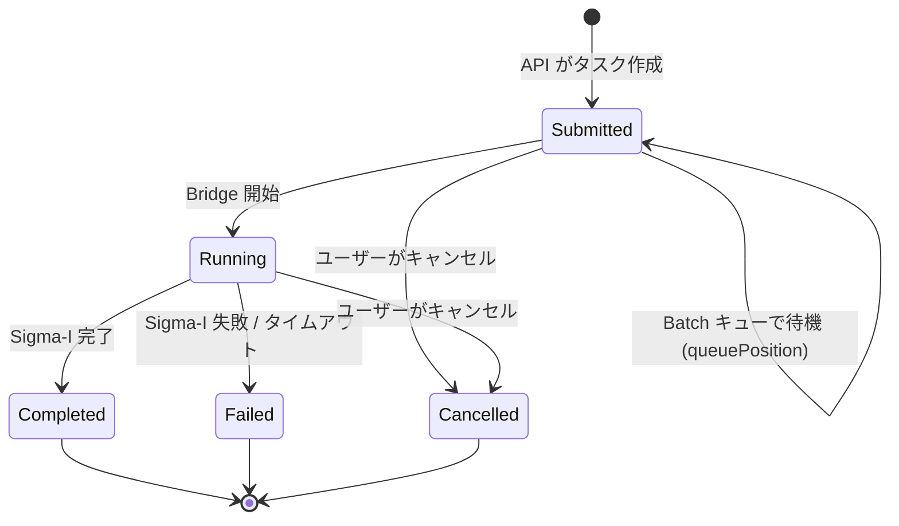
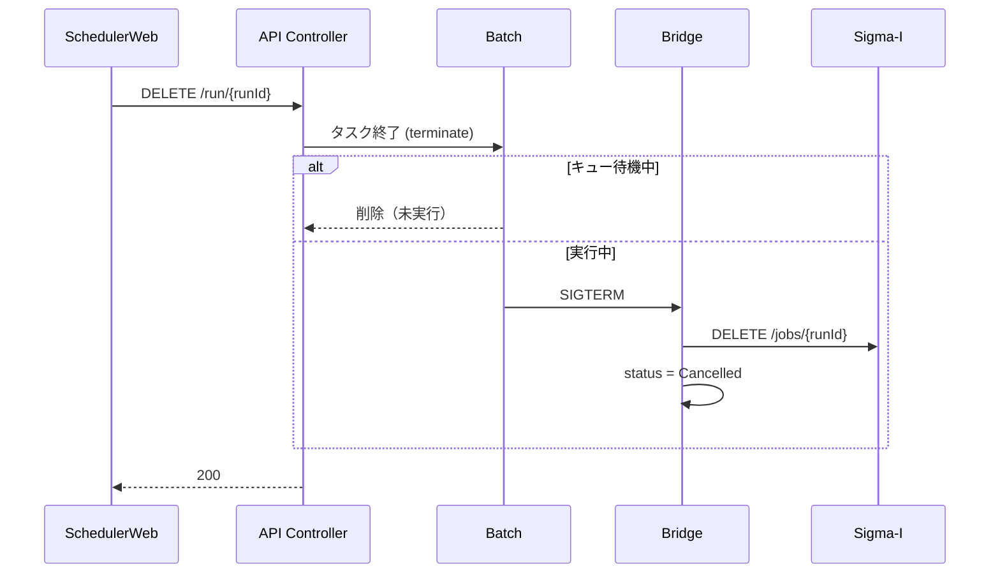
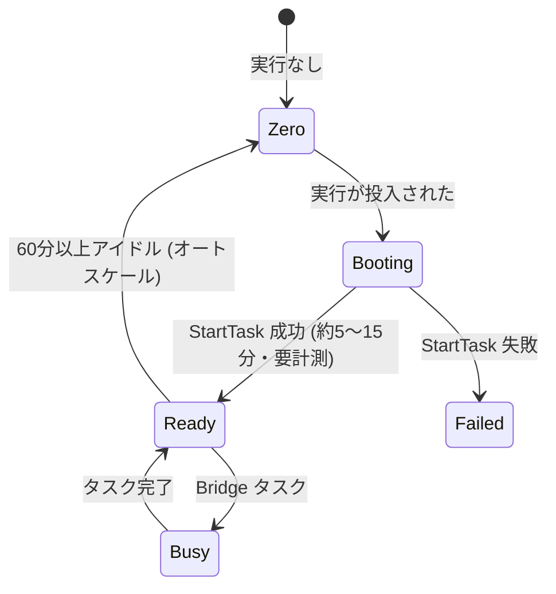
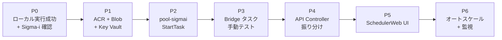

# Sigma-I Azure 実装計画（概要）

> 図中心の概要版です。詳細版（英語）: [SigmaI_Azure_DetailedDesign20261013.md](./SigmaI_Azure_DetailedDesign20261013.md)
> English: [SigmaI_Azure_ImplementationPlan20261013.md](./SigmaI_Azure_ImplementationPlan20261013.md)

**目的:** SchedulerWeb から **Timefold** と **Sigma-I（SCIP / D-Wave）** を選んで実行できるようにする。Timefold で使っている Azure 構成（ACA + ACR + Blob + Batch）をそのまま活用する。

---

## 1. 現在と目標

### 現在 — Timefold のみ

### 目標 — Timefold + Sigma-I

---

## 2. Sigma-I で Batch 構成を変える理由

| | Timefold | Sigma-I |
|---|---|---|
| 実行するもの | コンテナ 1つ | コンテナ 3つ: **API + worker + Redis** |
| 呼び出し方 | コマンド（`entrypoint.sh`） | **HTTP API**（`POST /jobs` → 状態確認 → ダウンロード） |
| 起動コスト | 小（JVM 起動） | **大** — 起動のたびにコアロジック wheel を `pip install` |
| 最適な使い方 | 実行ごとに新規コンテナ | **起動したまま（ウォーム）** で複数回再利用 |
| ソルバー | Timefold | Stage 1: `scip` / `dwave`、Stage 2: `scip` のみ |
| シークレット | なし | `API_KEY`（ノード内）、`DWAVE_API_TOKEN`（D-Wave 利用時のみ） |

➡ **ポイント:** Sigma-I スタックは **ノードごとに1回だけ起動**（Batch *StartTask*）。各実行は小さな **Bridge タスク** が Sigma-I API を呼び出す。

---

## 3. Sigma-I Batch ノードの中身

---

## 4. Bridge タスクの3つの役割

---

## 5. 全体シーケンス

---

## 6. キュー — 同じノードで順番待ち

```mermaid
gantt
    title pool-sigmai — ノード1台・タスクスロット1
    dateFormat HH:mm
    axisFormat %H:%M
    section ノード
    StartTask (起動 + pip install)   :crit, s0, 09:00, 8m
    section 実行
    実行 A (SCIP)                    :a, after s0, 30m
    実行 B (Batch キューで待機)       :done, bq, 09:10, 28m
    実行 B (SCIP)                    :b, after a, 30m
    実行 C (Stage 1 = D-Wave)        :c, after b, 20m
    section ノード
    アイドル保持 → 0台へ縮小          :idle, after c, 30m
```

- Batch の **ジョブキュー** をそのままキューとして使う。`taskSlotsPerNode = 1` → 同時実行は1つ。
- 待機中の実行は SchedulerWeb で **Submitted（待ち #2）** と表示。
- スタックは **1回だけ起動** → 実行 B・C は **インストール時間なし**。

---

## 7. 実行ステータス（SchedulerWeb の表示）

| Sigma-I の状態 | → SchedulerWeb の状態 |
|---|---|
| *（Batch タスク待機中）* | `Submitted` + `queuePosition` |
| `queued`、`running`、`cancel_requested` | `Running` |
| `finished` | `Completed` |
| `failed` | `Failed`（+ `errorType`） |
| `canceled` | `Cancelled` |

Timefold と同じ5状態 → **UI 変更は最小限**。

---

## 8. キャンセル

---

## 9. ノードのライフサイクル（ウォーム維持）

---

## 10. コンポーネントごとの変更

| コンポーネント | 変更内容 | 規模 |
|---|---|---|
| **SchedulerWeb** | エンジン選択 + Sigma-I オプション + 待ち順表示 | 小 |
| **API Controller** | `engine` 項目、`job-sigmai` への振り分け、待ち順、`sigmai_options.json` 保存 | 中 |
| **Blob** | `sigmai-setup/` と `output/{runId}/sigmai/` を追加 | 極小 |
| **ACR** | Sigma-I API イメージ + `redis:7-alpine` を登録 | 極小 |
| **Key Vault** | `DWAVE_API_TOKEN` シークレット | 極小 |
| **Batch** | 新規 `pool-sigmai` + `job-sigmai` + StartTask + bridge スクリプト | **大** |
| **Timefold 側** | **変更なし** | — |

---

## 11. ロードマップ

⚠ **P0 の前提:** ローカルテスト `test-001` は `OPTIMIZATION_FAILED`（`validation_passed: false`）で終了。先に Sigma-i と原因を解決する — 入力やモデルの問題は Azure では解決しない。

---

## 12. 確認事項（Sigma-i / 社内 IT）

| # | 質問 | 確認先 |
|---|---|---|
| 1 | wheel を **イメージに事前インストール** して、毎回の pip を省略できるか？ | Sigma-i |
| 2 | イメージ + wheel を自社 Azure で動かしてよいか？ | Sigma-i |
| 3 | SCIP 用の推奨 VM サイズ（CPU / メモリ）は？ | Sigma-i |
| 4 | Batch ノードからのインターネット接続（PyPI、D-Wave）は可能か？ | 社内 IT |
| 5 | D-Wave Leap の契約 / トークン管理者 / 費用は？ | 社内 |
| 6 | 業務時間中は常時ウォームにするか、アイドル時間で停止のみか？ | 自チーム + 社内 |
