# Sigma-I on Azure — Implementation Plan (Overview)

> Visual summary. Deep version: [SigmaI_Azure_DetailedDesign20261013.md](./SigmaI_Azure_DetailedDesign20261013.md)
> 日本語版: [SigmaI_Azure_ImplementationPlan20261013(JP).md](./SigmaI_Azure_ImplementationPlan20261013(JP).md)

**Goal:** In SchedulerWeb the user picks a solver option. The run uses the same Azure stack we already have for Timefold (ACA + ACR + Blob + **the same Batch account**). Sigma-I gets **its own pool of nodes** inside that Batch account.

---

## 1. Solver options

| # | Option in SchedulerWeb | Stage 1 | Stage 2 | Where it runs |
|---|---|---|---|---|
| ① | **Timefold** | Timefold | Timefold | Batch → **Timefold pool** (existing) |
| ② | **Sigma-I: D-Wave + SCIP** | D-Wave (quantum annealing, cloud) | SCIP | Batch → **Sigma-I pool** (new) |
| ③ | **Sigma-I: SCIP + SCIP** | SCIP | SCIP | Batch → **Sigma-I pool** (new) |

> Sigma-I Stage 2 is always SCIP (fixed by the Sigma-I API). D-Wave can only be used in Stage 1.

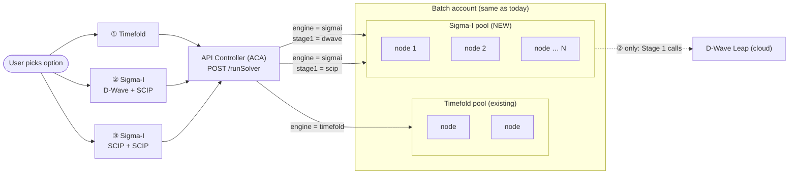

- **Same Batch account**, **different pools**: each pool has its own nodes, VM size and startup.
- The Sigma-I pool can have **more than one node**. More nodes = more runs at the same time. Adding nodes is fine.
- Options ② and ③ use the **same Sigma-I node type**. The solver choice is only a parameter of the request.

---

## 2. Big picture — blocks

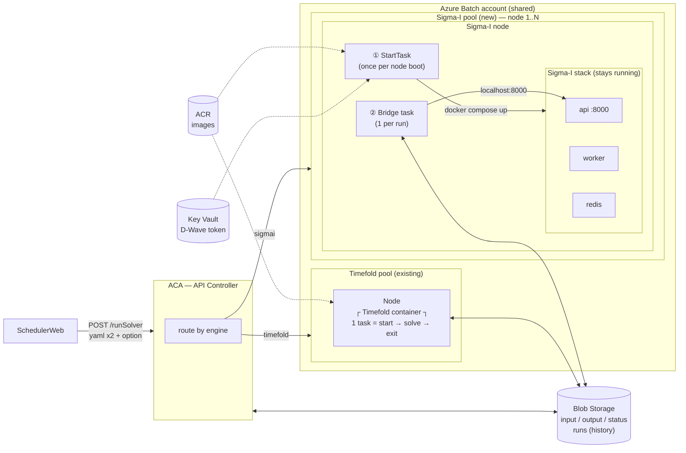

---

## 3. What SchedulerWeb sends (per option)

All three use the **same endpoint**: `POST /runSolver` (multipart/form-data).

### ① Timefold — same as today, plus `engine`

```text
POST /runSolver
  env              = EnvConfig.yaml        (file)
  sched            = Schedule.yaml         (file)
  label            = "Plan Sep-Nov"
  engine           = timefold               ← new (default if missing)
```

### ② Sigma-I — D-Wave (Stage 1) + SCIP (Stage 2)

```text
POST /runSolver
  env              = EnvConfig.yaml        (file)
  sched            = Schedule.yaml         (file)
  label            = "Plan Sep-Nov (D-Wave)"
  engine           = sigmai
  stage1Solver     = dwave
  stage2Solver     = scip
  stage1TimeoutSec = 600
  stage2TimeoutSec = 1800
  weightPreset     = standard              (optional)
```

### ③ Sigma-I — SCIP (Stage 1) + SCIP (Stage 2)

```text
POST /runSolver
  env              = EnvConfig.yaml        (file)
  sched            = Schedule.yaml         (file)
  label            = "Plan Sep-Nov (SCIP)"
  engine           = sigmai
  stage1Solver     = scip
  stage2Solver     = scip
  stage1TimeoutSec = 1800
  stage2TimeoutSec = 1800
  weightPreset     = standard              (optional)
```

### What happens to the fields

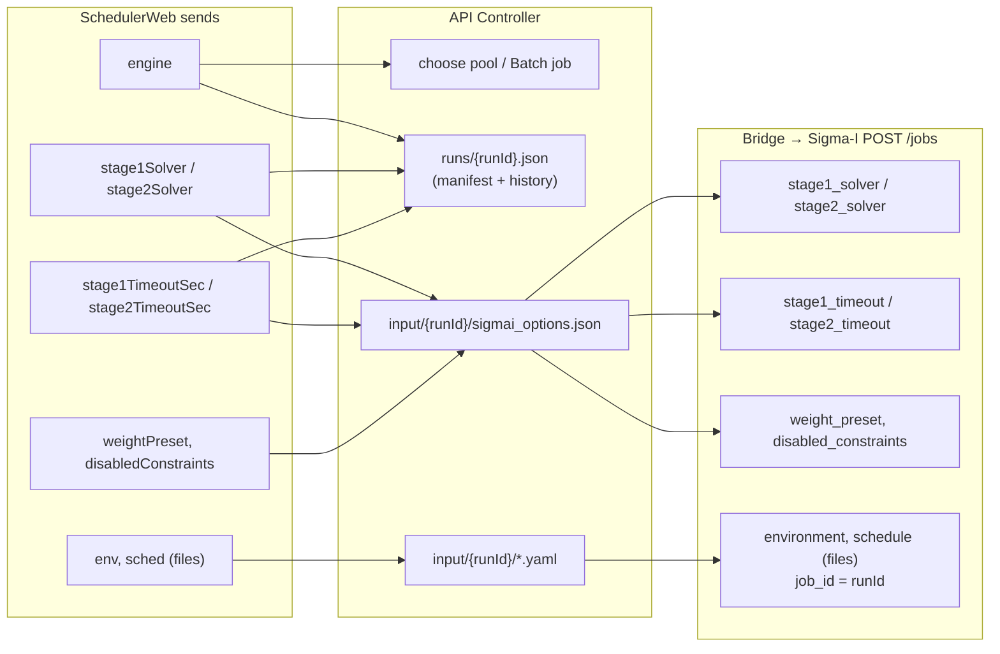

---

## 4. Why Sigma-I needs its own pool

| | Timefold pool | Sigma-I pool |
|---|---|---|
| What runs | 1 container | 3 containers: **API + worker + Redis** |
| How you call it | Command line (`entrypoint.sh`) | **HTTP API** (`POST /jobs` → poll → download) |
| Startup cost | Small (JVM start) | **Large**: installs the core wheel (`pip`) at every start |
| Best lifecycle | New container per run | **Keep running (warm)** and reuse for many runs |
| Node startup | — | **StartTask** brings the Sigma-I stack up once |
| Per run | Timefold container task | **Bridge task** (small script) |
| Secrets | none | `API_KEY` (made on the node), `DWAVE_API_TOKEN` (option ② only) |

---

## 5. Inside one Sigma-I node

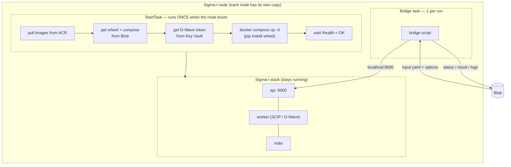

---

## 6. The Bridge task — 3 jobs

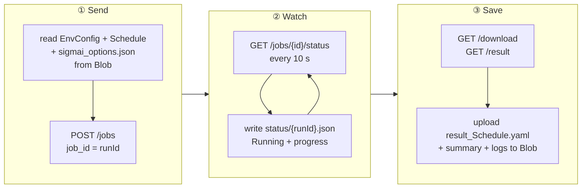

---

## 7. End-to-end sequence (option ② or ③)

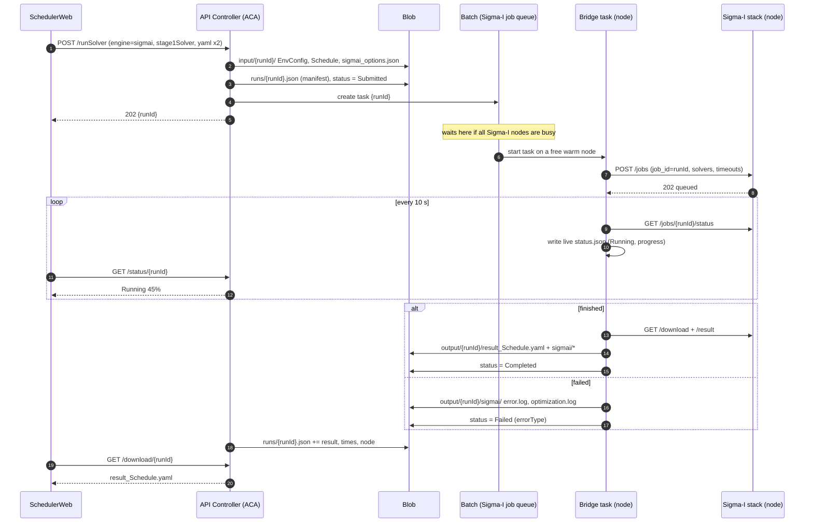

---

## 8. Several nodes and the queue

```mermaid
gantt
    title Sigma-I pool — 2 nodes, 1 run per node
    dateFormat HH:mm
    axisFormat %H:%M
    section Node 1
    StartTask (boot + pip install) :crit, n1s, 09:00, 8m
    run A (③ SCIP+SCIP)            :a, after n1s, 30m
    run C (② D-Wave+SCIP)          :c, after a, 20m
    section Node 2
    StartTask (boot + pip install) :crit, n2s, 09:05, 8m
    run B (③ SCIP+SCIP)            :b, after n2s, 30m
    section Batch queue
    run C waiting                  :done, cw, 09:15, 23m
```

- 1 node = 1 run at a time (`taskSlotsPerNode = 1`).
- More runs than nodes → the extra runs **wait in the Batch queue**. SchedulerWeb shows **Submitted (queue #n)**.
- Each node starts its stack **once**, so later runs on the same node skip the install.

---

## 9. Run status (what SchedulerWeb sees)

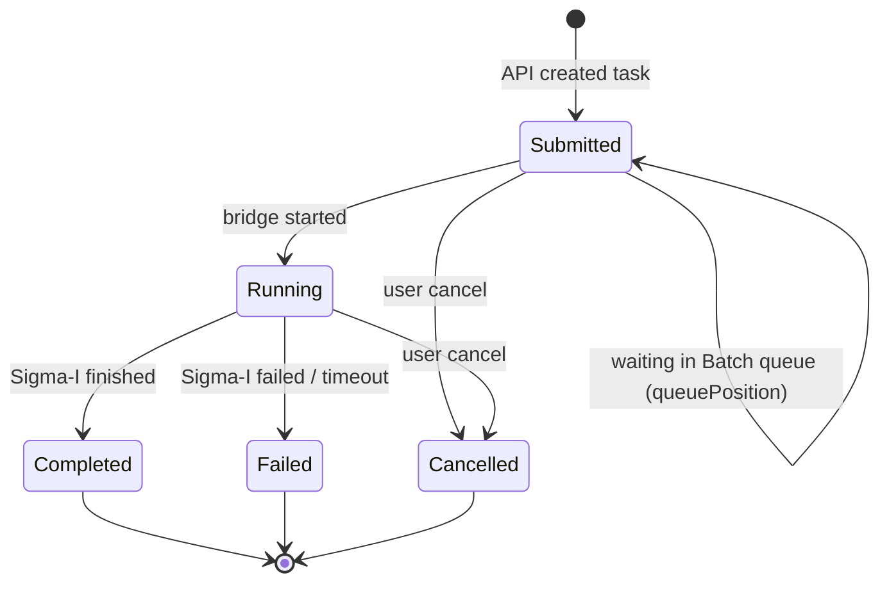

| Sigma-I status | → SchedulerWeb status |
|---|---|
| *(Batch task waiting)* | `Submitted` + `queuePosition` |
| `queued`, `running`, `cancel_requested` | `Running` |
| `finished` | `Completed` |
| `failed` | `Failed` (+ `errorType`) |
| `canceled` | `Cancelled` |

These are the same 5 states as Timefold, so the UI changes very little.

---

## 10. Cancel

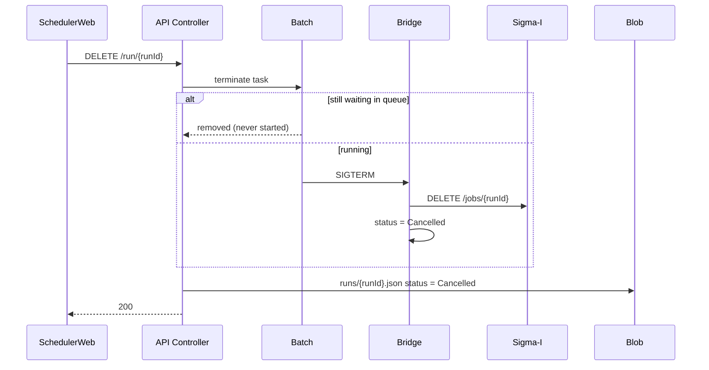

---

## 11. Blob Storage — what we store

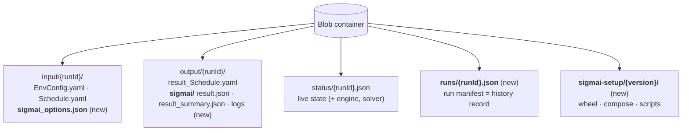

| Prefix | What | Written by | Kept |
|---|---|---|---|
| `input/{runId}/` | input YAML + Sigma-I options | API | 30 days |
| `output/{runId}/` | result YAML + Sigma-I summary/logs | Batch task | 30 days |
| `status/{runId}.json` | live state while running | API → task | 30 days |
| **`runs/{runId}.json`** | **who / when / which solver / settings / versions / node / durations / final result** | API (create + finalize) | **long term (history)** |
| **`sigmai-setup/{ver}/`** | Sigma-I wheel, compose, StartTask + bridge scripts | us (deploy) | per version |

`runs/{runId}.json` (short example):

```json
{
  "runId": "20261014_093000123",
  "label": "Plan Sep-Nov (D-Wave)",
  "engine": "sigmai",
  "solver": { "stage1": "dwave", "stage2": "scip", "stage1TimeoutSec": 600, "stage2TimeoutSec": 1800, "weightPreset": "standard" },
  "versions": { "sigmaiImage": "0.1.0", "sigmaiWheel": "0.1.x", "apiController": "v2" },
  "submittedAt": "2026-10-14T00:30:00Z",
  "execution": { "pool": "pool-sigmai", "node": "tvm-…-1", "queuedSec": 95, "runSec": 1260 },
  "result": { "status": "Completed", "validationPassed": true, "finalScore": 123.4 }
}
```

The history uses **Blob index tags** (`engine`, `status`, `month`), so we can filter "all D-Wave runs in October" without a database.

---

## 12. Sigma-I node lifecycle

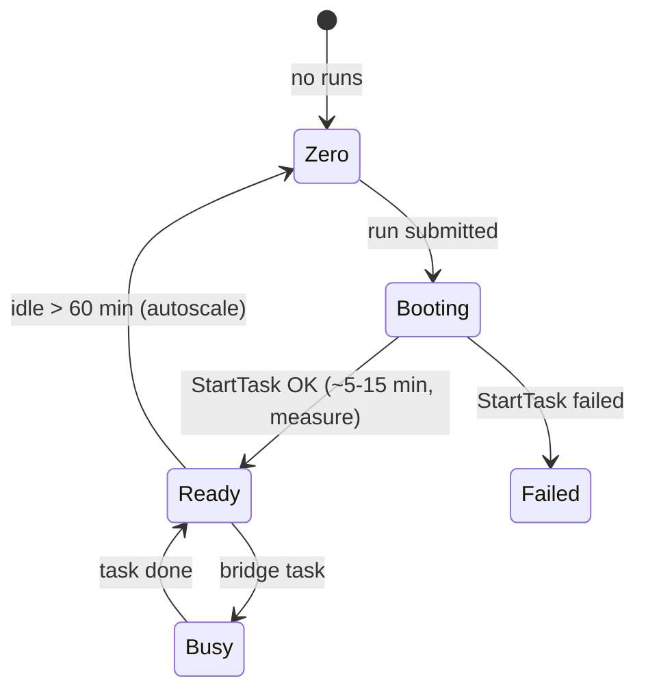

Autoscale: number of nodes = number of waiting + running Sigma-I runs (max N). Each node stays warm for 60 min after its last run.

---

## 13. What changes

| Component | Change | Size |
|---|---|---|
| **SchedulerWeb** | option picker (①②③), time limits, queue display, engine in run list/history | S |
| **API Controller** | `engine` routing, option validation, `sigmai_options.json`, `runs/` manifest (all engines), queue position, optional `GET /runs` | M |
| **Blob** | new prefixes `runs/`, `sigmai-setup/`, `output/{runId}/sigmai/`; index tags; lifecycle rules | S |
| **ACR** | add the Sigma-I API image + a `redis:7-alpine` copy | XS |
| **Key Vault** | `DWAVE_API_TOKEN` (option ②) | XS |
| **Batch** | new **Sigma-I pool** + job + StartTask + bridge script (same Batch account) | **L** |
| **Timefold pool / container** | **no change** | — |

---

## 14. Roadmap

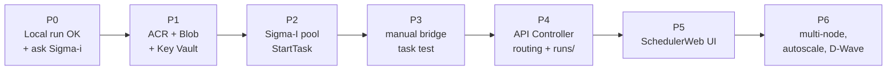

⚠ **P0 blocker:** the local test `test-001` ended with `OPTIMIZATION_FAILED` (`validation_passed: false`). Fix this with Sigma-i first. Azure will not fix input or model problems.

Focus is **running on Azure first**. Batch cost tuning (sharing nodes with Timefold, smarter queueing) comes later.

---

## 15. Open questions (for Sigma-i / company IT)

| # | Question | Who |
|---|---|---|
| 1 | Can the wheel be **pre-installed in the image** (skip pip at every start)? | Sigma-i |
| 2 | Are we allowed to run the image + wheel on our Azure? | Sigma-i |
| 3 | Recommended VM size (CPU / RAM) for SCIP? | Sigma-i |
| 4 | Outbound internet from Batch nodes (PyPI, D-Wave)? | Company IT |
| 5 | D-Wave Leap plan / token owner / cost? | Company |
| 6 | How many Sigma-I nodes at most (cost cap)? Keep warm in business hours? | Us + Company |
| 7 | How long to keep run history (`runs/`)? | Us + Company |
