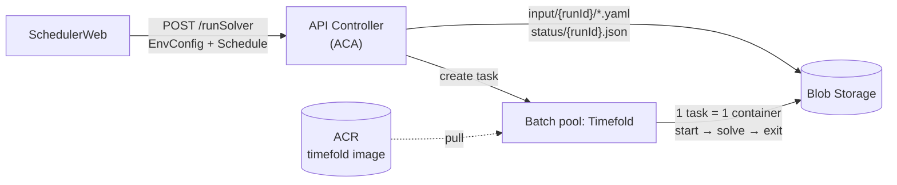
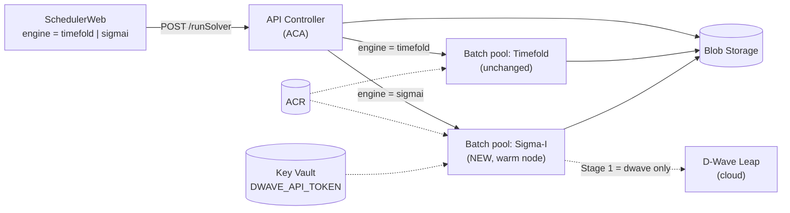
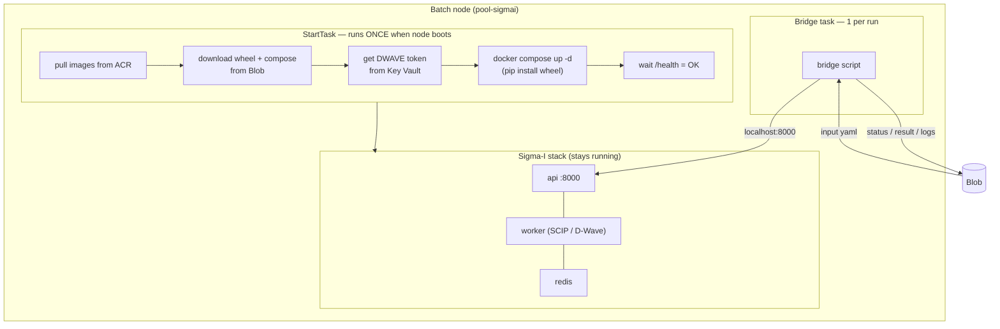
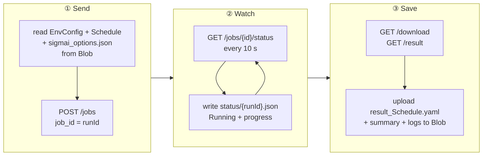
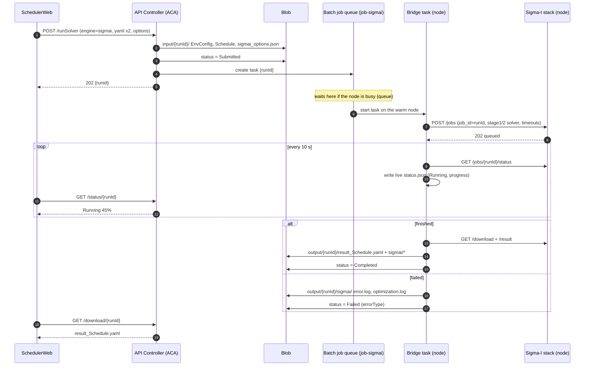
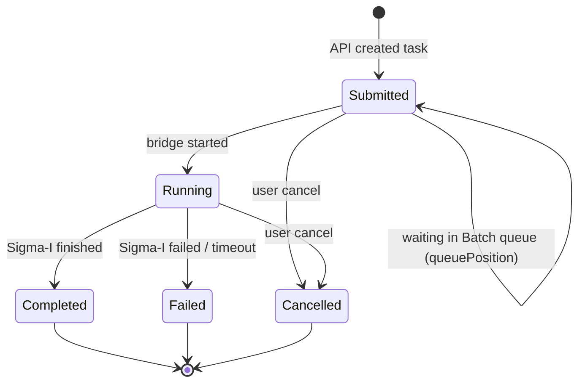
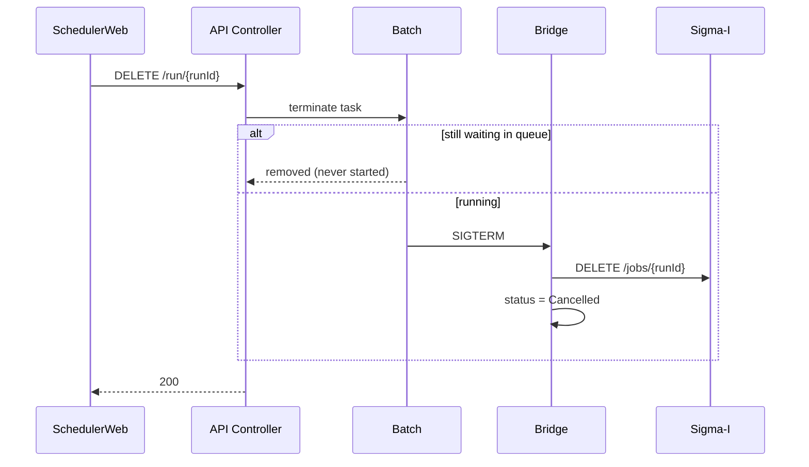
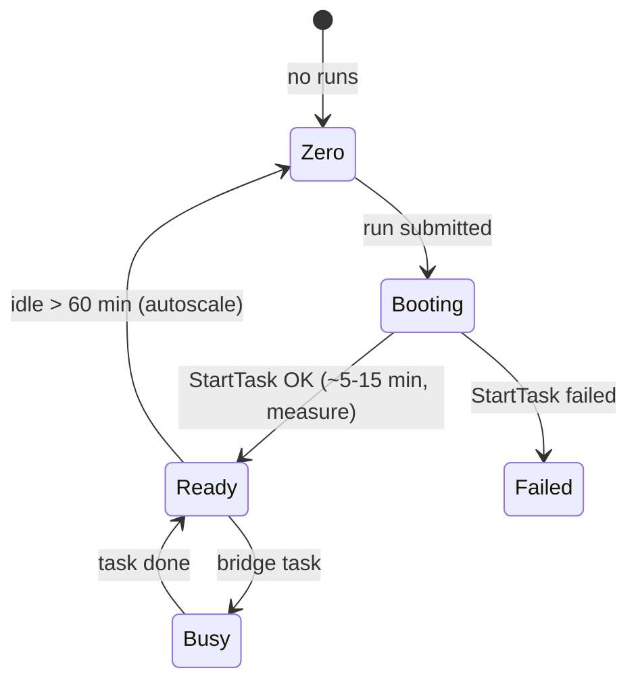
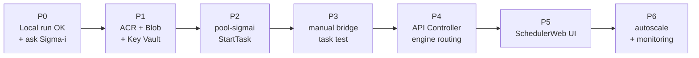

# Sigma-I on Azure — Implementation Plan (Overview)

> Visual summary. Deep version: [SigmaI_Azure_DetailedDesign20261013.md](./SigmaI_Azure_DetailedDesign20261013.md)
> 日本語版: [SigmaI_Azure_ImplementationPlan20261013(JP).md](./SigmaI_Azure_ImplementationPlan20261013(JP).md)

**Goal:** SchedulerWeb can choose **Timefold** or **Sigma-I (SCIP / D-Wave)**, using the same Azure stack we already run for Timefold (ACA + ACR + Blob + Batch).

---

## 1. Today vs. Target

### Today — Timefold only

### Target — Timefold + Sigma-I

---

## 2. Why Sigma-I needs a different Batch design

| | Timefold | Sigma-I |
|---|---|---|
| What runs | 1 container | 3 containers: **API + worker + Redis** |
| How you call it | Command line (`entrypoint.sh`) | **HTTP API** (`POST /jobs` → poll → download) |
| Startup cost | Small (JVM start) | **Large** — installs the core wheel (`pip`) every start |
| Best lifecycle | New container per run | **Keep running (warm)**, reuse for many runs |
| Solvers | Timefold | Stage 1: `scip` or `dwave` / Stage 2: `scip` only |
| Secrets | none | `API_KEY` (local), `DWAVE_API_TOKEN` (only for D-Wave) |

➡ **Key idea:** start the Sigma-I stack **once per node** (Batch *StartTask*), then each run is a small **Bridge task** that talks to it.

---

## 3. Inside the Sigma-I Batch node

---

## 4. The Bridge task — 3 jobs

---

## 5. End-to-end sequence

---

## 6. Queue — same node, runs wait their turn

```mermaid
gantt
    title pool-sigmai — 1 node, 1 task slot
    dateFormat HH:mm
    axisFormat %H:%M
    section Node
    StartTask (boot + pip install)  :crit, s0, 09:00, 8m
    section Runs
    run A (SCIP)                    :a, after s0, 30m
    run B (waiting in Batch queue)  :done, bq, 09:10, 28m
    run B (SCIP)                    :b, after a, 30m
    run C (D-Wave stage 1)          :c, after b, 20m
    section Node
    idle keep-alive, then scale to 0 :idle, after c, 30m
```

- Batch **job queue** = our queue. `taskSlotsPerNode = 1` → one run at a time.
- Waiting runs show as **Submitted (queue #2)** in SchedulerWeb.
- Stack is **started once** → runs B and C pay **no** install cost.

---

## 7. Run status (what SchedulerWeb sees)

| Sigma-I status | → SchedulerWeb status |
|---|---|
| *(Batch task waiting)* | `Submitted` + `queuePosition` |
| `queued`, `running`, `cancel_requested` | `Running` |
| `finished` | `Completed` |
| `failed` | `Failed` (+ `errorType`) |
| `canceled` | `Cancelled` |

Same 5 states as Timefold → **minimal UI change**.

---

## 8. Cancel

---

## 9. Node lifecycle (keep warm)

---

## 10. Changes per component

| Component | Change | Size |
|---|---|---|
| **SchedulerWeb** | engine selector + Sigma-I options + queue display | S |
| **API Controller** | `engine` field, route to `job-sigmai`, queue position, write `sigmai_options.json` | M |
| **Blob** | add `sigmai-setup/` + `output/{runId}/sigmai/` | XS |
| **ACR** | add Sigma-I API image + `redis:7-alpine` mirror | XS |
| **Key Vault** | `DWAVE_API_TOKEN` secret | XS |
| **Batch** | new `pool-sigmai` + `job-sigmai` + StartTask + bridge script | **L** |
| **Timefold path** | **no change** | — |

---

## 11. Roadmap

⚠ **P0 blocker:** local test `test-001` ended `OPTIMIZATION_FAILED` (`validation_passed: false`). Fix with Sigma-i first — Azure won't fix input/model problems.

---

## 12. Open questions (for Sigma-i / company IT)

| # | Question | Who |
|---|---|---|
| 1 | Can the wheel be **pre-installed in the image** (skip pip at every start)? | Sigma-i |
| 2 | Are we allowed to run the image + wheel on our Azure? | Sigma-i |
| 3 | Recommended VM size (CPU / RAM) for SCIP? | Sigma-i |
| 4 | Outbound internet from Batch nodes (PyPI, D-Wave)? | Company IT |
| 5 | D-Wave Leap plan / token owner / cost? | Company |
| 6 | Keep node warm all business hours, or idle timeout only? | Us + Company |
