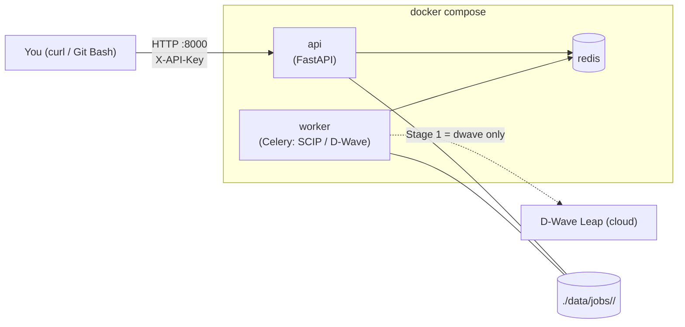
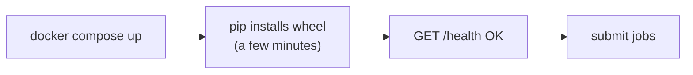
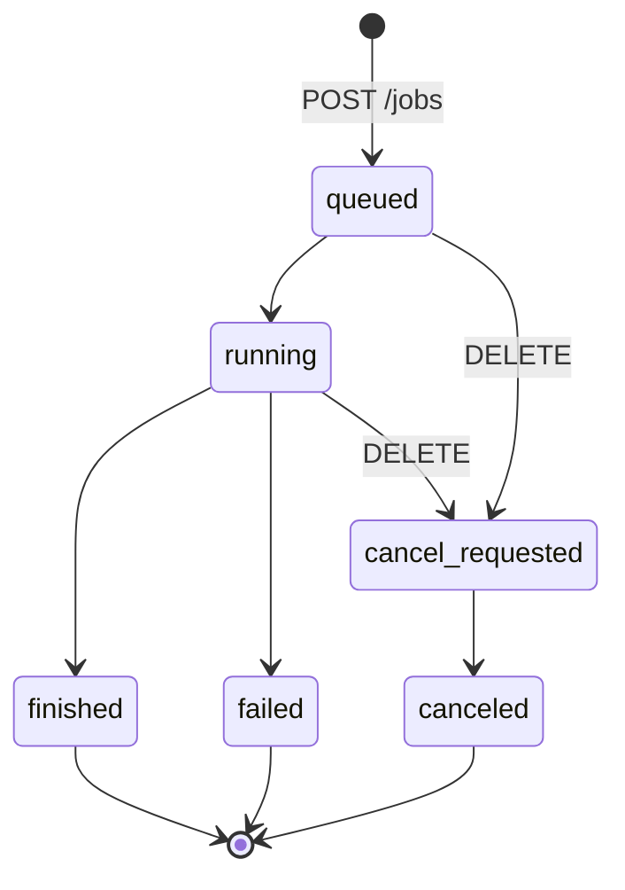

# Sigma-I — How to Run Locally

How to start the Sigma-I worker-assignment API on one PC and run jobs with **SCIP + SCIP** or **D-Wave + SCIP**.

> Source: the Sigma-i delivery `sigmaI/2.Web APIソースコード一式/APIコンテナ（2026-07-15提供物と同一）/screenas-workerassign-api/README.md` and the API source code. The Azure plan is in [SigmaI_Azure_ImplementationPlan20261013.md](./SigmaI_Azure_ImplementationPlan20261013.md).

---

## 1. What you are running



- **3 containers:** `api` (port 8000), `worker` (does the solving), `redis` (job queue).
- **Async jobs:** `POST /jobs` returns immediately. Check `/status` until the job finishes, then download the result.
- **Core logic** (`screenas_workerassign_opt-*.whl`) is installed **every time the containers start**. The first start takes a few minutes.

---

## 2. Requirements

| Item | Note |
|---|---|
| Docker + Docker Compose | Windows: Docker Desktop (WSL2 backend). Linux: Docker + compose plugin |
| Linux / amd64 | Docker Desktop on Windows is fine |
| Internet access | The first start pulls `redis:7-alpine` from Docker Hub and the wheel's dependencies from PyPI |
| **Git Bash** (Windows) | The commands below are bash. In PowerShell, `source` and `$API_KEY` do not work |
| Core wheel | `screenas_workerassign_opt-*.whl`, received separately from Sigma-i |
| D-Wave token | **Only** for D-Wave runs |

---

## 3. Folder layout

Copy the delivery to a **short path with no spaces or Japanese characters**, e.g. `C:\sigmai-api`. Long paths and OneDrive folders can break Docker volume mounts.

```text
sigmai-api/                              ← run every command from here
├── docker-compose.yml
├── .env.server.example
├── .env.client.example
├── screenas-workerassign-api_0.1.0.image.tar
├── wheels/
│   └── screenas_workerassign_opt-0.1.x-py3-none-any.whl   ← exactly ONE .whl, do not unzip
├── inputs/
│   ├── EnvConfig.yaml                   ← e.g. from GanttChartEditor/Test_data
│   └── Schedule.yaml
└── data/                                ← created by you, filled by the containers
```

Not needed: `screenas-workerassign-api_0.1.0_delivery.tar.gz` (the original archive) and the extracted `screenas-workerassign-api_0.1.0.image/` folder.

---

## 4. First-time setup (once per PC)

### 4.1 Load the Docker image

```bash
docker load -i screenas-workerassign-api_0.1.0.image.tar
```

Check:

```bash
docker images | grep screenas-workerassign-api
```

### 4.2 Make an API key

```bash
openssl rand -hex 32
```

Copy the output. The same value goes in both env files.

### 4.3 Create the env files

```bash
cp .env.server.example .env.server
```

```bash
cp .env.client.example .env.client
```

Edit `.env.server`:

```env
APP_IMAGE=sigmai/screenas-workerassign-api:0.1.0
API_KEY=<your key>
DWAVE_API_TOKEN=
```

Leave `DWAVE_API_TOKEN` empty for SCIP only. Fill it in to use D-Wave (see §8).

Edit `.env.client`:

```env
API_BASE_URL=http://localhost:8000
API_KEY=<the same key>
```

### 4.4 Create the folders

```bash
mkdir -p data wheels inputs
```

Then put the `.whl` in `wheels/` and the two YAML files in `inputs/`.

---

## 5. Start and stop



Start (keep this terminal open to see the logs):

```bash
docker compose --env-file .env.server up
```

Or start in the background:

```bash
docker compose --env-file .env.server up -d
```

Check that the containers are running:

```bash
docker compose --env-file .env.server ps
```

Stop:

```bash
docker compose --env-file .env.server down
```

> Do **not** add `-v` to `down` unless you want to delete the Redis job data too. The `data/` folder is never deleted automatically.

---

## 6. Run a job

Open a **second terminal** in the same folder and load the client settings. Do this in every new terminal:

```bash
source .env.client
```

Health check:

```bash
curl "$API_BASE_URL/health"
```

### 6.1 Option A — SCIP + SCIP

```bash
curl -X POST "$API_BASE_URL/jobs" -H "X-API-Key: $API_KEY" -F "job_id=scip-001" -F "scenario_name=scip-test" -F "stage1_solver=scip" -F "stage2_solver=scip" -F "stage1_timeout=1800" -F "stage2_timeout=1800" -F "weight_preset=standard" -F "environment=@inputs/EnvConfig.yaml;type=application/x-yaml" -F "schedule=@inputs/Schedule.yaml;type=application/x-yaml"
```

### 6.2 Option B — D-Wave + SCIP

`DWAVE_API_TOKEN` must be set first (§8).

```bash
curl -X POST "$API_BASE_URL/jobs" -H "X-API-Key: $API_KEY" -F "job_id=dwave-001" -F "scenario_name=dwave-test" -F "stage1_solver=dwave" -F "stage2_solver=scip" -F "stage1_timeout=600" -F "stage2_timeout=1800" -F "weight_preset=standard" -F "environment=@inputs/EnvConfig.yaml;type=application/x-yaml" -F "schedule=@inputs/Schedule.yaml;type=application/x-yaml"
```

Expected response:

```json
{"job_id":"scip-001","status":"queued","created_at":"..."}
```

### 6.3 Job fields

| Field | Required | Values | Default |
|---|---|---|---|
| `job_id` | ✔ | letters, digits, `_`, `-`; **must be new each time** | — |
| `environment` | ✔ | `@inputs/EnvConfig.yaml;type=application/x-yaml` | — |
| `schedule` | ✔ | `@inputs/Schedule.yaml;type=application/x-yaml` | — |
| `scenario_name` | | any text | none |
| `stage1_solver` | | `scip` \| `dwave` | `scip` |
| `stage2_solver` | | `scip` only | `scip` |
| `stage1_timeout` | | seconds, ≥ 1 | `30` |
| `stage2_timeout` | | seconds, ≥ 1 | `30` |
| `stage1_num_solutions_limit` | | stop Stage 1 after N solutions, ≥ 1 | no limit |
| `stage2_num_solutions_limit` | | stop Stage 2 after N solutions, ≥ 1 | no limit |
| `weight_preset` | | `standard` \| `daily_balance` \| `worker_balance` | `standard` |
| `disabled_constraints` | | JSON array, any of `stage2.overtime_limits`, `stage2.stay_limits`, `stage2.manager_assignment` | `[]` |
| `custom_overrides` | | JSON object of weight overrides per stage | `{}` |

Example with constraints turned off (note the single quotes around the JSON):

```bash
curl -X POST "$API_BASE_URL/jobs" -H "X-API-Key: $API_KEY" -F "job_id=scip-002" -F "stage1_solver=scip" -F "stage2_solver=scip" -F "stage1_timeout=300" -F "stage2_timeout=300" -F 'disabled_constraints=["stage2.overtime_limits","stage2.stay_limits","stage2.manager_assignment"]' -F "environment=@inputs/EnvConfig.yaml;type=application/x-yaml" -F "schedule=@inputs/Schedule.yaml;type=application/x-yaml"
```

> The time limit for the whole job = `stage1_timeout` + `stage2_timeout`. With the 30 s defaults, a job may stop too early for real data.

---

## 7. Check status, get the result, cancel



Replace `scip-001` with your `job_id`.

Status (repeat until `finished` / `failed` / `canceled`):

```bash
curl -H "X-API-Key: $API_KEY" "$API_BASE_URL/jobs/scip-001/status"
```

The response includes `progress.elapsed_seconds`, `progress.time_limit_seconds` and `progress.estimated_progress_rate`.

Result summary (score, solve times, KPIs, error):

```bash
curl -H "X-API-Key: $API_KEY" "$API_BASE_URL/jobs/scip-001/result"
```

Download the optimized schedule. This works only when the job is `finished`:

```bash
curl -H "X-API-Key: $API_KEY" -o result_Schedule.yaml "$API_BASE_URL/jobs/scip-001/download"
```

> If `result_Schedule.yaml` is tiny (~170 bytes), it is an **error JSON**, not a schedule. Open it with `cat result_Schedule.yaml`.

List recent jobs:

```bash
curl -H "X-API-Key: $API_KEY" "$API_BASE_URL/jobs?limit=20"
```

Cancel a job:

```bash
curl -X DELETE -H "X-API-Key: $API_KEY" "$API_BASE_URL/jobs/scip-001"
```

---

## 8. Using D-Wave

1. Put the token in `.env.server`:
   ```env
   DWAVE_API_TOKEN=<your D-Wave Leap token>
   ```
2. Restart the containers so they read the new value (this reinstalls the wheel):
   ```bash
   docker compose --env-file .env.server down
   ```
   ```bash
   docker compose --env-file .env.server up -d
   ```
3. Submit with `stage1_solver=dwave` (§6.2).

D-Wave is used **only in Stage 1**. Stage 2 is always SCIP. The PC needs internet access to D-Wave Leap.

---

## 9. Where the files are

Each job gets a folder in `data/jobs/<job_id>/`:

```text
data/jobs/<job_id>/
├── request.json              request as received
├── status.json               current status
├── result.json               final result (API format)
├── logs/
│   ├── worker.log            worker progress
│   └── error.log             details when the job fails      ← check first
├── inputs/
│   ├── EnvConfig.yaml
│   ├── Schedule.yaml
│   └── core_params.yaml      parameters passed to the core logic
└── opt_output/
    ├── result_Schedule.yaml  the optimized schedule
    ├── result_summary.json   core logic summary
    ├── optimization.log      core logic log                  ← check second
    └── internal/             core internal files
```

Read the logs:

```bash
cat data/jobs/scip-001/logs/error.log
```

```bash
tail -n 100 data/jobs/scip-001/opt_output/optimization.log
```

```bash
cat data/jobs/scip-001/opt_output/result_summary.json
```

If the folder is empty on Windows, read the files from inside the container:

```bash
docker compose --env-file .env.server exec worker cat /app/data/jobs/scip-001/logs/error.log
```

Container logs:

```bash
docker compose --env-file .env.server logs --tail 200 worker
```

```bash
docker compose --env-file .env.server logs --tail 200 api
```

---

## 10. Measure CPU and memory (for Azure VM sizing)

While a job is running, in another terminal:

```bash
docker stats
```

Note the **peak CPU %** and **peak memory** of the `worker` container. Also note the time from `up` until `/health` answers (the startup time). We need these numbers to choose the Azure Batch VM size.

---

## 11. Troubleshooting

| Symptom | Likely cause | Fix |
|---|---|---|
| Containers stop right after `up` | No `.whl` in `wheels/`, more than one `.whl`, or no internet for `pip` | Exactly one `.whl`; check `logs worker` |
| `401` / rejected request | `X-API-Key` doesn't match `API_KEY` in `.env.server` | Same key in both files; run `source .env.client` again |
| `$API_KEY` is empty | New terminal, or PowerShell | `source .env.client` in Git Bash |
| `422 VALIDATION_ERROR` | Bad field: `stage2_solver` not `scip`, wrong preset name, invalid JSON in `disabled_constraints`, empty YAML | Check the field table (§6.3) |
| `JOB_ALREADY_EXISTS` | `job_id` reused | Use a new `job_id` |
| `JOB_NOT_FINISHED` on download | Job still running | Wait for `finished` |
| Download is ~170 bytes | The job failed; the file is an error JSON | `cat result_Schedule.yaml`, then check §9 logs |
| `failed` + `OPTIMIZATION_FAILED`, `validation_passed: false` | The core finished but the schedule failed its validation. It is not a timeout | Read `error.log` + `optimization.log`; try `disabled_constraints` (§6.3); ask Sigma-i with the logs |
| `TIMEOUT` | Time limit too short | Raise `stage1_timeout` / `stage2_timeout` |
| `STAGE1_FAILED` with D-Wave | Token missing or invalid, or no internet to D-Wave | §8; check `logs worker` |
| `CORE_IMPORT_ERROR` | Wheel not installed correctly | Check `logs worker` from startup; reinstall with `down` / `up` |
| Port 8000 already in use | Another app on 8000 | Change `ports` in `docker-compose.yml` to `"8001:8000"` and `API_BASE_URL` to `:8001` |
| `curl` behaves oddly on Windows | PowerShell alias | Use Git Bash, or `curl.exe` in PowerShell |

---

## 12. Quick reference

```text
once:     docker load -i screenas-workerassign-api_0.1.0.image.tar
start:    docker compose --env-file .env.server up -d
client:   source .env.client
health:   curl "$API_BASE_URL/health"
submit:   curl -X POST "$API_BASE_URL/jobs" -H "X-API-Key: $API_KEY" -F job_id=... -F stage1_solver=scip|dwave -F stage2_solver=scip -F stage1_timeout=... -F stage2_timeout=... -F "environment=@inputs/EnvConfig.yaml;type=application/x-yaml" -F "schedule=@inputs/Schedule.yaml;type=application/x-yaml"
status:   curl -H "X-API-Key: $API_KEY" "$API_BASE_URL/jobs/<id>/status"
result:   curl -H "X-API-Key: $API_KEY" "$API_BASE_URL/jobs/<id>/result"
download: curl -H "X-API-Key: $API_KEY" -o result_Schedule.yaml "$API_BASE_URL/jobs/<id>/download"
cancel:   curl -X DELETE -H "X-API-Key: $API_KEY" "$API_BASE_URL/jobs/<id>"
logs:     cat data/jobs/<id>/logs/error.log
stop:     docker compose --env-file .env.server down
```
