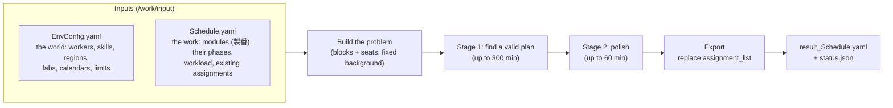
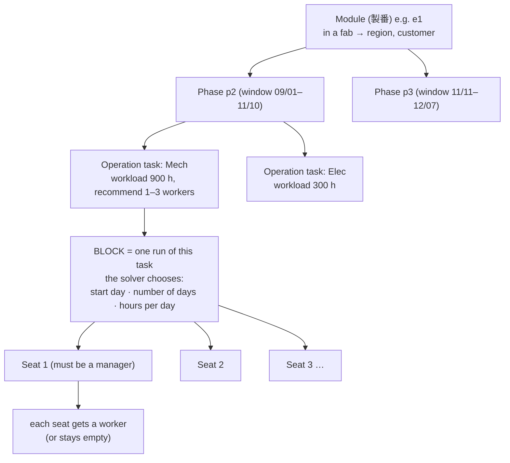
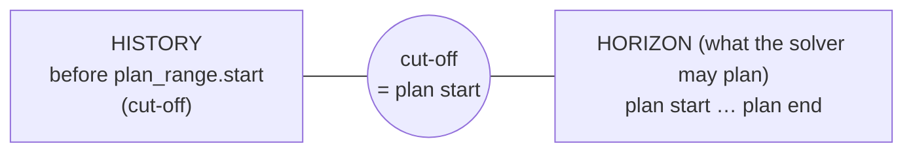
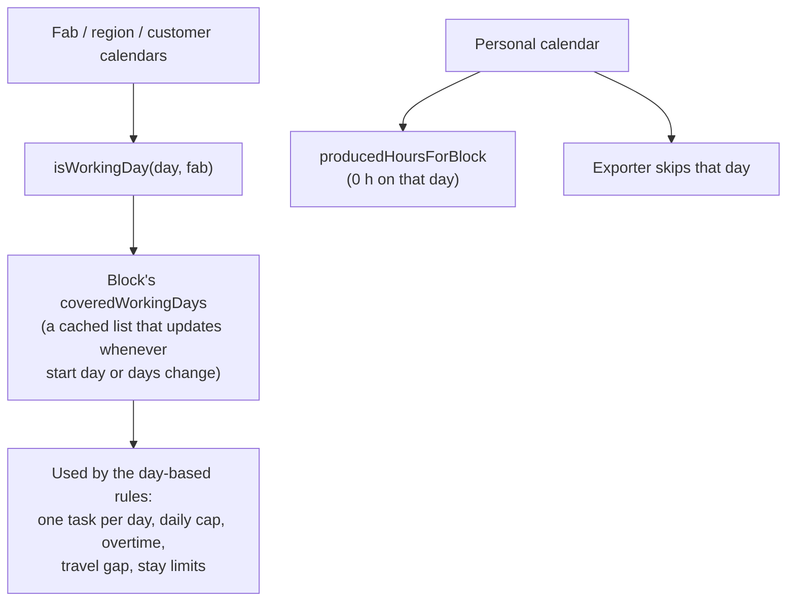
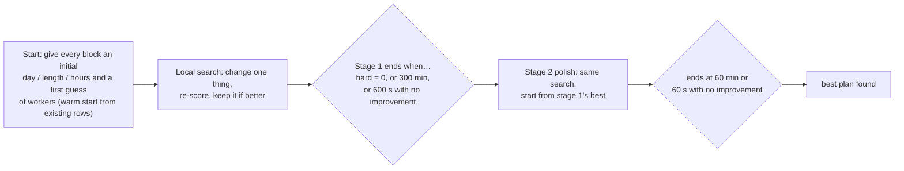
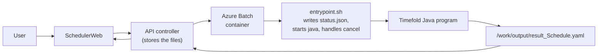
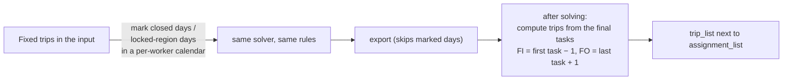

# How the Timefold scheduler works — a picture for the whole team

> **For:** teammates who have not read the Java code. **Not about FI/FO:** it explains the whole solver first (section 11
> shows where trips fit). Facts below come from reading `TFDocker/.../EmployeeSchedule.java` and `ExportSchedule.java`;
> where I am describing intent rather than code, it says so.
> **Date:** 2026-10-21

---

## 1. The one-minute picture

Timefold takes two YAML files, decides **who works on which task on which days**, and writes the answer back.



Nothing is "learned": it is a search. Timefold tries many plans, scores each one against a list of rules, and keeps the
best one it has found when time runs out.

---

## 2. What is in the two files

| File | Section | Plain meaning |
|---|---|---|
| **EnvConfig** | `workflow_list` → phases → operations | Kinds of work. An operation lists the allowed hours per day (`work_hours`, e.g. 8/10/12) and min/max workers |
| | `worker_list` | Each worker: `skill_map` (operation → level), regular/spot type, manager flag, region/customer preference, personal `unavailable_dates`, company |
| | `fab_list`, `region_list`, `customer_company_list`, `worker_company_list` | Sites (fab) belong to a region and a customer; each can have its own **unavailable_dates** (calendars). Regions have stay limits, companies have overtime limits |
| | `transite_day_map` | Days needed to travel from one region to another |
| | `affinity_tag` | Tags with weights (can be negative) that reward/penalise workers sharing a tag |
| **Schedule** | `plan_range` | First and last day of the plan. The **first day is the cut-off** |
| | `workflow_task_list` | The work: one **module** (製番) with phases, each phase with a date window and operation tasks with `workload_hours` |
| | `misc_task_list` | Other things a worker can be busy with (not planned work) |
| | `assignment_list` | Who already does what. `Fixed` = fact, `Flexible` = may be re-planned |

---

## 3. Vocabulary, as a picture



| Word | Meaning |
|---|---|
| **Module (製番)** | One tool installation. Belongs to a fab, so it has a region and a customer |
| **Phase** | A stage of the module with its own date window; phase *n* must end before phase *n+1* starts |
| **Operation task** | One kind of work in a phase (Mech, Elec, QC) with a total `workload_hours` |
| **Block** | One continuous run of an operation task. This is what the solver places on the calendar |
| **Seat** | One worker slot in a block. A block has up to `max_worker_num` seats. **Seat 0 must be a manager** |
| **Fixed / Flexible** | Fixed rows are facts and never move. Flexible rows are what the solver re-plans |
| **Misc task** | Any non-planned bar from the sheet. Always treated as Fixed. Today Timefold does not use its region |

---

## 4. What the solver decides

For every **block**: the **start day**, the **number of days**, and the **hours per day** (one of the allowed values).
For every **seat**: **which worker** (or nobody).

```
 Block "Mech" needs 900 h        days →  1   2   3   4   5   6   7   8   9
 chosen: start day 2, 5 days, 10 h/day          [  work    work   work  work  work ]
 seat 1 (manager)  worker A                      ■■■  ■■■  ■■■  ■■■  ■■■
 seat 2            worker B                      ■■■  ■■■  ■■■  ■■■  ■■■
 seat 3            (nobody)
 produced = 2 workers × 5 days × 10 h = 100 h  (plus any Fixed hours already done)
```

A worker can be put on a seat only if they have the skill (level ≥ 1) and their region / customer preference is not
"never" (level 0). Non-manager seats may stay empty.

---

## 5. Time: history, horizon and "how much work is left"



* Day numbers are counted from `plan_range.start_date` (day 0).
* Everything **before** the cut-off is history. Fixed rows there are facts.
* A phase that **already started before the cut-off** has all its flexible rows turned **Fixed** (the code calls this a
  "new rule": started work is not re-planned).
* **Work left** for an operation = `workload_hours − Fixed hours of that same module + operation`, never below zero.
  Zero means "nothing to plan": no block is created and the task is simply skipped.
* A phase window can be **pushed later** by Fixed work of the previous phase.
* Fixed hours only count **inside the horizon** for the day-based rules (overtime, balance, daily cap). Older Fixed work
  is not counted there.

---

## 6. Calendars — the part nobody explained

A **calendar** here is simply **a set of closed days**. It answers one question: *"is this day open?"* Timefold has
several, owned by different things:

| Calendar | Comes from | Closes the day for | Effect |
|---|---|---|---|
| Fab | `fab_list[].unavailable_dates` | everybody working in that fab | The day is **not a working day** for the block |
| Region | `region_list[].unavailable_dates` | every fab in the region | same |
| Customer | `customer_company_list[].unavailable_dates` | every fab of that customer | same |
| Worker company | `worker_company_list[].unavailable_dates` | read in, but **not used when deciding working days** today | — |
| **Personal** | `worker_list[].unavailable_dates` | one worker | **Zero production** that day and **skipped in the output**; other rules still see the worker as present |

A closed day can be one date, or a weekly pattern such as `sat, sun`. **There is no built-in weekend**: if none of the
calendars lists Saturday and Sunday, they are normal working days.

### What a closed day does to a block

```
 Block start day 1, 5 days            Mon  Tue  Wed  Thu  Fri
 Fab calendar closes Wednesday:        ■    ■   ×    ■    ■     → "covered working days" = 4, the block simply skips Wed
 Personal calendar of worker B on Tue: A ■ ■ ■ ■ ■      B ■ × ■ ■ ■
                                       → A works 5 days, B works 4; B's Tuesday produces 0 h and is left out of the output
```

Two different mechanisms, on purpose:



Why it matters: this "mark the day, do not add a rule" style is the cheapest way to say *"nothing happens on this
day"*. It costs a lookup, not a new rule the engine must re-check on every move. (The trip feature reuses exactly this
idea; see section 11.)

---

## 7. The rules the solver follows

The score has three levels, written `hard / medium / soft`. **Hard must be zero** for a plan to count as valid; medium
is "strongly prefer"; soft is "nice to have". Stage 1 stops as soon as hard reaches 0 (or on a time limit).

**Hard (must hold)**

| Rule | In plain words |
|---|---|
| block-end-within-window | A block cannot run past its phase window |
| block-hours-in-allowed | Hours per day must be one of the operation's allowed values |
| phase-order | Phase *n* must finish before phase *n+1* starts (same module) |
| block-no-underfill | Total produced hours must reach the work left (a shortfall is penalised ×10) |
| block-overfill-at-most-one-day | Not more than about one day of extra work beyond what is needed |
| emp-one-task-per-day | A worker has at most one task on a day (Fixed rows count) |
| seat-daily-cap-12h | At most 12 h per worker per day (Fixed hours count) |
| emp-region-transit-gap | Changing region needs the travel days from `transite_day_map` between two worked days |
| emp-region-stay-max-on / annual-stay-max | Longest stay and yearly stay in a region (today set to 10000 = effectively off) |
| emp-annual / monthly-overtime-limit | Hours above 8 per day, summed per worker, must stay under the company's limit (today 10000) |

**Medium:** `block-recommend-headcount-range` — staff each block with the recommended number of workers (weight 50).

**Soft (preferences)**

| Rule | Preference | Weight |
|---|---|---|
| soft-smaller-hours | shorter days (8 h over 12 h) | 40 × hours per day |
| soft-earlier-start | start as early as the window allows | 1 per day late |
| soft-affinity-reward / penalty | workers sharing a tag work together (or not, if the weight is negative) | 5 |
| soft-encourage-skill-variety | avoid several workers of the same skill level in one block | 3 |
| soft-balance-block-avg-skill | a block's average skill should match the operation's overall average | 10 |
| soft-balance-total-hours | spread total hours evenly across workers (target = all work ÷ workers) | — |
| soft-minimize-region-transitions | avoid sending the same worker to several regions | 5 |
| soft-fab-preference | reward workers placed where they prefer (region / customer level ≥ 2) | 5 |
| prefer-regular-over-spot | prefer "regular" workers to "spot" workers | 40 |

---

## 8. How the search runs



* The score of a change is **not** computed from scratch: only the rules touching the changed block or seat are
  recalculated. That is why rules are written with "streams" and cached values (the covered-days list in section 6).
* Time limits are hard-coded today (300 min / 600 s, then 60 min / 60 s). The design makes them parameters.
* While running, the program writes a progress number into `status.json` every few seconds, plus text files with the
  score (`initial_score`, `stage1_score`, `final_score`, `score_progress`).

---

## 9. Writing the answer

* Every **seat that has a worker** becomes one assignment row: worker, task, first/last day, and a `work_date_list`
  (day + hours).
* Days that are not open for that worker (closed fab/region/customer day, personal unavailable day) are **left out** of
  the list.
* **Fixed rows from the input are copied unchanged. Old Flexible rows are replaced** by the new ones.
* Everything else in the YAML (`misc_task_list`, unknown keys, …) is carried through untouched, which is why new keys
  can be added to `Schedule.yaml` without breaking a run.

---

## 10. Where it runs



---

## 11. Where the new FI/FO ("trips") work fits

It adds no new engine. It reuses the calendar idea of section 6 and adds one step at the end:



Details are in `Timefold_TripList_Design20261021.md`.

---

## 12. Things that often surprise people

* **Remaining work is counted per module and operation.** Fixed rows of *another* module do not reduce it. That is why a
  module turned into misc tasks is no longer "planned" at all.
* **Misc tasks are always Fixed** and, today, have no region inside Timefold.
* **A personal unavailable day is not a hard rule.** The worker produces nothing that day and it is dropped from the
  output, but some rules still treat the worker as present.
* **Seat 0 of every block must be a manager.** If no manager can take it the run stops with an error.
* **Old Fixed work before the cut-off is invisible to overtime and balance.** Only Fixed work inside the plan range counts.
* **Setting a limit to 10000 turns it off**, but the rule still runs. Cheap to fix later; worth knowing when profiling.
