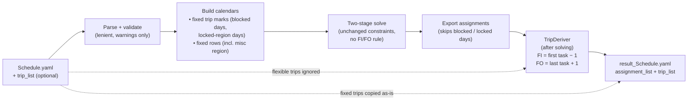
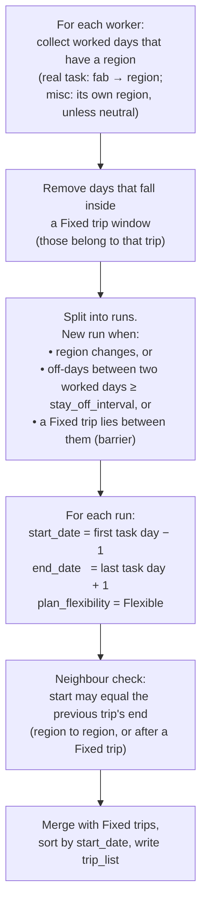

# Timefold — `trip_list` (FI/FO), misc region, parameters, refactor and 2.x upgrade

> **Status:** DESIGN FOR CONFIRMATION — nothing is implemented yet.
> **Target project:** new Maven project `web/Timefold` (copy of `web/TFDocker`; `TFDocker` stays untouched as the
> baseline for comparison). **Language/build:** Java + Maven, like today.
> **Date:** 2026-10-21
>
> Section 12 lists the decisions I need from you. Items marked **(verified)** were checked in the code or on the
> Timefold/Maven sites; items marked **(unverified)** are my expectation and must be proven by a spike.
>
> **Revision 2 (after your review):**
> (a) a trip with `start_date == end_date` is invalid — equal dates only occur *between two different trips*;
> (b) new option `allow_cut_fixed_trip` (section 6.2);
> (c) stay limit and annual stay count **FI → FO**, the travel gap does not look at FI/FO (section 4.1);
> (d) personal unavailable days that fall on an FI/FO day (section 5.2);
> (e) parameters arrive through an optional `SolverParams.yaml` that SchedulerWeb will fill (section 8);
> (f) `TFDocker` compatibility is no longer a constraint.
> A plain-language explainer for teammates is in `Timefold_HowItWorks_Explained20261021.md`.

---

## 1. What you asked for, and how I read it

| # | Your requirement | My reading |
|---|---|---|
| R1 | FI/FO is **not a scoring factor**. The existing travel gap (`stay_off_interval` and `transite_day_map` from EnvConfig) already keeps FI away from tasks and **must not consider FI/FO**. | No new score term for FI/FO; travel gap unchanged. (Only the stay limits change, see R13.) |
| R2 | FI/FO is **written on output**, from the final tasks, using `stay_off_interval`. The solver does **not calculate** it. | A separate `TripDeriver` runs after solving (section 6). |
| R3 | `Schedule.yaml` gets a new list after `assignment_list`, per worker, each trip with start/end date, region, flexibility, description. | `trip_list` (section 3). |
| R4 | A **Fixed** trip means the worker stays in that region for the whole period; FI day and FO day get **no task at all**; days inside allow **only that region's** tasks (any task, not only the existing ones). | Calendar marks (section 5), not a constraint. |
| R5 | A fixed trip does **not** fix its tasks, and fixed tasks do **not** fix the trip. | Independent concepts. |
| R6 | A **Flexible** trip is ignored by the solver; its tasks may move anywhere. | Input flexible trips are ignored, then regenerated on output. |
| R7 | Same-region work **after** the FO of a fixed trip (e.g. 09/11) is allowed, but the **output** must be careful about it. | Fixed trips are barriers when deriving trips (section 6). |
| R8 | **Misc tasks** carry their own `region`; Timefold must use it. | Section 7. |
| R9 | Timers (both stages, "no improvement" cut-off) become **parameters**, same defaults when nothing is given; more parameters where useful. | Section 8. |
| R10 | Upgrade Timefold (you said "2.7"). | **Verified:** 2.7.1 is the latest stable on Maven Central (2.8.0-rc-1 is a release candidate). Needs Java 21 (section 9). |
| R11 | Keep other logic the same, but suggest speed-ups. Split the single huge file into proper files. | Sections 4, 10, 11. |
| R12 | First test: **empty `assignment_list`** and only `workflow_task_list` + EnvConfig; the output must contain a correct `trip_list`. | Section 13. |
| R13 | **Stay limit and annual stay** count from **FI to FO**; the **travel gap** does not. | Section 4.1. |
| R14 | If a **Fixed** trip has **no task inside** after solving, **delete it when writing the output**; switchable true/false. | Parameter `allow_cut_fixed_trip` (section 6.2). |
| R15 | Parameters are entered by the user in **SchedulerWeb**; `TFDocker` compatibility does not matter. | Optional input file `SolverParams.yaml` (section 8). |

Out of scope here: decoder, `fix_edited_modules`, GanttChartEditor, Excel tools. They must be adapted to read and
write `trip_list` separately.

---

## 2. Data flow



---

## 3. `trip_list` format

Placed after `assignment_list`, one entry per worker, each with its trips in date order.

```yaml
  trip_list:
  - worker: w1
    trips:
    - start_date: 2026/09/01        # FI date
      end_date: 2026/09/10          # FO date
      region: r1
      plan_flexibility: Fixed
      description:
    - start_date: 2026/09/10        # same day as the previous FO = region to region
      end_date: 2026/09/15
      region: r2
      plan_flexibility: Flexible
      description:
```

**Names.** I recommend `trip_list` (not `FIFO_list`) and `plan_flexibility` (the key `assignment_list` already uses).
The reader also accepts `flexibility`. Dates use `YYYY/MM/DD` like the rest of the files; `-` is accepted.

**Meaning of a trip**

| Day | Fixed trip behaviour |
|---|---|
| `start_date` (FI) and `end_date` (FO) | **No task at all** for this worker, even in the same region. If another trip of the same worker starts on a day this one ends, that day is blocked for both. |
| strictly between | **Only tasks of `region`**. Days may be empty. Tasks inside are free to move or be replaced by other tasks of the same region. |
| `start_date == end_date` **inside one trip** | Not a valid trip: warn and skip. Equal dates happen only **between two different trips** of one worker: the first trip's `end_date` equals the next trip's `start_date` (region to region, section 6). That shared day is blocked for both. |
| outside `[start_date, end_date]` | Nothing implied. Same-region work may start the very next day. |

A **Flexible** trip has no effect on solving.

**Reading input safely (a new key, so old and odd files must not break a run)**

| Input | Behaviour |
|---|---|
| `trip_list` missing / `null` / `[]` | No trips. The solver behaves exactly as today. |
| Worker not in EnvConfig | Warn, skip the trip. |
| Missing `start_date` / `end_date` / `region`, `start > end`, unparseable date | Warn, skip the trip for solving. A Fixed trip is still **copied unchanged** to the output. |
| Region not in EnvConfig `region_list` | Warn; trip is not enforced; copied unchanged. |
| Unknown `plan_flexibility` | Warn; treated as Flexible. |
| Two Fixed trips of one worker overlap (touching at an end date is fine) | Warn; the earlier one is enforced, the later one is not enforced. |
| Fixed trip partly or fully outside the plan range | Marks are clamped to the plan range; the trip is still copied to the output. |
| Fixed **task** (pinned) lying on a blocked day or in another region inside a fixed trip | Pinned rows are facts and are never moved; warn "fixed task conflicts with fixed trip". |
| Duplicate entries | Deduplicated. |
| `start_date == end_date` in one trip | Warn, skip for solving; a Fixed one is copied unchanged. |
| A worker's personal `unavailable_date` on a trip's FI/FO day, or inside the trip | Normal and expected (section 5.2). No warning. |
| Extra keys inside a trip | Kept when a Fixed trip is copied to the output. |
| Flat form (`worker` on each trip, no `trips:` list) | Accepted on input; always written in the nested form. |

Warnings are printed and written to `/work/output/trip_warnings.txt`. A parameter `trip_validation: strict` turns
them into a failed run (`InvalidInputData`). Default is `lenient`, so one bad trip cannot stop a weekly run.

---

## 4. What changes inside the solver

Only these things: **no new score term for FI/FO**.

| Change | Detail |
|---|---|
| Parse `trip_list` | New `TripListParser` + `TripValidator`. |
| `TripCalendar` | For each worker with Fixed trips: a day-indexed array over the horizon with two marks: `blocked[day]` and `lockRegion[day]` (region index, or none). Built once; read-only. |
| One shared test | `WorkerCalendar.isOpen(employee, day, regionIndex)` is the single place that answers "may this worker work in this region on this day?". |
| Consumers | The existing day-based functions call it instead of using the raw block span: `seatCoveredDays`, `expandToEmpDays`, `expandToEmpDayHours`, `producedHoursForBlock`, and the exporter's per-day loop. |
| Output | The class `TripDeriver` calculates the trips after solving; the file gets `trip_list` written next to `assignment_list`. |

Nothing else about stages, candidate selection or constraints changes, **except the stay-limit counting in 4.1**.

### 4.1 Stay limits count FI → FO; the travel gap does not

| Rule | What it counts |
|---|---|
| `regionTransitGap` (travel gap: `stay_off_interval` and `transite_day_map`) | Worked days only. **Unchanged. It never looks at FI/FO or trips.** |
| `regionStayMaxOn` (longest continuous stay in a region) | Days from FI to FO, both included. |
| `regionAnnualStayMax` (total stay days per year in a region) | Sum of the FI → FO lengths of all that worker's stays. |

How one stay is measured while solving:

* **Stay with no Fixed trip:** from the day before the first task to the day after the last task:
  `length = (last − first + 1) + 2`. This is the same shape the output will print (section 6), so the limit the
  solver enforces matches the trip the user will see.
* **Stay that overlaps a Fixed trip:** the trip's own dates count. The stay runs from `min(trip.start, first − 1)` to
  `max(trip.end, last + 1)`, and the empty days between start and end count as present.
* Two stays of the same region closer than the interval are one stay (same rule as the output). If the FO day of one
  stay and the FI day of the next are the same day, that day is counted once.

Today both limits are `10000`, so nothing changes until a real limit is set. Once set, the same plan shows two more
stay days per stay than before (decision D14).

---

## 5. Calendar marks, not a constraint

You asked to *mark the calendar* so FI/FO adds no constraint work. Timefold already works this way for days off:
a day that is not open for a worker produces **no hours**, does not count in the day-based rules, and is **skipped when
the output is written** (this is how the personal `unavailable_dates` behave today: the rule
`employeeAvailableAllDays` is commented out at `EmployeeSchedule.java:1262`; the days are dropped in
`producedHoursForBlock` and in `ExportSchedule` — **verified**). I reuse that pattern for trip marks, and make it
consistent by routing every consumer above through the single `isOpen` test.

What that gives, and what it does not:

| Property | With calendar marks |
|---|---|
| A fixed trip's FI/FO day never contains a task in the output | ✅ |
| Another region never appears inside a fixed trip in the output | ✅ |
| Extra score constraints / streams | **none** |
| The solver "understands" it is forbidden and steers away early | ⚠️ Only indirectly: such a day earns no hours, and `block-no-underfill` (hard) pushes the solver to place the work elsewhere. A worker may be tried on such a block and the blocked day simply contributes nothing. |

If a test run shows the search wasting time on such assignments, the fallback is **one** tiny hard constraint that
penalises a seat covering a blocked day (array lookup only). I would add it only if measurements say so (decision D3).

**Personal `unavailable_dates` are left exactly as they are today** (decision D4) so existing results do not change.

### 5.2 A personal unavailable day on the same day as FI or FO

This will happen: in the sample sheet 629 of the 4,431 FI/FO cells (241 FI, 388 FO) have a red fill, and the decoder
already turns those days into `unavailable_dates`.

| Situation | What happens |
|---|---|
| Unavailable day = FI or FO day of a Fixed trip | The day is closed twice. The result is the same as being closed once: no work, no extra penalty, no warning. Where both apply, the trip mark wins, so every day-based rule ignores the day (today's personal-off alone is not ignored by every rule, see section 5). |
| Unavailable day inside a Fixed trip | The worker simply does not work that day. The region lock is unaffected. |
| Unavailable day right before a first task or right after a last task | Derived FI/FO are unaffected: FI is still `first task − 1`, FO still `last task + 1`, even if that day is unavailable. |
| Unavailable day on a normal task day | Unchanged from today (no production that day, skipped in the output). |
| "Task inside" test for `allow_cut_fixed_trip` | Unavailable days are never tasks, so they never count as "something inside". |

Test cases: unavailable = FI, = FO, inside the window, and on a derived FI/FO day; the output must be the same as
without the unavailable date, except for work that the unavailable date itself removes.

### Behaviour for your cases

| Fixed trip | Inner tasks | Result |
|---|---|---|
| yes | Flexible | The tasks may move inside the trip, shrink, or be replaced by other same-region tasks. Nothing on FI/FO days. |
| yes | Fixed | Fixed rows stay. Trip marks only matter for flexible work. |
| no (or Flexible trip) | any | No restriction. Timefold may attach more same-region work next to tasks or to fixed tasks. |

---

## 6. Output: deriving trips (`TripDeriver`)

`TripDeriver` is only the name of the Java class (the piece of code) that makes this calculation. What you see in the
file is the `trip_list`, written next to `assignment_list`. It runs after solving, on the **final** assignment list:
preserved Fixed rows, solved Flexible rows, and Fixed history. Fixed trips from the input are copied unchanged (unless
cut, section 6.2); every other trip is regenerated.



Rules, stated exactly:

* **Gap** = number of off-days between two worked days = `next − previous − 1` (calendar days, weekends count).
  Within the same region the stay continues while `gap < interval`, and a new trip starts when `gap >= interval`.
  `interval = max(1, region.stay_off_interval)` — this is what `regionStayMaxOn` already does (**verified**).
  Your text says "gap > interval"; I chose `>=` so the output agrees with the solver's own stay rule (**decision D1**).
* **FI** is the calendar day before the first task, **FO** the calendar day after the last task (they may fall on a
  weekend).
* **Region change:** the transit gap already guarantees `first(B) ≥ last(A) + transit + 1`, so
  `start(B) = first(B) − 1 ≥ last(A) + 1 = end(A)`. With a 1-day transit the dates are **equal**
  (the same day is FO of A and FI of B) — exactly your example.
* **Barrier after a Fixed trip (your 09/11 case).** The fixed trip is r1, 09/01–09/10. If the solver puts r1 tasks on
  09/11–09/13, the derived trip is r1, **09/10–09/14**, a *separate* Flexible trip that starts on the day the Fixed
  trip ends. The two are never merged, and the Fixed trip's dates never change.
* **Zero transit between two regions** (transit days 0 or missing): the dates could collide. Fallback: the later
  trip starts on the earlier trip's end date and a warning `tight_transit` is logged. (Recommend validating that every
  region pair has transit ≥ 1.)
* Workers with no region-bearing days get no derived trips. A Fixed trip with no tasks inside is still output.

### 6.1 Example (from your message)

Input trips: w1 r1 Fixed 09/01–09/10; w1 r2 Flexible 09/10–09/15. Solved tasks: r1 on 09/03–09/04 and 09/09; r2 on
09/12–09/14.

| Output trip | Why |
|---|---|
| r1 · 09/01–09/10 · **Fixed** | Copied as-is. Tasks 09/03, 09/04, 09/09 are inside; nothing was placed on 09/01 or 09/10. |
| r2 · 09/11–09/15 · Flexible | First r2 task 09/12 → FI 09/11. Last 09/14 → FO 09/15. (Region change after FO 09/10: gap OK.) |

(The input's Flexible r2 trip is ignored; this one is regenerated from the tasks.)

### 6.2 Fixed trips with nothing inside (`allow_cut_fixed_trip`)

Sometimes the solver moves every flexible task out of a Fixed trip, which would leave FI and FO "for nothing".

* Parameter `allow_cut_fixed_trip`, default **`true`** (accepted spellings: `allow_cut_fixed_trip`,
  `ALLOW_CUT_FIXED_TRIP`, `ALLOWCUTFIXEDFIFO`; decision D13).
* After solving, for each **Fixed** input trip count the worker's worked days **strictly inside** it
  (`start < day < end`) that belong to the trip's region: module tasks of that region, Fixed rows, misc rows whose
  (non-neutral) region equals the trip's region. Unavailable days and region-less misc rows are not counted.

| Days inside | `true` | `false` |
|---|---|---|
| 0 | The trip is **removed** from `trip_list`; logged as `cut_fixed_trip` in `trip_warnings.txt` | Kept unchanged |
| 1 or more | Kept | Kept |

Flexible input trips are never "cut" (they are regenerated anyway). The cut is applied first, then the derivation, so a
removed trip is no longer a barrier. The solver still obeyed the trip while solving; only the written file changes.

---

## 7. Misc tasks and region

Today a misc row is "always Fixed" and carries no region inside Timefold, because the region is looked up through the
module's `fab` and misc rows have none (**verified**, `EmployeeSchedule.java:2777`, `:3155`).

Change: a row's region is **its own** `region` when it is a misc task (from `misc_task_list`), else the module's
fab region. The region is resolved once and stored as an `int` index on the fixed row and on pinned seats, then used
by the transit-gap, stay and last-fixed-region logic. A misc task with no `region` stays region-less (no stay, no
transit), as it is now.

**Warning — this changes results for existing data.** The decoder gives *every* misc task `region: r_other`, and
the default `transite_day_map` makes `r_other` ↔ every region a 1-day transit. Honouring that literally means every
"other work" day becomes presence in `r_other`, so a tool task in `r1` right after one would violate the (hard)
transit gap. To avoid silently changing weekly results I propose a parameter
`misc_neutral_regions` (default `[r_other]`): misc regions listed there are treated as "no region". Everything
else (a misc with `r1`, a visa trip with `r2`, ...) counts as presence. Real module tasks are unaffected (**decision D2**).

---

## 8. Parameters (timers and more)

Today the values are hard coded: stage 1 `300 min` spent / `600 s` without improvement and stop as soon as the
hard score is 0 (`"0hard/*medium/*soft"`); stage 2 `60 min` / `60 s` (**verified**, `EmployeeSchedule.java:4024-4067`;
the progress bar uses separate constants at `:3483`).

**Where a value can come from** (first wins): command-line `--key=value` → environment `TF_KEY` → the optional input
file `SolverParams.yaml` (next to `EnvConfig.yaml` and `Schedule.yaml`) → built-in default.

The file is what SchedulerWeb will fill from a settings screen: the user types the values, SchedulerWeb uploads the file
as a third input, the API controller stores it, and the container entrypoint hands its path to Timefold. Those tool
changes come later; Timefold only defines the contract here and reads the file when it exists (no file means defaults).
I deliberately do **not** put the values inside `Schedule.yaml`: the Gantt editor rewrites that file and would drop them.

```yaml
# SolverParams.yaml — every key is optional
stage1_minutes: 300
stage1_unimproved_seconds: 600
stage2_minutes: 60
allow_cut_fixed_trip: true
```

| Key | Default | Meaning |
|---|---|---|
| `stage1_minutes` | 300 | Maximum time of stage 1 |
| `stage1_unimproved_seconds` | 600 | Stop stage 1 after this long without a better solution |
| `stage1_stop_when_feasible` | true | Today's `0hard/*medium/*soft` best-score limit |
| `stage2_enabled` | true | Run the polish stage at all |
| `stage2_minutes` | 60 | Maximum time of stage 2 |
| `stage2_unimproved_seconds` | 60 | Stop stage 2 after this long without a better solution |
| `random_seed` | unset | Fixes the search for repeatable tests |
| `trip_validation` | `lenient` | `strict` fails the run on a bad trip |
| `allow_cut_fixed_trip` | true | Delete a Fixed trip that has no task inside when writing the output (section 6.2) |
| `misc_neutral_regions` | `[r_other]` | Section 7 |
| `trip_history_days` | -1 (all) | Drop derived trips that ended more than N days before the plan start |
| `write_score_files` | true | The `initial_score / stage1_score / final_score / score_progress` text files (cost time on big runs) |
| `move_thread_count` | unset | **Enterprise only** (not available in the Community edition you use) — listed only so it is ignored with a warning, not silently |

The progress percentage is computed from the effective values, and is an upper bound (runs end earlier on "no
improvement"). Wrong values (negative, text) fall back to the default with a warning.

---

## 9. Upgrade to Timefold 2.x

**Versions (verified, Maven Central metadata updated 2026-10-15):** latest 1.x is 1.35.0; 2.0.0 … 2.7.0, **2.7.1**;
2.8.0-rc-1 is a release candidate. Recommendation: **2.7.1**.

**Baseline (verified, official upgrade guide):** Java **21**; upgrade first to the latest 1.x, then to 2.x; an
OpenRewrite recipe does most renames. The Docker builder and runtime images must move from Java 17 to 21.

Things in the **current code** that the guide says will break (line numbers in `EmployeeSchedule.java`):

| Current code | 2.x |
|---|---|
| `BlockSpanVariableListener implements VariableListener` + two `@ShadowVariable(variableListenerClass…)` (`:347-351`, `:376-416`) | **Removed.** Rewrite `coveredWorkingDays` as a custom shadow variable: `@ShadowVariable(supplierName = …)` with `@ShadowSources({"startDay","days"})` on a pure supplier method. |
| `ConstraintCollectors.count()`, `sum(ToIntFunction)` (`:1522, :1551, :1904, :1974, :2079, :2092, :2110`) | `count()` now returns `Long`; `sum` takes `ToLongFunction`. The filter/penalty lambdas that add counts to ints need casts. |
| `@PlanningEntity(difficultyComparatorClass…)`, `@PlanningVariable(strengthComparatorClass…)` | Renamed to `comparatorClass`. |
| `CountableValueRange`, `ListValueRange` from the `impl` package (`:22, :40`) | `ValueRange`; do not import `impl` classes. |
| `ScoreExplanation` / `SolutionManager` use for the score text files and `cmt.getScore()` (`:42, :3423, :3455`) | Score analysis API changed (`ScoreAnalysis` is listed as an **Enterprise** feature in the guide). **(unverified)** whether the per-constraint breakdown used by `writeFinalScoreAnalysis` / `appendScoreProgress` still works on Community 2.7. A spike must prove it before anything else. |
| `ScoreDirector` import (`:46`) | Removed from public API (only used by the listener, so it disappears with it). |
| `getScore()` etc. | Score getters drop `get` (`score()`, `hardScore()`). |
| Constraint names such as `emp-region-transit-gap` | Names are validated more strictly in 2.x; hyphens are very likely fine **(unverified)** — the spike checks. |
| `@PlanningPin` on `isPinned()` | Still supported (only `pinningFilter` was removed). |

**Approach, to separate the causes of any regression:**

1. Characterise `TFDocker` on the real sample (decoder7 output): per-constraint totals of the *initial* solution plus a
   fixed-step-count run with a fixed random seed.
2. Refactor into the new project on **1.27** with no behaviour change; the characterisation must match.
3. Move to **1.35** (latest 1.x), then to **2.7.1**. Compare constraint totals of the same given solution
   (search paths will differ between versions; scores of a fixed solution must not).
4. Only then add trips, misc region and parameters.

### 9.1 Spike results (Timefold 2.7.1, 2026-10-21)

The spike ran on a throw-away branch of `web/Timefold`, which was at 1.35.0 and `27986d8`; that branch is deleted and
nothing was merged. Evidence: `web/Timefold/.superpowers/sdd/Timefold_ImplementationPlan20261021/task-10-report.md`
(snippets, outputs, source references in the 2.7.1 sources jar). Diff: `spike271.patch` in the same folder.
This supersedes the **(unverified)** marks in the table above.

| Q | Result | Answer | Task 11 action |
|---|---|---|---|
| Q1 per-constraint breakdown on Community | PARTIAL | `SolutionManager.analyze` throws on Community: "A commercial feature "Score analysis" was requested but it could not be loaded". `update()` works. Two Community routes reproduce the `initial` golden (score + match count, 23 ids) exactly: (A) internal score director with `ConstraintMatchPolicy.ENABLED` → `getConstraintMatchTotalMap()`, which is what `ConstraintVerifier` uses; (B) public only: a one-constraint provider via `constraintProviderCustomProperties` + `update()` for the score, plus `ConstraintVerifier` `penalizes/rewards(n)` for the count. | `Characterization` uses route A in one helper. `ScoreLogger`: decide between route A in main and score-only logging. |
| Q2 hyphenated ids | PASS | 2.7.1 rule `^[a-zA-Z0-9]+[a-zA-Z0-9 _.'()-]*$`. All 23 ids accepted; `emp/region` rejected. | None. |
| Q3 ids in order, public API | PASS | `ConstraintVerifier.build(...).verifyThat((provider, factory) -> …)` exposes a real factory; `provider.defineConstraints(factory)` gives the ids in registration order. | Rewrite `ConstraintNamesTest` without `DefaultSolverFactory` casts. |
| Q4 custom shadow variable | PASS | `@ShadowVariable(supplierName)` + `@ShadowSources({"startDay","days"})` → `List<Integer>`, on an entity with `@PlanningPin`. Equals `WorkingDays.computeCoveredWorkingDays`. FULL_ASSERT 300 seeded steps: no corruption, solver score = fresh score. Reading static `SolveContext` works, because it is fixed during a solve. | Replace `BlockSpanVariableListener` with the supplier. |
| Q5 `comparatorClass` | PASS | Compiles for `Integer` and `EmployeeFact`. Javadoc: "should sort the data in ascending order". CH defaults DESCENDING entities / ASCENDING values, the same as 1.x. | Recipe does it. |
| Q6 value ranges | PASS | `createIntValueRange` exists (returns `ValueRange`). `ValueRange` is the public interface, and all built-ins are `sealed`. Providers may return `java.util.List`. `IntValueRange` + `comparatorClass` still throws UnsupportedOperationException. | `List` for startDay / hours / employee; `createIntValueRange` for days; no `impl` imports. |
| Q7 initial-value validation | PARTIAL | The one-time check still runs in every mode, against the cached entity range. Pinned entities are **not** exempt. `null` **is** skipped. A custom `ValueRange` (the 1.35 `ValidationTolerantRange`) crashes `solve` with a ClassCastException to the sealed `AbstractValueRange`. Widening the range by the initial value passes the goldens but **re-empties manager seats** (datagen). Tested working: STRICT ranges + normalise. UNASSIGNED copies become the shared UNASSIGNED; every other non-pinned out-of-range value becomes `null`, which the CH re-plans; a pinned seat's range is its own employee; constraints use `forEachIncludingUnassigned(CrewSeat)`. Result: `initial` goldens identical and `ManagerSeatKeepsManagerTest` green. | Implement STRICT + `normalizeInitialValues` in `PlanBuilder`. Decide the phase-1 warm startDay (drop or widen only that range) and re-specify `Phase1WarmStartTest`. |
| Q8 termination / config / events | PASS | No renames. Wildcard `bestScoreLimit` OK. Default mode PHASE_ASSERT. | None. |
| Q9 score API, collectors | PASS | Score package moved (recipe). `penalize/reward` take `ToLong*Function`, and int lambdas still compile. `count()`/`sum()` return `Long`. | 6 `int`→`long` locals: `OvertimeConstraints:78,93,148,163`, `SeatConstraints:153`, `SoftConstraints:138`. |
| Q10 OpenRewrite | PASS | `mvn org.openrewrite.maven:rewrite-maven-plugin:6.28.1:run -Drewrite.recipeArtifactCoordinates=ai.timefold.solver:timefold-solver-migration:2.7.1 -Drewrite.activeRecipes=ai.timefold.solver.migration.ToLatest` ran and cut main errors from 114 to 37. It fixes: version, packages, `ValueRange` rename, `comparatorClass`, `constraintId()`. It does not fix: Java 21, the listener, `ScoreExplanation`, `ValidationTolerantRange`, `Long` sums, `ConstraintRef.id()`. It also expands wildcard imports (noise). | Run first, as a separate commit. |
| Q11 seeded run | PASS (info) | Small, 200 steps, seed 42: 1.x golden `-376hard/-150medium/-7476soft`; 2.7.1 `-36hard/0medium/-7138soft` (STRICT) or `-31hard/-150medium/-7699soft` (WIDEN). Deterministic within a JVM. | Keep `initial` goldens identical. Regenerate `seeded_run` once on 2.7.1. |

**Compile-error census** (main, raw bump to 2.7.1 + Java 21, `-Xmaxerrs 2000`): **114 errors**.

| Category | Count | Fix |
|---|---|---|
| Score package flattened | 45 | recipe |
| VariableListener / `ScoreDirector` / old `@ShadowVariable` attributes | 21 | manual |
| `CountableValueRange` → `ValueRange` | 11 | recipe |
| internal `AbstractCountableValueRange` gone | 11 | manual |
| `@PlanningId` package | 8 | recipe |
| `ListValueRange` package | 8 | recipe |
| comparator renames | 5 | recipe |
| `ScoreExplanation` | 3 | manual |
| `Long` lossy (6 once the rest compiles) | 2 | manual |

After the recipe: **37**, all manual (listener 13, tolerant range 13, `ScoreExplanation`/`explain` 5, `Long` 6), plus
1 test error (`ConstraintRef.constraintName()` → `id()`). Runtime-only breakages that compile cleanly:
`analyze` (Enterprise), and a custom `ValueRange` at solve time.

**Recommended order for Task 11:**
1. pom + Dockerfile to Java 21 / 2.7.1.
2. Recipe (separate commit).
3. 6 `Long` edits.
4. Supplier shadow variable.
5. Range rework + normalisation + `forEachIncludingUnassigned` (Q7).
6. Tests: Community analysis helper and `ConstraintVerifier`-based ids.
   Gates: `initial` goldens identical, manager-seat test green.
7. `ScoreLogger`.
8. Regenerate `seeded_run` goldens, run the full suite, build the image.

**Updated risks:**
1. Warm start changes: out-of-range initial values are re-planned, not kept. This is a decision for the phase-1 day; the manager rule is safe.
2. The test-side analysis helper uses internal API; the public fallback is proven.
3. Per-constraint log files lose their breakdown on Community unless `ScoreLogger` uses the helper.
4. Seeded goldens must be regenerated.
5. The shadow supplier reads static `SolveContext`.
6. A non-pinned manager seat with an empty strict range and `null` is untested (not in the fixtures).
7. With `forEachIncludingUnassigned`, every new CrewSeat constraint must guard `s.employee` with `isUnassigned`.

---

## 10. Project layout (Maven, one responsibility per file)

```
web/Timefold/
  pom.xml                     one pom, no parent; Java 21; timefold-solver-core 2.7.1; snakeyaml; JUnit 5
  Dockerfile  docker/entrypoint.sh  docker-compose.yml        (/work/* folders and status.json kept; optional SolverParams.yaml input added)
  src/main/java/com/yourorg/scheduler/
    Main.java                        arguments → run
    config/      SolverParams.java   parameters + precedence (section 8)
    io/          YamlFiles.java  EnvConfigParser.java  ScheduleParser.java  ScheduleWriter.java
    trip/        Trip.java  TripListParser.java  TripValidator.java  TripDeriver.java  TripWriter.java
    model/       EmployeeFact  TaskWindow  FixedAssign  BlockDecision  CrewSeat  SinglePassPlan  DaySlot
    calendar/    Calendars.java  WorkerCalendar.java  TripCalendar.java  RegionIndex.java
    build/       PlanBuilder.java    blocks, seats, candidates, warm start
    constraints/ BlockConstraints  SeatConstraints  RegionConstraints  OvertimeConstraints  SoftConstraints
                 SinglePassConstraints.java   (only assembles the groups above)
    solver/      SolverFactories.java  TwoStageRunner.java  StatusReporter.java  ScoreLogger.java
    export/      ExportSchedule.java  (assignment rows)
  src/test/java/...                  unit tests per package + golden/characterisation tests
```

Today's static global state (`CAL`, `FIXED_*`, `DAY_TO_*`, `SOLVE_MIN_DAY`…) becomes one `SolveContext` object behind
a single holder (Timefold constructs the `ConstraintProvider` itself, so it cannot take constructor arguments). That
makes the pieces testable and keeps behaviour identical.

---

## 11. Speed suggestions (to measure, not promised)

Stage 1 can run for hours; the 2026-05 notes show 5× from the shadow variable and flatten work. From reading the code
I would try, in this order, **after** a profile (JDK 21 Flight Recorder works on the container as is):

| # | Idea | Why I think it helps |
|---|---|---|
| 1 | Register `regionStayMaxOn` and `regionAnnualStayMax` only when some region has a finite limit | Today both are `10000`, so they never fire but still maintain a `toList` group of every worked day per (employee, region) on every move. |
| 2 | `regionTransitGap` and the stay constraints build the same sorted map twice (once in `filter`, once in `penalize`) | Compute once, penalise on the result. |
| 3 | Cache the region as an `int` on seats and fixed rows; use arrays for the `FIXED_*` day maps | Removes string-keyed map lookups per day per seat. |
| 4 | Replace pinned Fixed history seats in the region constraints by a fixed-presence calendar | Fewer entities and tuples; history can be large. |
| 5 | Build `eligibleEmployeesForSeat` and the start/days value ranges once, not on every call | Each call builds new lists/ranges. |
| 6 | Avoid per-day object allocation (`EmpDayRegion`, `EmpDayKey`) with packed `long` keys | Less garbage in the hottest lambdas. |
| 7 | Tune stage 1 stop and unimproved time through parameters | The simplest "speed-up" is not running when nothing improves. |
| 8 | Check the 2.x release notes for engine changes | **(unverified)** |

Multithreaded solving is Enterprise-only, so it is not an option on the Community edition you use.

---

## 12. Decisions I need

| # | Decision | My recommendation |
|---|---|---|
| D1 | Is the stay split at `gap >= interval` (solver's rule) or `gap > interval` (your text)? | `>=` — one rule everywhere |
| D2 | Misc regions: honour literally, or neutral list default `[r_other]`? | Neutral list (avoids silently changing existing results) |
| D3 | Trip marks as calendar only, or also add the tiny penalty constraint? | Calendar only; add the constraint only if measurements demand |
| D4 | Leave personal `unavailable_dates` as they are? | Yes |
| D5 | Input Flexible trips: ignore (recommended) or use as hints? | Ignore |
| D6 | Order: refactor → 1.35 → 2.7.1 → features? | Yes, to isolate regressions |
| D7 | Target version | 2.7.1 (not the 2.8 release candidate), Java 21 |
| D8 | `TFDocker` compatibility is **not required** (your answer). Keep the `/work/*` folders and the `status.json` format SchedulerWeb already reads; add the optional `SolverParams.yaml` input. | Yes |
| D9 | Validation `lenient` default, `strict` optional? | Yes |
| D10 | Keys `plan_flexibility` (also accept `flexibility`) and `trip_list` / `trips`? | Yes |
| D11 | Parameters from CLI → env → `SolverParams.yaml` (new optional input, filled from SchedulerWeb later) → default? | Yes |
| D12 | `TFDocker` stays as it is, as a baseline for comparison only; no compatibility promise. | Yes |
| D13 | Default of `allow_cut_fixed_trip`: delete empty Fixed trips (`true`) or keep them (`false`)? | `true` (an empty Fixed trip would keep locking the worker every week), and every cut is logged |
| D14 | Stay limits count the stay as `(last − first + 1) + 2` days, or the trip's own FI → FO when a Fixed trip overlaps? | Yes, as in section 4.1 |
| D15 | Personal unavailable day on an FI/FO day: the trip mark wins (day ignored by every rule)? | Yes (section 5.2) |

---

## 13. How I would test

1. **Characterisation** of `TFDocker` (section 9, step 1) → must match after each step.
2. **Parser/validator unit tests**: every row of the section 3 table.
3. **Calendar tests**: blocked days, locked region, touching trips, clamp to the horizon, worker without marks takes the
   fast path.
4. **`TripDeriver` tests**: your example; equality of gap and interval; region change with transit 1 and 0; barrier after
   a Fixed trip (09/11); weekend FI/FO; Fixed trip with no tasks; zero tasks.
   Invariants: trips of one worker never overlap except at an end date; every region-bearing work day is in exactly one
   trip; Fixed trips are byte-identical to the input.
5. **Your first run:** `assignment_list: []`, a few `workflow_task_list` entries, EnvConfig, and `trip_list` with one
   Fixed and one Flexible trip. Expected: assignments are produced; none on a Fixed trip's start/end day; none of another
   region inside it; `trip_list` in the output contains the Fixed trip unchanged plus derived Flexible trips.
6. **Parameter tests**: no input = old behaviour; `stage2_enabled: false`; bad values fall back.
7. **No-trips regression:** a run without `trip_list` gives the same constraint totals as `TFDocker`.

---

## 14. Risks and easy-to-miss points

* **Misc region** can change existing results (section 7). Highest risk; decision D2.
* **Score text files** may not survive the 2.x API change as they are (section 9). Spike first.
* **Calendar marks do not stop the solver trying such assignments** (section 5); they only make them useless and
  keep them out of the output.
* **Zero transit** between two regions breaks the "FI never touches a task" guarantee (section 6).
* **Image rebuild:** Java 21 base images, new image in ACR/Batch; an old image given a `trip_list` would silently ignore
  it. I suggest the new image writes a `solver_version` into the result so the Gantt/tools can check it.
* **Downstream tools** (decoder, `fix_edited_modules`, Gantt) must read the new list; the Gantt's current YAML writer
  drops unknown keys.
* **Weekly loop:** derived trips are regenerated every run; only Fixed trips are authoritative.
* **`allow_cut_fixed_trip = true` deletes a Fixed trip from the output.** It is logged, but the user's input is
  gone from the next run. Turn it off if planners expect fixed trips to survive.
* **Stay-limit counting changes (+2 days per stay)** the day a real limit is set; today's `10000` hides it.
* **Parameter file:** until SchedulerWeb, the API controller and the entrypoint pass `SolverParams.yaml` through, the
  parameters can only be given by command line or environment variable.
